# The bridge, feature by feature

Each section says what was wrong, why, what the bridge changes (with the FreeTerraForged code it hooks into) and how it was
checked, with a bridge-on / bridge-off image (same seed, preset and settings, only the one option changed; see "How the
images were made" at the end). FreeTerraForged (FTF) class names are from FTF 1.0.0027-1.0.0033 (bridge 5.x; bridge 4.x
was built on 1.0.0025); the bridge's own classes are in `common/src/main/java/stilllife/ftfbridge`. Version numbers say
when a feature came in (see `CHANGELOG.md`).

Bridge 5.1 keeps out of FTF's lakes and rivers (section 13): of the 11 hooks into FTF code in 5.0, 7 are left, so that the
bridge keeps working as FTF changes and FTF's own terrain stays as its developer means it.

**NeoForge and Fabric (5.3).** Everything in this document is shared code (`common/`) and works the same on both loaders.
FTF's code is the same on both, and every mixin hooks FTF's own classes by name, so the mixins need no changes. Only the
start-up differs: `neoforge/` and `fabric/` each hold one entry point that hands the shared code the loader's config folder
(`Platform`), registers the wetland pools feature, the `surface_layer` and `terrain` surface conditions and the `terrain`
placement filter, adds the bridge's features to their biomes (NeoForge: the biome modifier files in
`neoforge/.../biome_modifier`; Fabric: Fabric API's `BiomeModifications`), and opens and closes the world's settings when
a world starts and stops. (Up to 5.6 it also registered the Sulfur Caves rock feature, removed in 6.0.) Fabric runs Minecraft with its own names for classes and methods
(`class_2791` for `ChunkAccess`), so the Fabric jar is remapped to them when it is built (Fabric Loom in the Gradle build,
`tools/RemapJar.java` in `tools/build-javac.sh`). Checked by generating the same areas on a NeoForge and a Fabric server
with the same seed, preset and world settings: a snowy mountainside (biomes 99.9% identical, snow in the caps 55.7% on
both) and a salt lake (99.5% of surface blocks identical, water 26.0% on both); the differences are in single columns at
biome edges and in trees, about as large as between two runs on the same loader.

Every option that changes terrain or biomes is **saved per world** (`WorldLock`, `<world>/stilllife_ftf_bridge.json`),
because a world whose settings change halfway would generate chunks that don't match. Worlds made before an option existed
keep it off. Every hook into FTF that is not essential is optional (`require = 0`): if a future FTF changes that code, the
feature switches itself off instead of stopping the game; `FtfCompat` checks the essential ones at start-up and fails with
a readable message.

- [1. Climate translation](#1-climate-translation)
- [2. Latitude, continents and biome sets](#2-latitude-continents-and-biome-sets)
- [3. Swamps in humid lowland](#3-swamps-in-humid-lowland)
- [4. Dry wetlands: aspen swamps and salt lakes](#4-dry-wetlands-aspen-swamps-and-salt-lakes)
- [5. Wetland biomes keep their water](#5-wetland-biomes-keep-their-water)
- [6. Standing water in wetlands and salt lakes](#6-standing-water-in-wetlands-and-salt-lakes)
- [7. Snow on peaks](#7-snow-on-peaks)
- [8. Wetlands stay off hillsides](#8-wetlands-stay-off-hillsides)
- [9. The coastal uplift cliff](#9-the-coastal-uplift-cliff)
- [10. VanillaBackport biomes (removed in 6.0)](#10-vanillabackport-biomes-removed-in-60)
- [11. Sulfur Caves rock (removed in 6.0)](#11-sulfur-caves-rock-removed-in-60)
- [12. Cave floors](#12-cave-floors)
- [13. Removed in 5.1: FTF's lakes and rivers left to FTF](#13-removed-in-51-ftfs-lakes-and-rivers-left-to-ftf)
- [14. Removed in 5.0: no longer needed with FTF 1.0.0027](#14-removed-in-50-no-longer-needed-with-ftf-100027)
- [15. Terrain data for datapacks](#15-terrain-data-for-datapacks)
- [16. Ground, rock, snow, shores and forests (6.0)](#16-ground-rock-snow-shores-and-forests-60)

For players, [`guide.md`](guide.md) explains all of this without the technical detail.

## 1. Climate translation

*3.0, refined in 4.x. `StillLifeClimateBridge`, `mixin/SamplerDecorationMixin`.*

**Problem.** Still Life is a multi-noise biome layout: thousands of entries, each a box in six climate parameters
(temperature, humidity, continentalness, erosion, depth, weirdness) and a biome. It was written for Lithosphere, whose
terrain produces those parameters in a particular way: continentalness rises with distance from the coast, erosion splits
the world into lowland and highland bands (and into Still Life's two biome sets), weirdness encodes peaks and valleys,
depth is the distance below the surface. FTF also gives Minecraft six numbers, but computes them from its own terrain, so
Still Life's table read them wrongly: biomes ended up by the wrong rules (inland beaches, highland biomes in valleys).

**Change.** The bridge hooks the point where FTF hands a climate point to the biome lookup
(`WorldgenPlans.SamplerDecoration.sample`, a `@ModifyReturnValue`) and rewrites it from FTF's terrain cell at that
position (`CellSampler.getCachedOrLookup`):

- **Continentalness** from FTF's `controlPoint` (its distance to the coast; called `continentEdge` before FTF 1.0.0027),
  mapped through a table so that the coast, 50, 110, 170, 320, 690, 1180 and 1380 blocks inland land on the
  continentalness values Lithosphere has at those distances. Oceans keep FTF's value.
- **Height scale.** Still Life's height-dependent choices assume Lithosphere's heights. The bridge samples FTF's terrain
  of the world once (a 32 x 32 km grid), takes the height percentiles of land, and maps them onto Lithosphere's percentiles
  (`Y_LITHO`), so "the highest 5% of land" means the same in both. The result is saved in the world's settings file
  (`heights`, `coast_edge`) and only re-measured if the preset's terrain changes.
- **Erosion** = the biome-set half (-0.5 American / +0.5 Afro-Eurasian) plus Still Life's band offsets for lowland,
  highland (FTF's highland terrain category) and wetland.
- **Weirdness** = a ridge magnitude from the mapped height (peaks, slopes, valleys as Still Life expects), with a
  per-region sign so both of Still Life's variants appear. Since 5.2 the height used for the mountain bands wanders (see
  [section 7](#7-snow-on-peaks)).
- **Depth** rescaled from FTF's to Lithosphere's (`LITHO_DEPTH`), so cave biomes sit at the depths Still Life meant. Since
  5.5 as a share of the column (see [Cave biome depth](#cave-biome-depth-55)).

**Checked** on generated worlds: biome maps per height band and per distance from the coast, compared with the same seed
on Lithosphere + Still Life.

**FTF 1.0.0027** made its own climate numbers closer to vanilla's (a `continentalness` in vanilla's bands, a weirdness that
keeps coasts out of the valley band, perlin instead of worley macro-biome noise). None of that reaches Still Life: the
bridge still writes its own continentalness, erosion, weirdness, depth and (with `latitude=still_life`) temperature, and only
takes humidity from FTF, which did not change. The translation is still needed because Still Life's table follows
Lithosphere's numbers, not vanilla's.


*Coast at the test spawn, generated chunks, one colour per biome (yellow = beach). Bridge on with `latitude=ftf`, bridge on with `latitude=still_life`, bridge off (FTF 1.0.0027's own climate numbers): beaches on 98% / 98% / 3% of the shoreline.*

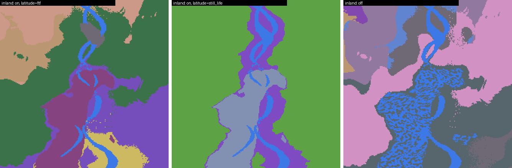
*Inland at the test wetland: with the bridge off, salt lake covers 12% of dry land and FTF's wetland water turns into river biome.*

### Cave biome depth (5.5)

*`column_depth`. `StillLifeClimateBridge`.*

**Problem.** Since 1.0.0023 FTF's depth number is not blocks but the share of the column below the surface:
1.5 x (surface - y) / (surface + world depth), so 1.5 at the world's bottom whatever the surface height. Bridge 5.0-5.4 read
it as 1/128 per block (vanilla's scale) and looked that up in `LITHO_DEPTH` (Lithosphere's depth every 16 blocks). Under
high ground that made every point look much shallower than it is (under a surface at Y 540, 64 blocks down read as 20), so:
- FTF, which fades cave biomes in over the first 28 blocks' worth of depth, started them later: with the bridge the
  same cells began 0-48 blocks deeper than with FTF alone (coverage 1.0, 9 cells at ground Y 407-611: 32-128 blocks instead
  of 32-80);
- the depth never reached Still Life's deepest band (1.0-1.1), so its deepest cave biome, Haunted Depths, and the deep
  entries of Deep Dark never appeared.

**Change.** The share of the column is mapped onto the Lithosphere column under the same Still Life height: a point a
third of the way from the surface to the world's bottom gets the depth a point a third of the way down a Lithosphere column
of that height (down to Y -64) would have. Every column then has Still Life's cave bands in order from the surface to
bedrock, with the deepest ones near the bottom under high ground, as in Lithosphere.

**Checked** (tester's preset, coverage 1.0, 1,681 chunks around a snowy peak, ground around Y 514): cave biomes start at
32-64 blocks below the ground (7 of 8 cells; one with few caves at 224 in every setup), never deeper than with FTF alone.
Share of cave biome by depth below the ground, 5.4 / 5.5 / FTF alone with Minecraft's biomes: 32-63 blocks 23% / 62% /
47%, 64-95 blocks 54% / 100% / 94%. Below about 400 blocks 5.5 has Deep Dark (12-44%) and Haunted Depths (3-21%, most at
the bottom); 5.4 had neither. Worlds made before 5.5 keep the old depth (`column_depth` false), so their new chunks match.

### Beaches

*5.0. `beach_max_height`, `beach_shallows`.*

**Problem.** Still Life's beach biomes are coastal points (continentalness up to 0.02) in a narrow weirdness band (0.05-0.08),
and its beach surface rule only lays sand (gravel on cold beaches) below Y 65. On Lithosphere that band is land within about
12 blocks of the sea plus the shallow water in front of it. The height mapping above is by rank: FreeTerraForged's lowest
~28% of land, which Lithosphere keeps below Y 75, reached Y 128 in the test world, so beach biomes climbed whole coastal
slopes as grassland (at one test spot 100% of the land in a 384-block square, 29 blocks above the sea on average, 1% sand),
while the sea stayed ocean biome right up to the shore. A preset can't change this: the bridge measures every world's heights
and coast distances, so moving the preset's coast control points left the beaches where they were. Sondre's bridge 3.3.0
takes another route (it adds beach biome to low land and shallow sea within set distances of the shore) but keeps the same
height mapping, and at the test spot gave the same result as 5.0 without this fix.

**Change.** Coastal land in the beach band more than `beach_max_height` blocks above the sea gets the band just above it
(the land's own inland biome), and sea up to `beach_shallows` blocks deep (not deep ocean) gets the beach band. The defaults
come from Still Life's own beaches: in a Lithosphere + Still Life world made with the same mods, half of the beach land was
within 2 blocks of the sea and 90% within 9, and 56-63% of the coastal water was beach biome, 2-4 blocks deep.

**Checked** at the same spot and at the test spawn's coast: beach land 3/6 blocks above the sea (median / 90%) instead of
29/41 and 18/39; beach biome on half of the coastal water instead of 2%; 5 km of coast below.


*Top blocks, red line = edge of the beach biome. Left: Still Life's own beach (Lithosphere + Still Life, taiga beach with
gravel); middle: the bridge before this fix at the same FTF spot (all of it "beach" grassland); right: with `beach_max_height`
8 and `beach_shallows` 4 (a band along the shore and the shallow water in front of it).*

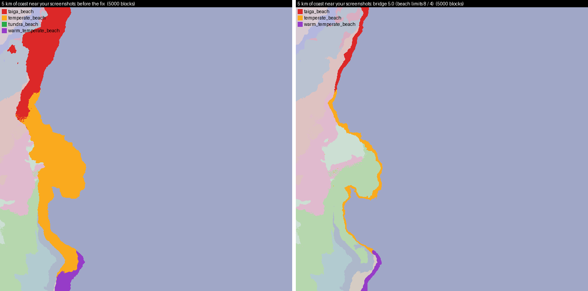
*Beach biomes along 5 km of FTF coast: before the fix (300-1000 blocks wide, up to Y 130) and after (median Y 64).*

## 2. Latitude, continents and biome sets

*3.x; blended borders 5.1; regions and halves 5.4; one set per landmass 6.0. `latitude`, `pole_distance`, `american_share`, `biome_set_blend`,
`biome_sets`, `biome_set_region_size`.*

- `latitude=still_life` gives Still Life's own climate: one equator and colder bands toward the poles, `pole_distance`
  blocks away. `ftf` keeps FTF's repeating temperature bands (with altitude cooling).
- Still Life has two complete biome sets (American and Afro-Eurasian). Lithosphere chooses them by region; the bridge
  rolls once per FTF continent (`continentId`), so each continent has one consistent set, `american_share` of them American.


*Still Life biome set per FTF continent at `american_share` 0.6, 80 x 80 km of the test world (biome-map tool, FTF 1.0.0027). Each continent is one set; mountain land shows as "both sets" (peaks and rivers exist in both).*

**Blended borders (5.1).** FTF's continents are Voronoi cells, and where two of them share land their border is a long,
nearly straight line. With one set per continent, every biome switched along that line: on one side salt lakes and cacti
savanna (American), on the other xeric shrubland (Afro-Eurasian), with temperature and humidity the same on both sides
(found in a test world from a straight biome edge several kilometres long). Now the set is read from the continent at a
point moved by a smooth warp of up to about `biome_set_blend` blocks (two noises with ~256-block features) plus a small
random jitter per 4-block cell. Near a border the switch wanders back and forth and frays into a dithered edge, like FTF's
other biome edges; away from borders the moved point is on the same continent and nothing changes. The continent at the
moved point comes from FTF's continent generator (`Heightmap.continent().apply`, a Voronoi lookup, not a full terrain cell).
0 gives the sharp border.

**One set per landmass (6.0, format 17).** Those borders were almost all on FTF's continent bridges. On UPLIFT continents
FTF joins neighbouring continent cells with land where `UpliftContinentGenerator.isBridged(a, b)` says so: a pure,
symmetric function of the two cells and the seed (`bridgeRoll(a, b) < bridgeChance`, both cells not skipped and at full
size), kept per Voronoi edge in `PlateUpliftBridge.CellVoronoi.isBridged`. Every other edge between two cells counts as
coastline (`getBoundaryDistanceSq` measures the coast from the unbridged edges only), so land never joins two cells
without a bridge. `biome_sets=continents` now gives one set per connected part of that bridge graph (`Landmasses`): from
the sample's cell (found from `Cell.continentX/Z`, FTF's rounded cell centroid) a breadth-first search over bridged edges
finds the landmass, its smallest cell (by z, then x) is its canonical cell, and the set is rolled from that cell and the
seed (a landmass of one cell keeps the set that cell had before). Results are memoised per cell, so the cost is one map
lookup per sample once a landmass is known. With FTF's default continent settings (`bridgeChance` 1, little size
variance) nearly the whole world can be one landmass, which would give it a single set: a search stops after 64 cells,
and a landmass larger than that (the same verdict from every one of its cells) is split along a fixed grid of 4 x 4 cells,
bridges leaving a block being ignored; only there do sets still meet on land, with `biome_set_blend` fraying the edge. On
the tester's preset (`continentSizeVariance` 0.61: only cells at full size can bridge) landmasses stay small and never
reach that limit. Not UPLIFT, `bridgeChance` 0, or a FreeTerraForged that no longer has the members this reads
(`FtfCompat.verifyLandmasses`, logged as an error): one set per cell. Worlds saved before format 17 keep one set per
cell, now `biome_sets=cells`.

*Checked* in a 1088-tall world from the tester's level.dat and preset (seed -7009751399224968059), 200 x 200 km around
the origin at 64-block steps from FTF's continent map (land = control point at or above the preset's beach value): 187
FTF cells with land form 144 landmasses, none giant; of 5.39 million pairs of neighbouring land samples, 5,803 cross a
cell border (all on bridges), and the sets differ across 4,430 pairs with `cells` (715 right on bridges, the rest in their
blended edges) and across none with `continents`. 300,000 lookups in order and on 16 threads in shuffled order, each
from empty caches, gave identical sets.

**Generation order (6.0).** With `biome_set_blend` the continent at the moved point is read into a per-thread scratch
cell. FTF's continent generator leaves `continentId` alone in skipped (ocean) cells, so a moved point on open ocean read
the id of whatever the thread had looked up before. The scratch cell is now reset first; such points read the ocean's own
fixed set.

**Both sets on one continent (5.4).** With one set per continent, a world with a single FTF continent (continent type
SINGLE, or a preset with very large continents) only ever gets one of Still Life's two sets. `biome_sets` chooses the layout:

- `continents` (default): one set per continent (per landmass since 6.0, see above); `american_share` is the share of
  continents (`cells` in worlds from before 6.0).
- `regions`: every continent is divided into irregular regions, each American or Afro-Eurasian, as Lithosphere does for
  Still Life's own worlds. Regions are the cells of a jittered grid (each point belongs to the nearest of nine jittered
  grid points), `biome_set_region_size` percent of an average continent's land in area: 25 gives about four regions per
  continent. The land of an average continent is measured once per world from FTF's continent map (the land of every
  continent whose centre lies within 1.5 continent cells of the origin) and kept in the world's settings
  (`continent_land_area`), so the regions never change size in that world.
- `halves`: every continent is American west of a line and Afro-Eurasian east of it. The line wanders by up to about a
  sixth of the continent's width, so it is not a straight north-south cut.

In `regions` and `halves`, `american_share` is the share of **each continent's own land**: the first time a continent is
needed, the bridge samples its land (96 x 96 points over 1.5 continent cells each way from its centre) and sets the region
threshold, or the line, so that this share of that continent is American. Regions stay whole, so the share is met to the
nearest region. At 0.5 every continent is half and half, not just the world on average.
`biome_set_blend` frays the borders between regions and halves the same way it frays continent borders.

**Checked** on the tester's preset switched to continent type SINGLE (one continent of about 306 km² of land) and on the
tester's own world (UPLIFT, many continents, 341 km² of land on average), with biome maps of the game's biome source
(counting land whose biome belongs to one set only). The single continent: `continents` 0% American (one roll),
`regions` at `american_share` 0.5 50% in three regions about 8.7 km across, at 0.3 27%, `halves` about 50%. The eleven
continents wholly inside a 98 x 98 km map of the tester's world: `continents` 100% or 0% each, `regions` 44-59% on all but
a small one (32%), `halves` 36-67% (the wandering line moves some land across). With `continents`, biomes match 5.3 (99.96% of a test area). On generated chunks,
`regions` gives the same biomes on NeoForge and Fabric (99.96%).

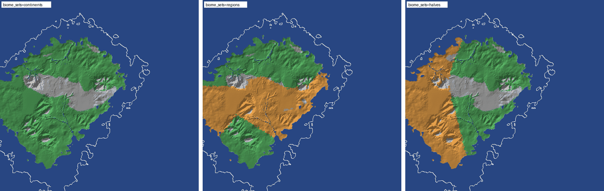
*The single continent (48 x 48 km, land coloured by the Still Life set of its biome: orange American, green Afro-Eurasian, grey biomes in both sets such as peaks and rivers). Left to right: `biome_sets` continents, regions (25%), halves; `american_share` 0.5.*

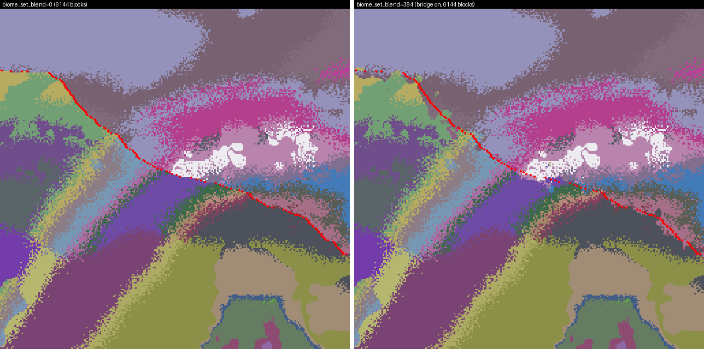
*6 x 6 km around a border between an American and an Afro-Eurasian continent (red dots: the border), one colour per biome. Left: `biome_set_blend=0`; right: 384.*

## 3. Swamps in humid lowland

*4.0. `humid_swamps` (off by default for new worlds since 6.0), `swamp_humidity`, `swamp_max_height`.*

**Problem.** Still Life's swamps, marshes and fens live in its "wetland" erosion band, which Lithosphere gives to low,
wet land. FTF only marks its own river wetlands (a few spots along rivers), so Still Life's large swamp biomes almost
never appeared.

**Change.** Land that is very humid (FTF humidity at or above `swamp_humidity`), low (at or below `swamp_max_height` on
Lithosphere's scale), not highland and at least ~110 blocks inland (coasts keep their beaches) gets the wetland band.

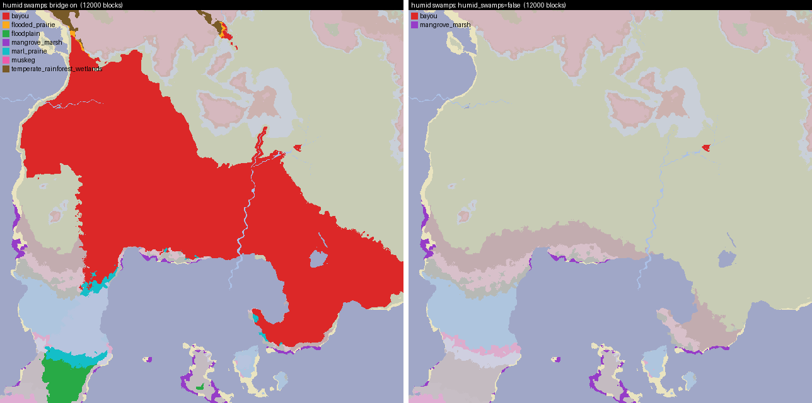
*12 x 12 km. Left: bridge on; right: `humid_swamps=false`. Wetland-band biomes highlighted; with the rule a very humid lowland becomes a bayou (28% of this map), without it only coastal marsh remains.*

## 4. Dry wetlands: aspen swamps and salt lakes

*4.4, surfaces in Still Life 0.3.5-ftf, salt lake flatness 5.1. `aspen_swamps`, `salt_lakes`, `salt_lake_max_relief`.*

**Problem.** Two of Still Life's wetland biomes need the wetland band *together with* fairly dry air: `aspen_swamp`
(cool) and `salt_lake` (hot). The humid-swamp rule above never gives dry air, so they never generated. `/ftf locate biome`
found none.

**Change.** On American-set continents (the Afro-Eurasian set has neither biome), inland **flat** ground whose climate
falls inside one of the two biomes' climate boxes (taken from Still Life's table, `ASPEN_SWAMP` / `SALT_LAKE`) gets the
wetland band in noise-shaped patches a few hundred blocks across. Flat means at most 4 blocks between the column and the
ground 16 blocks away in four directions for aspen swamps, and at most `salt_lake_max_relief` (default 2) for salt lakes.
`1` gives about a quarter of the qualifying land (thresholds measured over several seeds, `MASK_COVER`/`MASK_THRESHOLD`),
`2` about half. Salt lakes may sit 25 blocks higher than `swamp_max_height`, because dry inland basins are often raised.

**Why salt lakes need flatter ground (5.1).** With standing water (section 6) a salt lake should look like a sheet of
shallow water on a white flat. FTF's "flat" land is often a gentle slope of 1-block terraces: a test salt lake at relief 4
climbed 30 blocks (Y 103-132) with a step every 6-8 blocks, and since water cannot cross a step, its water could only lie in
bands along each terrace. At relief 2 that lake shrank to a sixth of its area, onto the flat part, and salt lakes in
general became fewer and flatter; 4 gives the 5.0 layout.

**Why the Still Life patch too.** Still Life builds both biomes for sea level (Lithosphere drops the wetland band to the
sea): its salt crust is only at Y 62-64 and its aspen-swamp mud only at Y 62. On FTF terrain they sit at any height and
looked like plain desert or forest. The 0.3.5-ftf surface rules work at any height: white calcite crust (dithered with
clay) on dry salt-lake ground, clay under water, mud in aspen swamps (see `still-life-ftf-edition.md`).

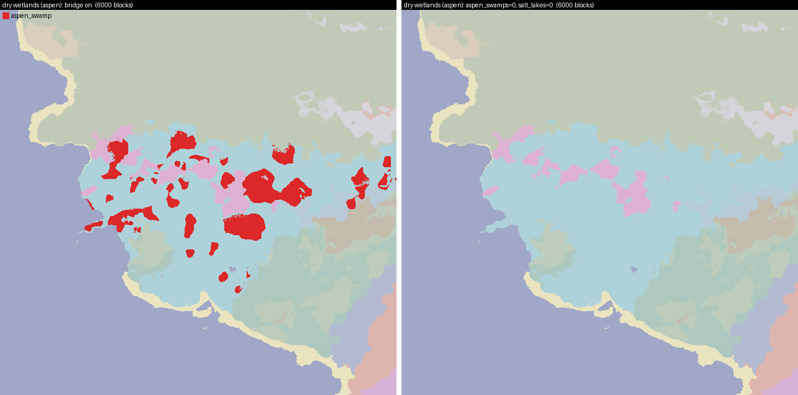
*6 x 6 km, cool dry American lowland. Left: bridge on; right: `aspen_swamps=0, salt_lakes=0`. Aspen swamp patches (red) on flat ground.*


*6 x 6 km, hot dry inland, bridge 5.1. Left: bridge on (`salt_lake_max_relief` 2); right: `aspen_swamps=0, salt_lakes=0`. Salt lakes in red: 11% of this map (15% with 5.0's relief 4).*

## 5. Wetland biomes keep their water

*5.0. `keep_wetland_biomes`. `mixin/TerrainBiomeRoleSelectionMixin`, tag `stilllife_ftf_bridge:wetland_biomes`.*

**Problem.** Up to 1.0.0025 FTF left the biome of its wetlands alone. 1.0.0027 re-picks the biome of submerged wetland
cells: it keeps the chosen biome only if FTF recognises it as a wetland (`WetlandBiomeTags.isWetland`: the tags
`c:is_swamp`, `c:swamps`, `c:is_wetland`, `c:wetlands`, or a name containing swamp, wetland, marsh, bog, bayou or fen), and
otherwise takes the nearest such biome. Still Life's `c:is_swamp` tag and those names cover most of its wetlands, but not
the muskegs (`muskeg`, `snowy_muskeg`, `frozen_muskeg`), `floodplain`, `flooded_prairie`,
`flooded_tropical_deciduous_rainforest`, `marl_prairie` or `salt_lake`: their water would have become patches of bog, fen or
marsh inside the biome.

**Change.** Every Still Life wetland-band biome (the 24 in `has_wetland_pools`, salt lake included) also counts as a
wetland in that check (`@WrapOperation` on the `WetlandBiomeTags.isWetland` call in `resolve`).


*1.2 x 1.2 km, an FTF wetland in a frozen muskeg. Left: bridge on; right: `keep_wetland_biomes=false`: FTF replaces the frozen muskeg water with temperate rainforest wetlands.*


*Same for a flooded tropical forest wetland: without the setting its water turns into mangrove marsh.*

## 6. Standing water in wetlands and salt lakes

*4.5; salt lakes and level-ground pools 5.1. `wetland_pools`, `salt_lake_water`, `salt_lake_slope_pools`.
`WetlandPoolsFeature`.*

**Problem.** Still Life floods its swamps, marshes, bogs and fens only at sea level (its surface rules put water and mud
at Y 62-63), and its salt lakes are sea-level flats where Lithosphere's terrain dips just below the water: about a fifth of
the lake is water one block deep over calcite, in wide irregular sheets with round calcite islands (measured on a
Lithosphere + Still Life world: 21% water, sheets up to 16k columns). FTF's terrain puts these biomes at any height, so
they were dry.

**Change.** A feature (lakes step, added to Still Life's 24 wetland-band biomes in tag
`stilllife_ftf_bridge:has_wetland_pools` by a NeoForge biome modifier) places water in the top ground block. Whether a
column becomes water depends only on the terrain and noise, so pools match across chunk borders, and water is only placed
where the ground around holds it, so it never spills.

- **Wetlands:** noise-shaped pool patches from a few to twenty blocks across, 1-2 blocks deep, with a mud bed and a muddy
  rim. Water only sits where the ground is level for 2 blocks around (nothing lower, nothing more than one block higher).
  The parts of a patch on sloping ground become mud, level with the ground. Up to 5.0 a column only needed its four
  neighbours to reach as high, so on a sloped marsh water filled every 1-block step and left grass steps between them:
  stripes of water that looked like broken ground (a test marsh on a slope of 0.7 blocks per block: 16% water, median pool 1-2
  columns).
- **Salt lakes (5.1):** one block of water over calcite, no mud, covering about `salt_lake_water` (default 0.35) of the
  lake: wide, ragged sheets from a noise with 64-128-block features read at a warped point, broken by round calcite islands
  (radius 3-6, like Still Life's salt crust disks), on ground that is level for 2 blocks around. Where the ground is not one
  level for 6 blocks around (a stepped lake), sheets could only lie in bands along each step, so with
  `salt_lake_slope_pools` (default true) the water there comes as small round pools held by their four neighbours instead.

**Checked** on generated chunks: the sloped marsh (16% water in stripes, then 2% water in small level pools and 30% mud);
the bayou below; and salt lakes on the tester's seed and preset: 26% of a flat salt lake under water, in sheets up
to 2,300 columns.


*256 x 256 blocks of a bayou (a humid-lowland swamp), ground under trees and plants. Left: `wetland_pools=false` (dry forest floor); right: bridge on (water on 20% of the ground, mud on 20%).*

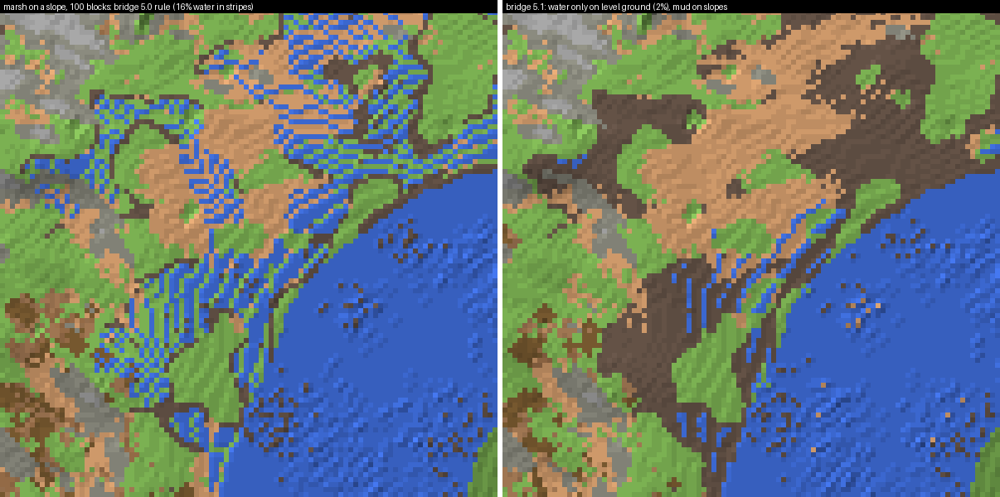
*A marsh on a slope (100 x 100 blocks, top blocks, water blue, mud brown). Left: bridge 5.0's rule (water in every held 1-block step); right: 5.1.*

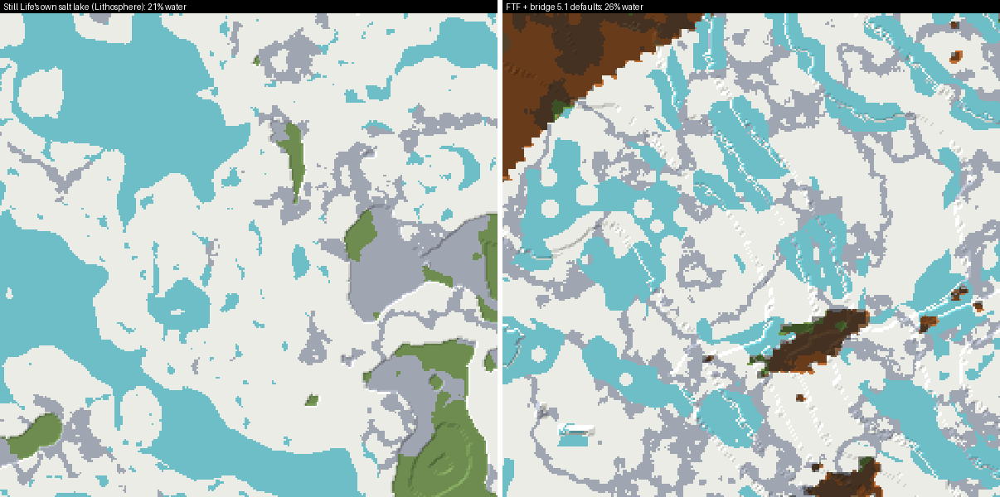
*256 x 256 blocks, salt lake biome bright (water turquoise, calcite white, clay grey). Left: Still Life's own salt lake (Lithosphere + Still Life, sea level); right: a salt lake on FTF with bridge 5.1 (defaults).*

> **Streams Reflowing** restyles other mods' water as its own banks by default (`allWaterBanks=1` in
> `config/streamsreflowing.properties`), which removes these pools and leaves mud rings where they were (salt lake water
> 26% -> 1% on the same lake). Set `allWaterBanks=0`.

## 7. Snow on peaks

*4.0; snow line 5.2; mountain belts 5.6. `snow_caps`, `snow_cliff_steepness`, `peak_line_variation`, `snow_cap_fade`,
`mountain_cooling`. `SnowCaps`, `mixin/ScreeFeatureMixin`, `mixin/DecorateSnowFeatureMixin`.*

**Problem.** Still Life puts snow blocks on its snowy peaks with surface rules. FTF's erosion decorator erodes snow, powder
snow and gravel (its `erodible` tag): above its rock line it turned that snow into stone, on slopes into tuff, in its dirt
band into moss or coarse dirt. Its snow decorator also cleared snow layers off any slope steeper than 0.45 above Y 95 (a
height made for 256-block worlds), so in tall worlds almost no snow survived on mountains.

**Change.** The erosion decorator skips columns topped with snow unless they are cliffs (steeper than
`snow_cliff_steepness`, or FTF's rock steepness when 0), and the snow decorator only clears cliffs.

> **Since 6.0** new worlds have `mountain_snow` on: the snow model of [section 16](#snow-one-model) then decides where
> snow ground and snow layers lie (it bares or lays snow ground after the erosion pass), and `snow_cap_fade` below is not
> used. `snow_caps` and `snow_cliff_steepness` still keep FTF's erosion off snow and set what counts as a cliff.


*256 x 256 blocks of peaks near the test spawn, top blocks. Left: `snow_caps=false` (FTF turns snow into moss, tuff and stone); right: bridge on. Snow above Y 450: 34% vs 49% of columns.*

### A natural snow line (5.2)

*`peak_line_variation`, `snow_cap_fade`. `StillLifeClimateBridge.peakShift` and `capSnowShare`, `SnowCaps.fadeBare`.*

**Problem.** Still Life picks its mountain biomes by height: the climate translation gives each column the weirdness band
of its height (section 1), and snowy peaks start at band 0.567 (Still Life height 242, about Y 380 in the tester's world).
On Lithosphere that height is read from its smooth large-scale terrain, so the cap's edge wanders over the real slopes. The
bridge reads FTF's actual height, so the edge was an exact contour line: on a mountainside in the tester's world, no snowy
peaks below Y 362 and 99% above Y 384, and snow on the ground went from 2% to 79% within 8 blocks of height. Still Life's
snowy peaks surface rule is plain snow on every floor (no noise, unlike its arctic desert), so the cap also began with a
solid white edge. `snow_caps=false` doesn't help: the edge stays at the same height, and above it FTF turns half the snow
into moss, tuff and gravel.

**Change.**
- **`peak_line_variation`** (default 40 blocks): for the mountain bands, the bridge counts the ground as higher or lower by
  a shift per biome cell: a slow wander across a range (two noises with 1 km and 256-block features, scaled so 90% of the
  shift lies within +-40), plus the terrain (the mean height 24 blocks north, south, east and west minus the column's own,
  clamped to +-40: gullies count higher, so snow and alpine biomes reach further down them, while ridges and spurs count
  lower), plus a jitter of up to +-8 blocks per biome cell that dithers the edge like FTF's other biome edges. The shift
  fades in between Still Life heights 140 and 175, so lowland bands, beaches and wetlands never move; the alpine bands and
  the treeline wander with the cap.
- **`snow_cap_fade`** (default 24 blocks, with `snow_caps`): in FTF's erosion pass, a snowy peaks column less than 24
  blocks above the cap's local edge keeps its snow with a chance that rises from about 10% at the edge to 100% (lower on
  steep ground near the edge), in the pattern of Still Life's own `surface_dithered` noise, the one its arctic desert uses
  for patchy snow. A bare column's snow blocks, and the dirt Still Life puts under them, become the rock or gravel below,
  and FTF's snow pass clears the snow layer the game lays on it. Polar caps (temperature below -0.56, where Still Life
  starts snowy peaks at the alpine band) are left alone.

A Still Life surface rule could fade the cap too, but it only knows absolute Y: the cap's edge is at a different height in
every world (heights are calibrated per world) and wanders with `peak_line_variation`. The bridge knows the edge at every
spot, so the fade is done there and Still Life is unchanged.

**Checked** with the tester's preset and world settings on 1024 x 1024 blocks of a mountainside. Snow on the ground by
height, 5.1: 2% at Y 368-376, 47% at 376-384, 79% at 384-392; 5.2: 3% at Y 320, 22% at 336, 43% at 352, 53% at 368, 68%
at 384. Measured inward from the cap's edge, snow covers 20% of the first 4 blocks, 41% at 8-16 blocks and 64% at 16-32
(5.1: 54%, 72%, 74%). The edge now crosses two or three 20-block contours every 500 blocks. Generation time about the same
(4,225 chunks: 3:46 with 5.1, 4:01 with 5.2).


*A 1 x 1 km mountainside seen from the south (generated chunks drawn in perspective; ground blocks, trees dark green). Left: bridge 5.1, the cap starts at about Y 380 along a level edge; right: bridge 5.2 defaults.*

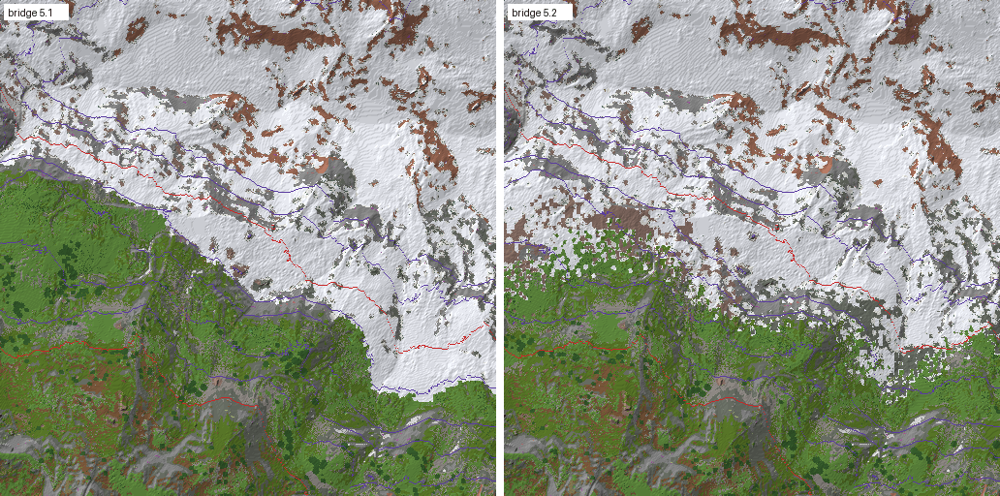
*The edge of the same cap from above (512 x 512 blocks, contours every 20 blocks, red at Y 300 and 400). Left: 5.1, the edge follows a contour; right: 5.2.*

### Mountain belts (5.6)

*`mountain_cooling` (0 by default in 5.6; 0.25 for new worlds since 6.0). `StillLifeClimateBridge.apply`.*

**Problem.** In warm, dry country the shrubland ran straight up to the snow: cacti savanna, painted xeric shrubland and
yucca scrubland right below snowy painted or snowy barren peaks, with nothing between. The bridge picks each mountain band
by height (section 1: highlands, then alpine from Still Life height 203, then the peaks from 242, about Y 351 and 409 in
the tester's world) and the biome inside the band by temperature. Still Life's own table has no cold belt for warm, dry
climates: at temperatures from about 0.1 to 0.4 its highland and alpine bands hold the same dry shrublands as the lowland
(dry warm shrubland from 0.095, painted xeric shrubland, yucca scrubland), while its peaks band is snowy below 0.23 (snowy
peaks below 0.17, snowy painted and snowy barren peaks up to 0.23) and bare rock above. With `latitude=ftf`, FTF's altitude
cooling takes such a mountain from about 0.3-0.4 at its foot to just under 0.23 at the cap; with `latitude=still_life`
the temperature doesn't change with height, and mountains at 0.1-0.23 do the same. In the two warmest mountain regions of
the tester's world (16 x 16 km each, `latitude=ftf`), 18.6% and 7.7% of the snow caps' edge touched one of these warm
biomes; in a `latitude=still_life` test region 14.1%. Savanna proper (temperature 0.57 and up) never meets snow: its
mountains get bare painted or barren peaks.

FTF's climate settings can't target this. `altitudeCoolingStrength` (`latitude=ftf` only) cools from sea level up: at 3.0
(the tester's preset has 1.81) the share went down only to 12.9% and 4.9%, and 23-48% of the land below Y 300 changed
biome; at 1.0 it went up to 28.9% in one region. Moving the mountain bands up 40 blocks made it worse (36% and 18%): the
alpine band it lifts is the same shrubland. A belt of bare rock under warm caps (snow starting higher, the higher the
temperature) also removed the edges, but took about a fifth of the snow.

**Change.** With `mountain_cooling` above 0, the temperature the biome lookup sees drops gradually from the highlands
(Still Life height 160, about Y 290 in the tester's world) up to the start of the peaks band, by `mountain_cooling` at the
top (on Still Life's temperature scale, -1 to 1). The heights include the `peak_line_variation` shift, so the belts wander
with the snow line. On the way up, a warm mountain now passes Still Life's cooler highland and alpine biomes (montane
meadows, prairie highlands, alpine tundra, cold barren highlands) below its cap. What stays as it was:
- the peaks band keeps its own temperature, so the snow caps (snowy, snowy painted, snowy barren) and the bare painted and
  barren peaks of hot mountains are unchanged;
- no column is cooled across -0.56, Still Life's polar line, so polar caps (which start at the alpine band) don't grow;
- only biomes up to 24 blocks below the surface are cooled (FTF never puts cave biomes that close to the ground), so cave
  biomes, several of which depend on temperature, keep the column's climate;
- rivers, lakes and the sea, and all land below the highlands.

**Checked** with the tester's seed, preset and settings (biome maps of the game's biome source, 8-block steps; and chunks
generated on FTF 1.0.0033, whose surface biomes matched the map 99.1%). With 0.25: snow
cap edges next to a warm biome 18.6% / 7.7% -> 0.0% / 0.0% (`latitude=still_life` region: 14.1% -> 0.0%); snow caps cover
the same land as before (3.34% / 2.89%); land below Y 300 changed 0.1-0.2% (edge dither); above Y 300 22-30% changed, to
the belts. Over 192 x 192 km at 64-block steps: 2.4% of all land changed (26% of land above Y 300), mostly alpine tundra to
boreal alpine tundra in cold ranges and tropical highlands to savanna highlands or tropical thorn clearings in hot ones.
Cave biomes at Y 250 under the mountains of the first region: 100% unchanged. Worlds made before 5.6 (and worlds with
`mountain_cooling=0`) generate exactly as with 5.5 (biome maps 100.000% identical). 0.25 is the tested value; less cools the
alpine band less, so the warmest dry mountains may keep shrubland up to their caps.

**6.0: the alpine band only.** In 5.6 the ramp started inside the highland band (Still Life height 160). Still Life's
highland band holds forests at its cold end (coniferous, larch and spruce-fir woodlands, wooded and taiga highlands) and
open biomes at its warm end (montane meadows, prairie highlands, shrublands); its alpine band holds no forest at all. So
on every mountain whose climate sat just above one of those forest edges, the cooling crossed it shortly before the alpine
band, and the top of the highland band became a thin forest strip wedged between open country below and alpine tundra
above, following the contour for hundreds of blocks (the owner's world, seed -2039252316125564386, at 83400..84150,
-3300..-2950: lush prairie, then 20-40 blocks of coniferous woodlands at Y 250-280, then alpine tundra; the trunks there
stood almost only in the coniferous columns: 8.6 per 1,000 columns against 0.06 in the tundra and 2.9 in the meadows at
the same heights). Since 6.0 the cooling ramps from the start of the alpine band (`YL_ALPINE`) to the peaks band, by the
same amount at the top, so the highland band keeps Still Life's own biome for the climate and the cooling only moves
between open alpine biomes. Worlds saved by 5.6 (format 15) keep the 5.6 ramp; the JVM switch
`-Dstilllife_ftf_bridge.legacyCooling=true` brings it back in any world, for comparisons only.

**Checked** in two worlds generated from the owner's level.dat, preset and settings (1088-high noise), 1.8 x 1.8 km
around 83700,-3000, same build with and without the switch:
- the flank the owner saw (83450..84150, -3300..-2950), by ground height: forest-biome columns at Y 240-260 / 260-280 /
  280-300 / 300-340 42% / 64% / 23% / 12-15% -> 24% / 15% / 0% / 0% (what is left is Still Life's own coniferous
  highland of cold wooded-prairie country); trunks per 1,000 columns 5.7 / 6.3 / 0.6 / 1.6 -> 3.5 / 0.7 / 0.06 / 0.2;
- a second flank (83230..83560, -3640..-3490): forest biome at Y 300-380 34-60% -> 0% (prairie highlands, then alpine
  tundra); trunks at Y 300-320 11.7 -> 2.2 per 1,000;
- the whole area: 6.9% of columns changed surface biome, none below Y 240 (coniferous woodlands to prairie highlands
  159,456 columns, to montane meadows 34,350; alpine tundra to cold barren highlands 27,237); trunks below Y 240 5.06 ->
  5.06 per 1,000 (prairie 5.19 -> 5.20); trunks at Y 240-400 4.33 -> 1.93 per 1,000. Tree cover differs in 2.6% of
  columns far from any changed biome, the usual difference between two worlds of one seed.
Not yet re-measured: the 5.6 numbers for warm, dry mountains (shrubland next to snow caps). The cooling at the cap edge is
the same as before, but halfway up the alpine band it is now about 0.12 instead of 0.19.

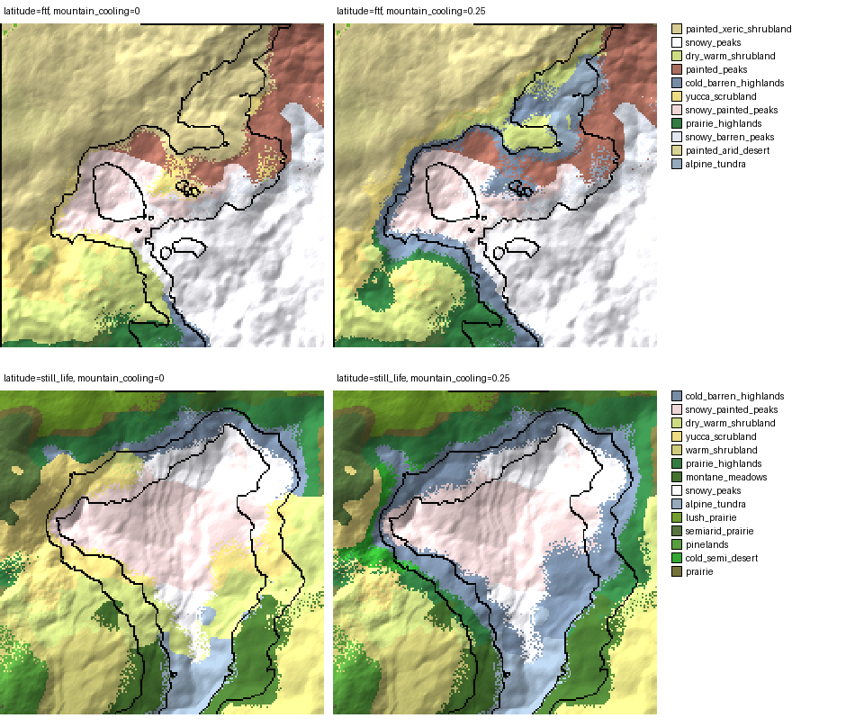
*1.5 x 1.5 km biome maps (black lines: Y 351 and Y 409, where the alpine and peaks bands start before the wander). Top: the tester's world (`latitude=ftf`) at -63632,-25560; bottom: `latitude=still_life` at 21376,3616. Left: `mountain_cooling=0`; right: 0.25.*

### Snow-line curve and mountain bands (6.0, format 18)

*`snow_line_equator`, `snow_line_tundra` (replace `snow_line_climate`), `mountain_cooling`, `peak_line_variation`.
`StillLifeClimateBridge.snowLine`, `bandLine`, `bandHeight`, `capLineDistance` / `snowLineDistance`, `AlpineCooling`,
`ValleyFloor`, `SnowModel.coverageCurve`.*

**Problem.** The mountain bands started at one height everywhere (Still Life heights 203 and 242, about Y 358 and 411 in
the tester's world), moved by at most `snow_line_climate` (60 blocks) with latitude. Real snow lines run from about 5000
m in the tropics to sea level in the high Arctic; with one line, tropical mountains were snowy from Y 465 and boreal ones
only from Y 384. A temperature lapse (cooling with height, so that climbing is like travelling poleward) was prototyped
and rejected: Still Life's temperature axis is a latitude axis with a dry subtropical belt (temperature 0.23-0.57:
painted xeric shrubland, yucca, arid highlands, in both sets and every humidity) between its tropics and its temperate
zone, so a lapsed tropical mountain climbs rainforest, thorn scrub, painted xeric shrubland, yucca, montane meadows,
conifers, alpine tundra: 228 belts under 50 blocks of height over 42 sample mountains against 63 with the old bands.

**Change.**
- **The curve**: each column's snow line from the temperature Still Life's lookup reads at sea level there (latitude
  and its regional variation): `snow_line_tundra` at -0.56 (the warm edge of the tundra), rising linearly to
  `snow_line_equator` at 1; from -0.56 falling linearly to the sea at -0.8 (where Still Life's arctic begins). The
  `peak_line_variation` wander is added as before. Defaults 650 / 250: about Y 394 at temperature 0, 500 at 0.4.
- **Bands under it** (Variant S): Still Life's own band choice, only placed differently. Below Still Life height 140
  (`lowY`, Y 262 in the tester's world, where the wander already started) nothing changes. The peaks band starts at the
  line, never below a floor (`lowY` + the alpine band's thickness + 80% of the old highland band's thickness: Y 369),
  and 45 blocks lower where the peaks are bare rock (fading in from temperature 0.17 to 0.30). The alpine band is the
  old thickness (53 blocks) under it; the highland band runs from the old highland start (Y 290) up to the alpine band,
  or, where that would leave it thinner than 80% of its old thickness, from lower down (not below `lowY`). Weirdness is
  the old spline of the mapped height, so the bands are Still Life's own. **Snowy peaks above the zone**: the peaks band
  starts where the snow zone's cover reaches 70% (`SnowModel.coverHeight(0.7, snowiness)`, the snowiness worked out
  where the biome point is built: about +73 above the line where wet, +95 normal, up to +194 dry), so in the
  transition zone the ground between snow patches is the alpine biome's own; lower mountains keep their alpine biome to
  the top. Bare ground in the snowy peaks band stays the region's strata rock (the owner's choice).
- **Cooling where needed** (`mountain_cooling`, `AlpineCooling`): the whole alpine band takes the temperature lowered by
  `mountain_cooling`, only when the column's own peaks band (weirdness 0.6) is a snow cap (tag
  `stilllife_ftf_bridge:snow_caps`), its alpine band (0.48) is not already a cold alpine biome and the cooled alpine band
  is one (tag `stilllife_ftf_bridge:cold_alpine`). Decided from FTF's layout (`BridgeHooks.biomeLayout`, the same list
  the cave floor guard reads), by Minecraft's nearest-box rule over its surface boxes reaching the mountain bands (907 in
  Still Life 0.3.7), memoised per climate cell of 0.005 temperature, 0.01 humidity and 0.02 continentalness and erosion:
  deterministic, no lookup per sample. Without a layout (none read yet) there is no cooling. The preset screen's preview
  goes through the same layout and gets the same result when FTF builds it from the same biome source.
  Why not the owner's simpler rule (only into mountain-only biomes): in the Afro-Eurasian set every alpine-band biome is
  mountain-only, and cooling turned tropical highlands into savanna or arid highlands on equatorial mountains.
- **Lines for features and snow**: `snowLineDistance` (the snow model) measures from the curve with its wander.
  `capLineDistance` (the treeline, alpine ground, belts, scree, fringe) measures from the curve moved by the climate's
  snowiness as the snow zone is (`SnowModel.lineShift`) plus 10 blocks, so the content's treeline windows (conifers
  -110..-50, broadleaf -145..-80) end 40 and 70 blocks below where the zone begins: forests stop below the first lasting
  snow. Gentle lowland (standing under 25 to 70 above its valley floor) below the zone counts 80 blocks lower, so valley
  floors and plains are never thinned. (A first format 18 build measured it from max(curve, floor): Y 358 on the owner's
  mountain while its snow began near Y 250, so 28% of its tree spots stood in snow.) The shift is done in the bridge,
  not in the content jars' windows, so worlds before format 18 keep their trees exactly.
- **Hot-country treeline**: the spruce clumps and krummholz test `max_temperature` 0.6 against the biome temperature
  lowered by height, which tropical biomes pass high up; they now also need Still Life's latitude temperature at most
  0.45 (`max_climate`, format 18 only). Above the thinning broadleaf trees of hot biomes (tag `belt_hot`), Still Life's
  own `savanna_bushes` group, one try every second chunk, fade-in 110-80 and treeline 40-14 blocks below the line,
  sheltered, off talus, cliffs and snow (`belt_hot_bushes`, `min_climate` 0.45).

Worlds saved before format 18 have no `snow_line_equator` and keep the old bands, `snow_line_climate` and the ramped
cooling; `latitude=ftf` worlds before format 19 too.

### Every preset and both latitude settings (6.0, format 19)

*`snow_line_equator` / `snow_line_tundra` `auto` (the default), `snow_scale` (saved per world). `StillLifeClimateBridge.
autoScale`, `snowLines`, `ftfSeaTemperature`; `SnowField.inv`, `dist`, `aboveSea`.*

**Problem.** Every height in the snow zone and the bands was tuned on the owner's 1024-high preset: the snow lines
(650 / 250), and the distances measured from them. Survey of what was tied to that preset:

| Number | Where | Kind | Now (format 19) |
|---|---|---|---|
| snow lines 650 / 250 | `snowLine` | vertical | `auto`: sea + 587 / 187 x scale |
| band floor (Y 369), `lowY`, alpine thickness, highland minimum | `build`, from the measured height table | vertical | already from the table |
| rock belt 45 | `bandLine` | vertical | x scale |
| floor margin 10 | `apply0` | vertical | x scale |
| snowy peaks at 70% cover (+73..+194) | `SnowModel.coverHeight` | vertical | x scale |
| zone 170 below / 240 above, wet lowering 25, wet tail 40, dry raise 110 | `SnowModel` | vertical | in scaled distance |
| aspect +-12 (+-24) | `aspectShift` | vertical | in scaled distance |
| below-line need 0.4 x, soft 20 | `curveShare` | vertical | in scaled distance and standing |
| gentle rule 25..70 standing, -60..20, cold uplands 30..90, fade 60..160 | `gentleWeight` | vertical | in scaled distance and standing |
| high ground 90..210, deep snow | `zoneShare` | vertical | in scaled distance |
| polar line (POLAR_RISE, reach 40, dry 30) | `polarLine` | vertical | in scaled height above the sea |
| vegetation offset 10, gentle drop 80 (25..70, -60..20) | `lineDistance` | vertical | in scaled distance and standing |
| treeline windows (content: -110..-50, -145..-80), shrubs -10..4, belts | content filters via `capLineDistance` | vertical | in scaled distance |
| frost 70/60, cold 160/100 | `GroundCover.frost` | vertical | in scaled distance |
| mountain(): relief 12..40, high 200..300 above the sea | `GroundCover.mountain` | vertical | x 1 / scale |
| `peak_line_variation` (a setting, blocks) | `peakNoiseShift` | vertical | x scale (format 19) |
| slope over 8 blocks 0.35..0.7, face / cliff slopes, step slope | `gentleWeight`, `face`, `step` | neither (a real steepness) | unchanged |
| valley-floor search 96, lattice 16 | `ValleyFloor` | horizontal | unchanged |
| shelter rings 4 / 12 / 32, horizon 4..26, curvature scales 1.2 / 3.5 / 10 | `SnowModel.keep` | horizontal (and local relief) | unchanged |
| talus trace 15, scree field noise 60 | `TalusField` | horizontal | unchanged |
| snow depth, layers | `SnowModel.depth`, `layers` | neither (snow, not terrain) | unchanged |
| FTF's rock line (`rockMin`), rock / scree steepness | the preset's own erosion settings | preset | read from the preset as before |

Horizontal numbers would need scaling only if a preset's mountains were much wider or narrower; FTF's
`globalHorizontalScale` / terrain horizontal scales say so, but the presets tested (1024 tall, FTF default, 320 tall)
give ranges and gullies of similar width, so they are left alone.

**Change.**
- **One vertical scale** per world: the mean height above the sea of the 97th to 99.5th percentile of land in the
  measured height table, over 333 (the owner's preset measures 310 to 350 over four seeds). Within 8% of 1 it is exactly
  1, eased to the measured value over the next 8%, clamped 0.2 to 3. It comes from the table, not from `worldHeight`, so
  a tall world with low terrain gets low numbers. Every distance from the line (`capLineDistance`,
  `snowLineDistance`, the snow model's distance, height above the sea and standing height) is divided by it, so all
  the thresholds above keep their tuned values in the reference preset's blocks; the few heights added to the line in
  blocks (rock belt, peaks offset, floor margin, vegetation offset, wander) are multiplied by it. With a scale of 1 the
  arithmetic is exactly that of format 18.
- **`auto` snow lines**: sea + 587 x scale and sea + 187 x scale (Y 650 / 250 on the owner's preset). Typed numbers
  are kept as typed; the scale still applies to the distances. Resolved once, when the world's heights are first
  measured, and saved in its settings (`snow_line_equator`, `snow_line_tundra`, `snow_scale`), so a world never shifts
  if the rule changes later.
- **Low presets**: the curve scales with the mountains, so the highest mountains of cold and temperate country carry
  caps on any preset, while the tropical line stays above all but a preset's very highest peaks. Where nothing reaches
  even the tundra line the scale's lower clamp (0.2) keeps the zone from sinking into hills.
- **`latitude=ftf`** (format 19 worlds): the curve reads FTF's temperature at sea level: FTF raises its 0..1
  temperature to the power 2^(normalised inland elevation x `altitudeCoolingStrength`) above its ground level; that is
  inverted (`ftfSeaTemperature`), so a mountain's own height does not lower its line. FTF's temperature already is the
  axis Still Life's table is read on in this mode, so it is used as it is (no remapping). Bands, snow zone, scree and
  the gentle rules are as with `still_life`. The biome of each band keeps FTF's own (height-cooled) temperature, and
  `mountain_cooling` does not apply (FTF's cooling already gives cold alpine biomes). Formats up to 18 with
  `latitude=ftf` keep FTF's bands and the older snow model.
- **Format 19** marks both: format 18 worlds read as before (scale 1, their saved lines, `latitude=ftf` on the old
  path).
- **Presets with FTF's erosion decorator off** (`miscellaneous.erosionDecorator` false): `ground_cover`, `snow_caps` and
  `mountain_snow` hook into that decorator. `mountain_snow`'s pass then runs at the start of the bridge's snow layer pass
  instead (`BridgeHooks.naturalSnow`, with `natural_snow_layers` and FTF's smooth layer decorator on), after the trees,
  without scree under bared snow; `ground_cover` does nothing. The bridge says so once per world in the log.
- **Generation order** (bug fix, all format 18 worlds): `ValleyFloor` read FTF's cells through `ctx.lookup.applyCell`,
  which answers with the eroded cell when FTF happens to have that chunk's region cached and with the uneroded one
  otherwise; the valley floor, so the standing height and the snow of high ground, depended on which chunks were
  generated first. It now reads FTF's height model directly (`ctx.heightmap.apply`). Most of the remaining order
  dependence (0.5% of a high massif's columns differing between two generations of the same chunks, along chunk edges,
  with the whiter high ground of this release) came from Still Life's disks that reach into neighbouring chunks: the
  stone cliff disks (which re-skin snow on cliffs with rock) and its snow disks of tundra and mountains (snowy boreal
  alpine tundra), whose blocks a neighbouring chunk's snow pass saw or did not see depending on order. In snow-line curve
  worlds the content now runs a twin of the stone cliff feature that leaves snow alone (`stone_cliff_snowsafe`,
  `requires_option` `!no_snow_curve`; the original has `no_snow_curve`), and the snow disks only in biomes that keep
  Still Life's own surface (`requires_option` `own_surface`). Older worlds and older bridges keep the originals (an
  option a bridge does not know counts as on).

**Checked** in worlds made from the owner's level.dat (seed -5190802358077486241, 1088-high noise, equator at z 23822),
nine mountains at seven latitudes and four lowland areas (384-512 blocks square), the build of 15:19 against this one:
- Tropical (110k,15k, temperature 0.74): before, bare barren peaks from about Y 440 and snow 27-85% from Y 380; now
  tropical thorn clearings up to about Y 540, barren peaks above, no snow below Y 480, 8-27% at Y 500-540 (lingering
  patches), 21-64% above. Dry tropical (87k,30k): snow 16-56% from Y 520 before, 3-19% now (thin, as in arid climates).
- Warm temperate, dry (89k,43k and 134k,44k): painted xeric shrubland or Mediterranean steppe, cold barren or barren
  Mediterranean highlands (the cooling), snowy painted / barren peaks; snow-cap edges touching dry scrub 0 of 1,159
  edge cells (before 0 of 1,241: the old ramp also cooled them, through 10-20-block strips of yucca and cold barren
  highlands).
- Temperate (97.6k,-7.3k), boreal (110k,-12k), tundra edge (108k,-16k): highland, alpine and peaks bands of 40-60 blocks
  (20-block bins) under the line; snow from about the curve's line up; taiga and tundra lowland (below Y 262) 0% snow,
  as before (gentle tundra at the mountain foot had 30-82% in a build without the lowland rule).
- Ribbons (one-biome strips under 40 blocks wide and over 150 long on the 4x4 biome grid) over the nine mountains: 21
  before, 13 now; the thinnest before were 4-10 wide (dry warm shrubland, yucca, alpine tundra strips under caps), now
  18-34 (alpine bands on steep slopes, lowland edges).
- Gentle lowland changed by the bridge (against the same build with ground, snow, shores and forest systems off), tundra
  1.1% ground / 1.7% layers, taiga, prairie and savanna equal to the old build's numbers (they are its vegetation
  differences between two runs); ice: no sea ice touched.
- Biomes identical (0 of 393,984 columns) between the old build and this one for a format 17 and a format 16 settings
  file, and between two generations of the same format 18 areas (multi-threaded, c2me); snow differs between two
  generations in 0.03-0.49% of columns, as with the old build (0.16-0.45%: near trees).
- The biome by height matches the prototype's prediction for the area's climate in 71-99% of columns (43% on the
  tropical mountain, where the local humidity differs from the climate sampled at its centre).

## 8. Wetlands stay off hillsides

*4.0, own setting in 5.0. `wetland_max_height`. `mixin/WetlandMixin`.*

FTF's wetlands flatten everything within their radius to water level, so where one touches a hill it digs a pit into it
(still so in 1.0.0027: without this, cell maps of the test area showed wetland pits up to 380 blocks deep in mountain
sides). Ground up to half of `wetland_max_height` (default 48) above the wetland's water is shaped normally, ground more
than the full value above it is left alone, and in between the wetland fades out; 0 turns this off. Up to 4.8 the limit was
`river_flank_max_cut`; worlds made then keep their saved value.


*2.4 x 2.4 km of mountainside. Left: `wetland_max_height=0` (FTF flattens a wetland into a pit up to 381 blocks deep); right: bridge on.*

## 9. The coastal uplift cliff

*4.8.0. `uplift_smoothing`. `UpliftSmoothing`, `mixin/UpliftContinentGeneratorMixin`.*

**Problem.** Long, flat-topped "plateau ridges" ran for kilometres parallel to coasts: a 40-100 block cliff with lowland on
the sea side and high land behind. It was first taken for FTF's plateau terrain, then for its tectonic plate uplift
(`tectonicPlateUplift`: setting it to 0 removed the ridge, but also lowered a third of the land by 50-95 blocks). Dumping
FTF's raw cells across the cliff showed the real cause: the water table (which also lifts the land) drops from ~Y 150-166
to sea level between two neighbouring cells. In `UpliftContinentGenerator.apply`, FTF replaces the uplift by a "custom
peak" from the coast distance wherever that value is below 0.05:

```java
float customPeak = shiftAndRemap(cell.controlPoint, levels.water);
if (customPeak < 0.05F && customPeak < upliftGradient) upliftGradient = customPeak;
```

So within a band along every coast the uplift is forced to nearly zero, and where raised land meets that band it ends in
a cliff.

**Change.** Beyond the band, the uplift is capped by a value that climbs from the band's edge back to full uplift over
`uplift_smoothing` blocks (`@WrapOperation` on the write to `cell.waterTable`). Coastlines, the land seaward of the old
cliff and everything farther inland are unchanged. FTF's water table is stepped (15 plateaus, `ContinentalHydrology`),
so the ramp shows as a staircase of ~10-block terraces; 1600 blocks spreads them 150-250 blocks apart, like river benches.

**Checked** on raw terrain maps of 3 x 3 km at the cliff: cell-to-cell height jumps over 20 blocks went from 704 to 0;
4.7% of the area changed (lowered by up to ~80 blocks near the old cliff top). FTF 1.0.0027 keeps the same code: on the
same map the biggest jump between cells 4 blocks apart is 48 blocks without smoothing and 14 with it.


*Height along a transect through the cliff at the test spawn (FTF 1.0.0027): a 48-block step without smoothing, a slope with it.*


*3 x 3 km at the test spawn, raw FTF terrain. Left: `uplift_smoothing=0` (the thin bright line is the cliff); right: 1600.*

## 10. VanillaBackport biomes (removed in 6.0)

> **Removed in 6.0.** The bridge no longer places the Pale Garden, Dappled Forest or Sulfur Caves in Still Life's layout
> (Still Life Naturalized already brings the Dappled Forest into Still Life, and the Pale Garden is its own underground
> biome). The options `pale_garden`, `dappled_forest` and `sulfur_caves` are gone and ignored in old files and worlds.
> VanillaBackport stays required for Still Life's blocks. What follows describes 4.2-5.6.

*4.2. `pale_garden`, `dappled_forest`, `sulfur_caves`. `VanillaBackportBiomes`, `mixin/MinecraftBiomeSourceGraphsMixin`.*

VanillaBackport adds the Pale Garden, Dappled Forest and Sulfur Caves to vanilla's layout, which Still Life replaces. The
bridge adds them to the layout FTF places biomes from (`MinecraftBiomeSourceGraphs.multiNoiseRoot`) by taking a humidity
band from chosen Still Life biomes: the Pale Garden the most humid part of temperate old-growth and mixed-wood forests,
the Dappled Forest the drier cool part of temperate forest, wooded prairie, aspen woodlands and inland mixed forest, the
Sulfur Caves thin bands of Still Life's barren caves. Each setting scales its band (1 = standard, 0 = none, 2 = about
double). Before 4.2 the Still Life patch wrote these into Still Life's table; now the amounts can be changed per world.

VanillaBackport's own switches for these biomes (`pale_garden`, `has_dappled_forest` and `has_sulfur_caves` in
`config/vanillabackport-common.toml`) only stop VanillaBackport from placing them itself; the biomes stay registered, so up to
5.2 the bridge still placed them in an FTF world. Since 5.3 the bridge reads those switches too (`VanillaBackportConfig`):
a biome switched off there is left out exactly as with an amount of 0 here, and the log says which switch did it. With one,
two or all three biomes off either way, the rest of Still Life and the bridge is unchanged (the donor biomes keep their whole
climate range; the sulfur rock feature only runs in the Sulfur Caves, so it does nothing). Switching a biome off in
VanillaBackport affects new chunks of existing worlds too, as it would without the bridge; the amounts here are saved per
world.

VanillaBackport is required (1.2.2 or newer, 5.3): Still Life's FTF edition already needed it for its 1.21.4+ blocks, and
without it neither loader starts.

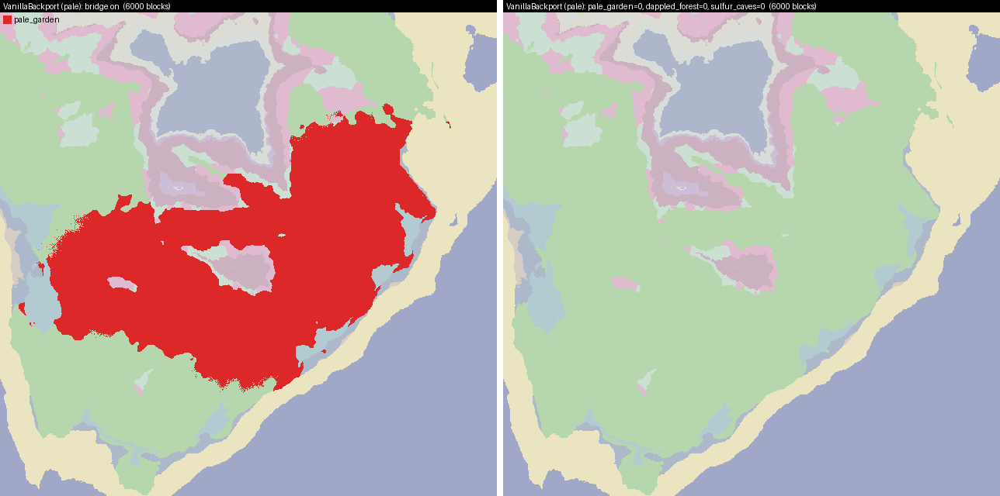
*6 x 6 km. Left: bridge on (`pale_garden` 0.18); right: amounts 0.*


*Dappled Forest (`dappled_forest` 0.5) vs 0.*


*Sulfur Caves at Y -20 (`sulfur_caves` 0.5) vs 0. The square shapes are FreeTerraForged's underground biome banding (cave biomes are laid out in square cells), not the bridge.*

## 11. Sulfur Caves rock (removed in 6.0)

> **Removed in 6.0** together with section 10: no `sulfur_rock` option and no sulfur rock feature any more. What follows
> describes 4.3-5.6.

*4.3, own setting in 5.0. `sulfur_rock`. `SulfurRockFeature`.*

VanillaBackport paints the Sulfur Caves with a surface rule driven by a 3D noise. FTF doesn't run VanillaBackport's surface
rule and skips surface rules for rock far from open space, so the caves were plain stone. The bridge places the same rock
as the first feature step, before VanillaBackport's sulfur pools and spikes: base stone becomes cinnabar where the
`sulfur_cave_gradient` noise is in [-0.4, -0.1] or above 0.4, and sulfur in [0, 0.4] (VanillaBackport's own thresholds).


*A horizontal slice at Y -20 through a Sulfur Cave (128 x 128 blocks). Left: `sulfur_rock=false` (plain deepslate); right: bridge on (sulfur yellow, cinnabar red).*

## 12. Cave floors

*5.5. `cave_floor_guard`. `CaveFloorGuard`, `SurfaceLayer`, `mixin/FastStrataSequenceRuleMixin`.*

**Problem.** FTF lays out cave biomes itself, and only part of the underground gets one: the preset's
`undergroundBiomeCoverage` (default 0.25) is the share of square cells (`undergroundBiomeSize`, default 225 blocks) that get
cave biomes, and near the surface no cell does (see [FTF notes](ftf-terrain-notes.md#cave-biomes-and-surface-biomes-underground)).
Everywhere else a cave keeps the biome of the ground above it, all the way down. Minecraft wraps its biome surface rules in
`above_preliminary_surface`, so with Minecraft's biomes such caves stay plain rock. Still Life doesn't (in its own worlds
every cave more than about 25 blocks down is a cave biome), so on FTF the floors of those caves got the ground of the biome
above: snow blocks in caves under snowy peaks, sand under deserts. In the tester's world 92-97% of cave floors were in a
surface biome, and 89% of them were snow blocks under a snowy peak, 70% sand under a desert. Not the bridge's doing: the
same regions of a world with FTF alone have exactly the same cave-biome and surface-biome columns (there they are plain
rock).

Minecraft's own check is not enough on FTF either. `above_preliminary_surface` compares with an estimated surface,
interpolated between chunk corners from the terrain noise without its detail, and on FTF's terrain that estimate can sit
20-25 blocks below the real ground. Tried as a Still Life patch: snow and sand stayed on 0.3-2% of those floors, all in small
pockets 8-25 blocks under the ground (a one-block gap 26 blocks under a snowy peak, a one-block sand shelf 19 blocks under
a desert).

**Change.** Once per world, just before FTF optimises it (`FastStrataSequenceRule.optimize`), the bridge rewrites the
surface rule FTF builds from Still Life's:
- every rule that names only surface biomes (the big block of biome ground materials, beaches and shallow seas, marshes,
  the Dappled Forest) only applies in the column's **surface layer**;
- in rules that already check `above_preliminary_surface` (grass, dirt, gravel and mud for every surface biome), the ground
  parts need the surface layer too. Still Life's rock layers there (granite, diorite, basalt and terracotta from 20 blocks
  under a floor) keep the plain check, so they stay continuous under small pockets near the surface.

The surface layer is a new surface rule condition, `stilllife_ftf_bridge:surface_layer` (also usable by datapacks): the run
of solid blocks that reaches up to open air, or to water standing on it (sea, lake and river beds). It is read from the real
column: its highest solid block (the chunk's height map, past any water) and how many solid blocks lie between the current
block and the air above it (FTF's `ISurfaceContext`). One look-up per column, one comparison per block. Cave-biome rules
and rules with no biome (bedrock, deepslate, stone, FTF's strata) are unchanged. Surface and cave biomes come from the
climate layout FTF places biomes from (cave = any entry deeper than the surface).

`cave_floor_guard` (saved per world; worlds made before 5.5 keep `off`):
- `exact` (default): ground blocks only on ground open to the sky or under standing water. Never on the floor of a cave,
  pocket or overhang; the bottom of an open ravine or sinkhole does get them.
- `vanilla`: Still Life's surface-biome rules get Minecraft's own `above_preliminary_surface` check, as Minecraft's biomes
  have; small pockets 8-25 blocks under FTF's ground keep their ground blocks.
- `off`: Still Life's own rules, as before 5.5.

Optional hook (`require = 0`): if FTF changes `optimize`, or no longer opens the surface system fields the condition reads,
the guard switches itself off and says so in the log.

**Checked** on the tester's seed, preset and settings (FTF 1.0.0032, Still Life 0.3.6-ftf, harness chunks identical block
for block to the tester's own), around a snowy peak, a desert and the tester's two screenshot spots:
- floors under a rock roof in surface biomes that carry ground blocks: bridge 5.4 68,108 of 78,306 (87%); 5.5 `exact` 2 of
  247,715, both inside a desert village house (a structure, placed later); `vanilla` 7 of 224,416, 16-31 blocks down. The tester's two spots: plain rock.
- open ground unchanged: ground blocks differ between 5.4 and 5.5 in about 2.5% of columns, as much as between two runs of
  the same build (features such as boulders and patches land differently between runs).
- same on Fabric. And with Still Life 0.3.7-ftf (a test build that wrapped the rules in `above_preliminary_surface` itself):
  the tightening covers those wraps, same result.
- not covered: caves that Minecraft's carvers cut after the surface is laid. Where the ground layer over such a cave is thin
  it shows from below, as under some deep sea floors (mud and Still Life's terracotta rock layers on the floor of a cave
  just under a 3-block sea floor). Minecraft's own biomes do the same.
- cost: none measurable. Tester's preset (1024 blocks high), the same area around a snowy peak generated 3 times each
  with no guard (5.4), with Minecraft's check added to Still Life's rules (the 0.3.7-ftf test build) and with `exact`,
  alternating. With 2 worker threads on the 2-core test server, 441 chunks: surface rules 24.0, 23.4 and 23.5 ms per chunk
  (runs of one setup spread by about 2 ms), the whole chunk 170, 162 and 162 ms of CPU. With 28 worker threads, 1,089
  chunks: 134, 121 and 122 s. Surface rules are about 14% of generation time; FTF skips them for about 84% of blocks
  (rock far from air), and for the rest the guard adds one comparison per block and one height look-up per column.

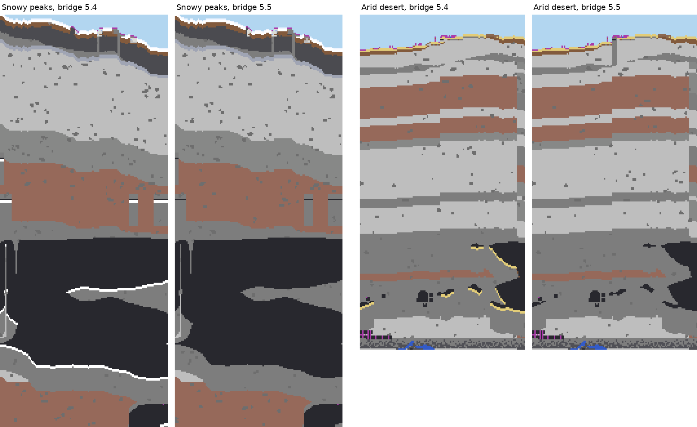
*Cross-sections through a snowy peak (Z -12636) and an arid desert (Z -23240) on the tester's seed, preset and settings
(dark = cave air). Left of each pair: bridge 5.4, snow blocks and sand on the cave floors; right: 5.5 (`exact`).*

## 13. Removed in 5.1: FTF's lakes and rivers left to FTF

Bridge 5.0 also reshaped FTF's lakes and rivers. 5.1 removes those changes, so the bridge depends on less of FTF's code
(4 of its 11 hooks went: the river carver, the river network, the heightmap and FTF's `Cell`) and FTF's own lakes and rivers
are used as its developer makes them. Their settings in older worlds' files are ignored, so new chunks there will not match
old ones along lakes and rivers.

### FTF lakes as salt lakes (`salt_lakes_on_lakes`, 4.6-5.0)

**Was:** FTF has no lake objects; its lakes are stretches where a river widens on a flat step of the water table, marked as
river. The bridge added a flag to FTF's `Cell`, set it where FTF carves a widened river bed, gave lake cells and their shores
the salt-lake climate, and stopped FTF's river-biome swap from replacing it there.

**Why removed:** it changed FTF's lakes and needed three hooks into FTF code. FTF is getting real lakes; salt lakes now come
from the dry-wetland climate alone (section 4), with water of their own (section 6). The test lake is now FTF's own
desert river lake.

### Lakes filled to their banks (`lake_fill`, `lake_min_depth`, 4.7-5.0)

**Was:** FTF clears a lake to its noise-widened radius but shapes the bed for the river's plain width, so most lakes had a
dry shelf 20-40 blocks wide at water level; the bridge shaped the bed for the full width and kept it 2 blocks under the
water. Water area of the test lake: 41k columns with FTF's own lake, 51k with the fill (FTF 1.0.0027).

**Why removed:** a change to FTF's river carver for a look FTF may change itself when it adds real lakes.

### Rivers start below mountains (`river_headwaters`, `river_mountain_height`, `river_fade_in`, 4.0-5.0)

**Was:** FTF's rivers are warped lines from a continent's interior to the sea, and they cut through mountain ranges. The
bridge sampled each river's course before carving and only let it start below the last point where the ground rose more
than 160 blocks above its water, fading it in from a dry valley.

**Why removed:** FTF 1.0.0027-1.0.0032 place rivers much better, and cutting through ranges is FTF's design (its own test
checks that rivers do). One FTF effect shows again where a river crosses a coastal range: a straight cliff 15-20 blocks
high can run from the river mouth up the slope along the edge of FTF's valley carving (seen in a test world with FTF
1.0.0030, also without the bridge): that is FTF's own valley carving.

## 14. Removed in 5.0: no longer needed with FTF 1.0.0027

### Even valley sides (`river_flank_max_cut`, `river_flank_slope`, 4.0-4.8)

**Was:** FTF 1.0.0025 faded a river valley out to the land over a fixed width with terraced steps, so in tall terrain it
sheared 100+ blocks off hill and mountain sides as walls. The bridge let carving lower the land by at most 48 blocks,
relaxed along a 45-degree slope from the bank (`@ModifyVariable` on `finalHeight` in `UpliftRiverCarver.carve`).

**Why removed:** 1.0.0027 replaced the terraces with natural valley sides of about 24 degrees (`carveValleySlopeFadeout`,
slope ratio 2.2) that reach out as far as the terrain needs (up to 1100 blocks). The bridge's limit, applied on top, only
cut that slope off: it left a terrace edge around each valley where the 48-block limit took over, and steeper valley
floors. Cell maps with and without it, at an inland lake and two coastal rivers: valley-floor slopes (median) 0.43-0.52
without it against 0.49-0.85 with it; everywhere else the same or within noise. A world's saved
`river_flank_max_cut` / `river_flank_slope` no longer shape valleys; the wetland limit it also set is now
`wetland_max_height` (section 8).


*A coastal river on FTF 1.0.0027, raw terrain. Left: without the flank limit (FTF's own valley); right: with it (48 blocks, slope 1): the terrace edge around the valley.*

### /ftf locate biome (4.4-4.8)

**Was:** `/ftf locate biome` failed with "An unexpected error occurred" (tooltip `spawnSearch`, a NullPointerException):
`FTFBiomeLocateQuery.isolateSampler` copied the world's spawn-search setting onto a private climate sampler with
`Objects.requireNonNull`, and that setting is empty unless the world's spawn was chosen in this session. The bridge skipped
copying an empty one.

**Why removed:** FTF 1.0.0027 fixed it itself (the setting may now be empty and falls back to a default), so the hook had
nothing left to do.

## 15. Terrain data for datapacks

*5.6 (placement filter), extended in 6.0 (terrain models, surface condition). `TerrainFilter`, `TerrainCondition`,
`TerrainSpec`, `TerrainFacts`.*

Everything the bridge knows about a column's terrain is open to datapacks under one id, `stilllife_ftf_bridge:terrain`,
in two registries:
- as a **placement modifier** (a filter in a placed feature's `placement` list, after `heightmap`): the feature is placed
  only where the column matches;
- as a **surface rule condition** (in `minecraft:condition` rules): true where the column matches.

Both take the same JSON fields. Every field is optional and an empty object matches everywhere. In a world that is not a
FreeTerraForged world everything matches. A field that reads a bridge option is **ignored** (matches) when that option is
off in the world, so a feature written for the full bridge still generates, unfiltered by that field, in worlds without
it; the table says which option each field needs. Unknown names in the list fields (`talus`, `faces`, `rock_suites`, ...)
are a load error that lists the allowed names.

**Where the values come from.** FTF's cell of the column (slope, sediment, river zone, terrain category, water level),
the climate bridge (snow line, humidity, latitude), the rock provinces (`Provinces`, `Strata`), the talus model
(`TalusField`, as `ground_cover` uses it), and the snow model (`SnowModel` / `SnowField`, as `mountain_snow` uses it,
including its sun, wind and shelter terms). All of these are worked out from FTF's terrain model, not from blocks, so they
are the same from any chunk, in any order, before and after the chunk is built. Only `hollow`, `prefer_facing`, `faces`,
`forest_edge` and the ground height the snow fields are judged at read the real blocks (within 2 blocks of the column),
which feature placement may do; surface rules run before those blocks are final, so there `hollow` and `prefer_facing` use
FTF's model ground, and `faces` and `forest_edge` are refused.

**The talus fields are the model's answer.** They say what the talus model makes of the column (the deposit `ground_cover`
lays there), read without blocks. `ground_cover` leaves some tops alone (blocks it doesn't treat as erodible, sand outside
dry land, snow, and river banks, which the erosion pass leaves alone), and on those the model may still say "talus" (on
river banks it says `none`, or `rock` where FTF's own rule bares rock). Combine with `faces`
or a block predicate where the real top matters.

**Cost.** A filter runs for every placement attempt (thousands per chunk). One FTF cell copy per attempt; the province,
climate and talus facts are worked out once per column and thread and kept for the 12 most recently used chunks (shared
by the filter and the surface condition); the snow and exposure fields come from the snow field, one per chunk and thread
(shared with `mountain_snow`'s own passes); the talus window is the one `ground_cover`'s erosion pass built for the same
chunk on the same thread when it is still kept (4 per thread), otherwise it is read from FTF's cell cache (no world
access, so columns a chunk away are fine). Fields that aren't set cost nothing. A talus trace is a few microseconds, once
per column.

### Fields

"real" = reads real blocks (feature placement only; for surface rules see the notes).

| Field | Type, unit, range | Meaning | Needs | Typical |
|---|---|---|---|---|
| `min_slope`, `max_slope` | FTF steepness, 0..~2 | FTF's slope of the column (the preset's rock / scree / dirt steepness: 0.8 / 0.6 / 0.45). A feature with `min_slope` 0.45 or more (a steep-slope painter: Still Life's stone_cliff, steep_slope_*) also skips columns where `mountain_snow` keeps snow ground (`MountainSnow.deepSnow`, real blocks; feature placement only), so it does not paint snowfields into rock | | trees `max 0.6`; ledges `min 0.3` |
| `min_sediment`, `max_sediment` | 0..1 | FTF erosion sediment (deposited soil: valley floors, foot slopes) | | valley gravel `min 0.25` |
| `river_zones` | list: `riverbed`, `banks`, `valley_floor`, `valley_fadeout`, `none` | FTF's river zone of the column | | |
| `terrain_categories` | list: `deep_ocean`, `shallow_ocean`, `coast`, `beach`, `river`, `lake`, `wetland`, `flatland`, `lowland`, `highland`, `island` | FTF terrain category | | |
| `max_above_water` | blocks | at most this far above the nearby river's water (river zones only) | | 2-3 |
| `min_hollow`, `max_hollow` | blocks, about -4..4 | how far the ground 2 blocks around lies above the column: + hollows, gullies, step feet; - ridges, edges | real (model in surface rules) | |
| `avoid_chutes` | bool | not in steep gullies (slope > 0.5 and hollow > 0.35) | real (model) | trees `true` |
| `min_temperature`, `max_temperature` | biome temperature | the biome's, cooled 0.05 per 40 blocks above Y 80 | | |
| `requires_rain` | bool | only in biomes with precipitation | | |
| `prefer_facing`, `facing_bias` | `north` / `south` / `east` / `west`, 0..1 | on slopes facing the other way, skipped this share of the time | real (model) | 0.3-0.4 |
| `facing_max_snow_line` | blocks | `prefer_facing` only below this snow-line distance, fading out over the 30 blocks above it | climate bridge | conifers `-100` |
| `ridge_thinning` | 0..1 | skipped up to this share on ground standing 16-48 blocks above the land 32 blocks around | | 0.5 |
| `min_snow_line`, `max_snow_line` | blocks | above (+) / below (-) where Still Life's snowy peaks begin here | climate bridge | belt `-70..-10` |
| `treeline` | `[from, to]` blocks | skipped more and more from `from` to `to` (snow-line distance), always above `to` | climate bridge | `[-110, -45]` |
| `treeline_shelter` | blocks per unit of `shelter` | raises the treeline in sheltered ground (gullies, benches), lowers it on ribs | climate bridge | 20-30 |
| `treeline_sun` | blocks per unit of `2 x insolation - 1` | raises it on sunny faces, lowers it on shady ones | climate bridge | 15-25 |
| `treeline_wind` | blocks per unit of `wind` | lowers it on windward slopes and crests, raises it in the lee | climate bridge | 10-20 |
| `treeline_ragged`, `treeline_ragged_size` | blocks; blocks (default 24) | plus smooth noise of +-this many blocks, in patches this wide | | 8-15 |
| `fade_in` | `[from, to]` blocks | the treeline upside down: never below `from`, skipped less and less up to `to` (snow-line distance), shifted by the same `treeline_*` terms; with `treeline` it makes a belt with soft, ragged edges on both sides | climate bridge | krummholz `[-72, -46]` |
| `min_insolation`, `max_insolation` | 0..1 | sun on the slope: 0.5 on flat ground, 0 in full shade, 1 at twice flat ground's light or more. The sun stands on the equator's side, low at high latitudes (so the contrast is strongest there, and weak near the equator) | climate bridge | sunny `min 0.55`; shady `max 0.4` |
| `min_wind`, `max_wind` | -1..1 | wind exposure: + slopes facing into the prevailing wind and crests (scoured), - lee slopes and the ground behind crests (loaded) | climate bridge | exposed `min 0.3` |
| `min_shelter`, `max_shelter` | -1..1 | the land's shape 2-32 blocks around: + gullies, couloirs, cirques, benches; - ribs, spurs, ridges | climate bridge | gullies `min 0.3` |
| `wind_thinning` | 0..1 | skipped up to this share, by wind exposure (none at <= 0, all of it at 1) | climate bridge | 0.3-0.5 |
| `shade_thinning` | 0..1 | skipped up to this share, by shade (none at insolation >= 0.5, all of it at 0) | climate bridge | 0.3-0.5 |
| `snow` | bool | `true`: the column holds snow (layers or snow ground) in `mountain_snow`'s model; `false`: bare | mountain_snow | `false` for plants |
| `min_snow_depth`, `max_snow_depth` | layers (8 = a block), 0..~19 | the model's snow depth (0 where bare) | mountain_snow | |
| `min_snow_margin`, `max_snow_margin` | score, -1..~1 | `>= 0` holds snow (higher = deeper inside a snowfield); just below 0 = bare but at a snowfield's edge; -1 far below any snow | mountain_snow | snow edge `-0.12..0` |
| `min_humidity`, `max_humidity` | -1..1 | Still Life's humidity | climate bridge | |
| `climates` | list: `cold`, `temperate`, `humid`, `arid` | `ground_cover`'s smooth climate class (cold: biome temperature < 0.3; arid: no rain or `c:is_dry`; humid / temperate by Still Life's humidity, with a wavy edge) | climate bridge | |
| `min_wetness`, `max_wetness` | 0..1 | how readily plants retake bare ground: 0 cold or dry, about 0.5-0.8 temperate, 0.85+ humid; fading out over the 90 blocks below the snow line | climate bridge | moss `min 0.3` |
| `talus` | list, see below | only on these talus kinds | ground_cover | |
| `avoid_talus` | list, see below | not on these kinds | ground_cover | trees `["fresh", "rock"]` |
| `min_talus_position`, `max_talus_position` | 0..1 | along the deposit: 0 at the apex below the face, 1 at the toe; fans count as 1; fails on columns that are no deposit | ground_cover | toe `min 0.6` |
| `min_face_distance`, `max_face_distance` | blocks, 0..15 or infinite | up the fall line to the rock face feeding the column (0 on bare rock; steep scree-angle ground counts as a face when there is no rock); infinite with no face within 15 | ground_cover | near cliffs `max 8` |
| `faces` | list: `open`, `ledge`, `face`, `cliff` | the real ground's shape from the blocks 5 x 5 around (`SnowModel.face`): `open` gentle ground; `ledge` a flat 3 x 3 (at most 1 block of relief) with at least two columns 2 blocks away standing 2+ higher, whatever the slope around; `face` about 1:1 (1-block risers); `cliff` steeper | real; refused in surface rules | trees `["open", "ledge"]` |
| `rock_families` | list: `grey`, `dark`, `pale` | the rock province's family (`pale` = limestone and dolomite hills) | ground_cover | |
| `rock_suites` | list: `grey`, `andesitic`, `dark`, `limestone`, `dolomite`, `granitic`, `kaolin_buff`, `kaolin_ochre`, `kaolin` | the province's bedrock suite (kaolin only in dry land with Nature's Spirit) | ground_cover and rock_strata | |
| `min_greenness`, `max_greenness` | 0.3..1.4 | how readily plants take over the province's scree | ground_cover | |
| `min_bare_rock`, `max_bare_rock` | 0..1 | how much bare rock shows through the province's thin soil | ground_cover | |
| `forest_edge` | blocks | only within this many blocks of where forest meets open land | real; refused in surface rules | 8-12 |
| `clearings` | 0..1 | skipped in natural clearings, about this share of the land | forest_variety | 0.1 |
| `regional_mix`, `mix_salt` | 0..1, int | skipped up to this share by a slow regional variation of its own | forest_variety | 0.4 |
| `requires_option` | `shores`, `ground_cover`, `mountain_snow`, `natural_snow_layers`, `forest_variety`; `!` before the name: only when it is off | only when this option is on (off) | | `"!ground_cover"` |
| `skip_with_natural_snow` | bool | not with `natural_snow_layers` (for features that set snow layers themselves) | | |
| `skip_if_loaded` | list of mod ids | not when one of these mods is installed | | |

"climate bridge" = the field needs the bridge's climate translation to know the world (always so in a Still Life FTF
world with the bridge enabled); otherwise it is ignored.

Talus kinds (`talus`, `avoid_talus`): `fine` (gravel and fine rock at the apex), `medium` (broken rock), `coarse` (blocks
and boulders at the toe), `mossy` (moss over blocks, wet climates), `overgrown` (the toe taken back by soil and plants),
`fan` (fines run out past the toe), `thin_soil`, `thin_gravel` and `outcrop` (steep ground with no face above), `rock`
(bare rock by FTF's rule: cliffs and ground above the rock line), `none`; groups `fresh` = fine, medium, coarse; `old` =
mossy, overgrown; `deposit` = fresh and old.

**Probability fields** (`facing_bias`, `ridge_thinning`, `treeline`, `fade_in`, `regional_mix`, `wind_thinning`, `shade_thinning`):
both use a hash of the column (with a salt per field), never the placement's random: tests that read blocks around the column can come out differently while a neighbouring chunk is still being decorated, and when that decided whether a roll drew from the shared random, every later placement of the feature in the chunk moved (two worlds of one seed differed in about 2% of their trees).

**Surface rules.** The condition is worked out once per column and used for every block of it. Heights come from FTF's
model ground (the top block by FTF's terrain model, within a block or two of the real one): snow line, treeline,
temperature and `max_above_water` at the model ground + 1 (where a feature would stand), the snow fields at the model
ground. The bridge's erosion pass (`ground_cover`) runs later and rewrites the top of steep ground and talus (and
`mountain_snow` then lays or bares snow ground), so surface rules with this condition matter on gentle ground and for
what lies under the top block; the talus fields let a rule agree with where the deposits will be.

### Examples

**1. A ragged treeline for a spruce feature.** Spruces thin out from 110 to 45 blocks below the snow line, but the line
climbs about 25 blocks into sheltered gullies and 20 on sunny faces, drops 15 on windward crests, and wanders +-12 blocks
in 24-block patches; no trees on fresh talus, bare rock, faces, cliffs or snow.
```json
{ "type": "stilllife_ftf_bridge:terrain",
  "max_slope": 0.6, "avoid_chutes": true,
  "treeline": [-110, -45],
  "treeline_shelter": 25, "treeline_sun": 20, "treeline_wind": 15,
  "treeline_ragged": 12, "treeline_ragged_size": 24,
  "wind_thinning": 0.4,
  "avoid_talus": ["fresh", "rock"],
  "faces": ["open", "ledge"],
  "snow": false }
```

**2. Shrubs only on old talus toes.** Pioneer shrubs on the lower part of deposits that are already mossy or overgrown, or
coarse at the toe, where plants can grow at all; on gentle ground only.
```json
{ "type": "stilllife_ftf_bridge:terrain",
  "talus": ["old", "coarse"], "min_talus_position": 0.6,
  "min_wetness": 0.15, "faces": ["open"], "snow": false }
```

**3. Moss and grass on cliff ledges.** Only on ledges inside cliff bands (a flat 3 x 3 with a wall behind) on steep land,
below the snow line, bare of snow, where it is wet enough.
```json
{ "type": "stilllife_ftf_bridge:terrain",
  "faces": ["ledge"], "min_slope": 0.45,
  "max_snow_line": -5, "snow": false, "min_wetness": 0.3 }
```

**4. A flower feature limited to limestone provinces.** Pale limestone and dolomite ranges, sunny gentle ground, not on
talus or rock, temperate or humid climate. (`rock_suites` needs `rock_strata` on; `"rock_families": ["pale"]` is the same
set of provinces and only needs `ground_cover`.)
```json
{ "type": "stilllife_ftf_bridge:terrain",
  "rock_suites": ["limestone", "dolomite"],
  "max_slope": 0.5, "min_insolation": 0.45,
  "avoid_talus": ["deposit", "rock"], "climates": ["temperate", "humid"] }
```

**5. Gravel on steep valley floors (surface rule).** The top of river banks and valley floors that are steep and hold
sediment, near the water, becomes gravel (combine with `stone_depth` / `stilllife_ftf_bridge:surface_layer` as usual):
```json
{ "type": "minecraft:condition",
  "if_true": { "type": "minecraft:stone_depth", "offset": 0, "surface_type": "floor", "add_surface_depth": false, "secondary_depth_range": 0 },
  "then_run": {
    "type": "minecraft:condition",
    "if_true": { "type": "stilllife_ftf_bridge:terrain",
                 "river_zones": ["banks", "valley_floor"], "min_slope": 0.2,
                 "min_sediment": 0.25, "max_above_water": 3 },
    "then_run": { "type": "minecraft:block", "result_state": { "Name": "minecraft:gravel" } } } }
```

**6. A brown subalpine belt (surface rule).** From 70 to 10 blocks below the snow line, on gentle, exposed ground (not in
sheltered hollows, not in the lee), cold or temperate, off talus and snow, the top becomes coarse dirt; the erosion pass
still lays its talus and alpine patches over it on steep ground.
```json
{ "type": "minecraft:condition",
  "if_true": { "type": "minecraft:stone_depth", "offset": 0, "surface_type": "floor", "add_surface_depth": false, "secondary_depth_range": 0 },
  "then_run": {
    "type": "minecraft:condition",
    "if_true": { "type": "stilllife_ftf_bridge:terrain",
                 "min_snow_line": -70, "max_snow_line": -10, "max_slope": 0.45,
                 "max_shelter": 0.3, "min_wind": -0.2, "climates": ["cold", "temperate"],
                 "avoid_talus": ["deposit", "rock", "outcrop"], "snow": false },
    "then_run": { "type": "minecraft:block", "result_state": { "Name": "minecraft:coarse_dirt" } } } }
```

**Checked:** the filter objects of examples 1-4 and the condition objects of 5 and 6 decode with the bridge's codecs and
encode back; unknown names, and `faces` / `forest_edge` in a surface rule, are refused with a message. The sun, wind and
shelter terms were checked on synthetic slopes (a slope facing the equator gets more sun than flat ground, which gets more
than one facing away; gullies are sheltered, ridges exposed).

**Checked in generated chunks** (6.0, seed -4620324235953065567, default settings, 768 x 768 blocks of a mountainside at
-784..-16, -752..16): a test datapack placed a marker block wherever a filter with a single field passed (4 tries per chunk
per field), read back from the region files against the ground measured from the blocks. `snow: false` never let a marker
through that `mountain_snow` later covered (0 of 2,849); `snow: true` markers got snow on top in 54% of cases (the rest
stand on a marker block the layer pass judges differently). `treeline` and `fade_in` thin out over the expected heights;
`min_shelter` picks columns about 2 blocks below the land around, `min_wind` ribs. `faces: ["ledge"]` matched 3 of about
3,150 tries, although flat benches with a wall behind are 13% of that ground: `SnowModel.face` only looks for ledges where
the 5 x 5 plane is already steeper than 0.9, which a flat bench barely tilts. Fixed for the filter (the snow passes keep
their own reading): a ledge is now the bench itself, a flat 3 x 3 with at least two columns 2 blocks away standing 2+
higher. `talus: ["old"]` matched nothing in two areas near the snow line: old talus needs wetness, which fades out below
the snow line, so there is almost none there; the field itself is not yet confirmed in a wetter area.

### Mountain vegetation zones (6.0)

*The bridge's own features (data/stilllife_ftf_bridge/worldgen, added to every overworld biome by `neoforge/biome_modifier/
alpine*.json` and `StillLifeFtfBridge.RIVERSIDE` / `NATURES_SPIRIT` on Fabric) and the trees of Still Life's FTF edition
(`still-life-patch/patch_terrain.py`). d = blocks above (+) or below (-) where the snowy peaks begin; "shift" = the
treeline's shift: `treeline_shelter` / `_sun` / `_wind` / `_ragged`.*

| Zone | Features | Filter |
|---|---|---|
| Forest (Still Life trees and tree groups, patch_terrain) | every tree feature a biome places | `max_slope 0.65`, `faces [open, ledge]`, `avoid_talus [fresh, rock]`, `avoid_chutes`, `ridge_thinning 0.4`, `wind_thinning 0.25`, treeline broadleaf `[-145, -80]`, conifers `[-110, -50]`, shift 25 / 30 / 15 / 12 (patches 28), clearings, regional mix; conifers lean north only up to 125 blocks below the line (`facing_max_snow_line -125`), so sunny faces carry the treeline higher |
| Treeline clumps and single small trees | `treeline_clumps` (2-4 small spruces, `treeline_spruce` 4-7 blocks, 1 placement every second chunk), `treeline_singles` (1 in 5 chunks) | clumps: fade_in `[-120, -84]`, treeline `[-62, -34]`; singles `[-115, -78]` / `[-52, -26]`; shift 25 / 30 / 15 / 12; `min_shelter 0` (not on ribs), `wind_thinning 0.5`, `max_slope 0.55-0.6`, `faces [open, ledge]`, `avoid_talus [fresh, rock]`, `snow false`, rain, `max_temperature 0.6` |
| Krummholz | `krummholz` (clumps of 1-2 block spruce bushes, 2 placements a chunk), `krummholz_ns` (Nature's Spirit firs) | fade_in `[-96, -70]`, treeline `[-44, -22]`, shift 30 / 30 / 15 / 12, `min_shelter 0.05` (sheltered spots), `wind_thinning 0.6`, `max_slope 0.6`, `faces [open, ledge]`, `avoid_talus [fresh, rock]`, `snow false`, rain, `max_temperature 0.6` |
| Belt ground, by biome group (Still Life's own disks, step `underground_ores`) | tundra (`alpine_tundra`, `boreal_alpine_tundra`, `snowy_boreal_alpine_tundra`): Still Life's `disk_coarse_dirt_tundra`, `disk_gravel_tundra`; heath (`alpine_heathlands`, `alpine_plains`): `forest/coarse_dirt_patches` (0.3 of its count), `disk_gravel_tundra`, moss ground (`belt_moss_ground`: Still Life's `moss_patch_forested` without its carpet vegetation, radius 2-6, 1 in 4 chunks, sheltered wet hollows); forest highlands: `forest/podzol_patches` (0.25 of its count), `disk_gravel_tundra`; dry highlands: `disk_gravel_tundra` | Still Life's own counts and noise counts; tundra/heath fade_in `[-80, -56]`, treeline `[-24, -8]`; forest/dry only on flanks: `min_slope 0.3`, fade_in `[-56, -36]`, treeline `[-18, -6]`; gravel only on exposed ribs and steep ground (`max_shelter -0.15`, `min_wind 0`, `min_slope 0.4`); `snow false` |
| Belt plants, by biome group (Still Life's own features, `vegetal_decoration`) | tundra: `berry_bushes`, `azure_bluet_alpine`, `bushes_common`, `groups/boreal_shrubs` (sheltered); heath: `azure_bluet_alpine`, `berry_bushes`, `groups/heathlands_shrubs` (sheltered), `allium_alpine`; dry: `dry_grass_normal` | Still Life's own counts; fade_in `[-80, -56]`, treeline `[-30, -12]`, `snow false`, `max_slope 0.8`, `faces [open, ledge]`; shrub groups `min_shelter 0.1-0.15` |
| Alpine flowers (5.6) | `alpine_flowers`, `alpine_flowers_ns` | d `-80..-12`, `max_slope 0.45`, lean south |
| Old talus and toes | `talus_pioneers` / `talus_pioneers_toe`: `pioneer_bush`, `pioneer_spruce` (they root in a spot of coarse dirt, so they can stand on fines and blocks), else fern / grass on soil | `talus [old, coarse, fan]`, `min_talus_position 0.55` (1 a chunk) / `0.8` (2 a chunk), `snow false`, `max_snow_line -6`, `faces [open, ledge]` |
| Ledges in cliff bands | `ledge_turf` (the bench's top rock or gravel becomes moss or grass), `ledge_moss_dark` (dark rock: more of the bench's top as moss block), then `ledge_plants` (grass, fern), `ledge_shrubs` (spruce bushes) | `faces [ledge]`, `min_slope 0.3`, `max_snow_line 0`, `snow false`, cold / temperate / humid (round 1 used `min_wetness`, which is 0 in cold country and fades out below the snow line) |
| Meadows (patch_terrain) | Still Life's grass, fern and flower patches | `wind_thinning 0.3-0.35`, grass also `ridge_thinning 0.25` |
| Calcite disks (patch_terrain) | Still Life's `pf_terrain/calcite_mountains` (calcite on rock beside snow blocks) | `requires_option "!mountain_snow"`: with the bridge's snow model and strata it no longer runs (it wrote into neighbouring chunks, so two worlds of one seed differed) |
| Snowy spruces (patch_terrain) | groups picking Still Life's snowy spruces / bushes | the group `snow true`; a plain twin `<group>_plain` `snow false` (with `mountain_snow` only) |

**The belt (third round).** The owner found the second round's belt "spammy": a busy speckle of brown, red, grey and small
bushes over whole uplands. The belt is now Still Life's own features, gated: each alpine biome gets its own ground and plant
recipe at Still Life's own densities, only in a narrow band below the snow line (forest and dry highlands only on flanks),
stone and gravel only on exposed ribs and steep ground, shrub groups only in shelter; prairie, meadows, steppe and forests on
gentle ground get nothing. The erosion pass's part (`GroundCover.alpine`) is now only a soft-edged fringe of bare, wet ground
(gravel, coarse dirt) around snow patches in the 45 blocks below the line; risers on stepped ground turn to rock only on
steep ground (FTF slope 0.45+) and not in hollows, so gentle terraced uplands no longer show grey stripes along every step.
No feature the bridge adds places azalea plants or moss carpets, and none lands on river beds, banks or valley floors
(`river_zones [none, valley_fadeout]`). Removed: the round-2 heath and fell-field mosaic, juniper mats, the rock-province
flowers and ferns, the lush hollows, extra red moss.

**What Still Life's own mountain biomes are made of** (read from 0.3.7-ftf and Naturalized 1.2.3): their surface rules give
alpine, tundra, heath and highland biomes plain grass tops (the biome-specific rules are only river sediments, kaolin and
travertine bedrock); the ground mosaic comes from features: `pf_terrain/forest/coarse_dirt_patches` (10 disks a chunk,
radius 1-3), `podzol_patches` (40, radius 1-2), `rooted_dirt_patches` (20), `disk_coarse_dirt_tundra` and
`disk_gravel_tundra` (noise-counted disks), `disk_rooted_dirt` (grass 7 : rooted 3 : coarse 1, radius 3-6); Naturalized adds
red tundra (`red_tundra_moss`: patches of 80 tries of red moss, noise-gated, with Nature's Spirit's bitter sprouts and
bearberries on them) and swaps grass for frigid grass. Cover: `minecraft:bush` patches, single persistent oak and birch leaf
bushes, groups of dwarf birch and blooming azalea bushes (`heathlands_shrubs`, `boreal_shrubs`, `lush_tundra`), sweet berry
and bearberry patches and heathers by noise providers at about 40-block scale (`berry_bushes`, `azure_bluet_alpine`), allium,
tall grass. The belt reuses those features and that palette.

Only vanilla blocks and Still Life's own features are used; the Nature's Spirit variants load only with that mod (NeoForge
conditions, Fabric load conditions and the `NATURES_SPIRIT` list) and their vanilla twins skip themselves when it is
installed (`skip_if_loaded`).

**Checked** on the same seed and areas, before (bridge 6.0 without these features, the 0.3.7-ftf jars) and after, from the
region files (rel = height above the edge of the snowy peaks biome, estimated per 32-block tile):
- mountainside at -784..-16, -752..16 (temperate, 2,304 chunks): tall trees per 1,000 columns at rel -60..-40 / -40..-20:
  0.72 / 0.26 -> 2.70 / 2.84, small trees 1.7 / 3.2 -> 6.5 / 7.8, shrub columns 4.1% / 7.8% -> 10.7% / 13.6%; the
  highest trees of each 32-block tile spread more (standard deviation 28.5 -> 41.1 blocks, 90th percentile -88 -> -39);
  trunks on ground steeper than 1:1 8.4% -> 2.4%, on cliff columns 81 -> 16, on rock or gravel 42 -> 35 (of about 3,000);
  plants on ledges 21% -> 24%; plants on gentle ground in hollows 38% -> 43%, on ribs 17% -> 18%;
- cold mountains at -17984..-17216, -7072..-6304: snow on leaves over mostly snowless ground (fewer than half of the open
  columns within 4 blocks snowy) 37 -> 6 columns, all six at snowfield edges (38-49% snowy);
- generation: 59 / 86 ms per chunk before, 50 / 54 after (timed forceloads of 2,304 chunks; the difference is within the
  noise of the method, polled every 5 s).

**Checked again (second round, bridge build of 23:37 on 23 November 2026, with the snow rework of 22:54)** on the owner's
seed 8783024580471023154, preset and saved settings, in worlds made from the owner's level.dat (1088-high noise, peaks to
Y 900; a dedicated server that enables the preset pack before Still Life gets Still Life's 576-high noise and flat tops at
Y 511). Baseline and result from the same build: the baseline with the first round's data and content jars and the 6.0
alpine streaks (`-Dstilllife_ftf_bridge.legacyBelt=true`). Snow-line distance from a probe world (marker blocks in 20-block
bands of the filter's own snow-line field, per 32-block tile). Areas (block coordinates): W 103248..104016, -13488..-12720
(temperate flank, forest to snow), C 105040..105552, -14368..-13856 (boreal), D 102192..102832, -3216..-2576 (dry
Mediterranean / barren peaks), T 104016..104784, -13488..-12720 (the owner's peak).
- W, d -60..-40: grass 16% -> 9%, brown ground (coarse, rooted, podzol, red moss) 6% -> 18%, tall trees 5.7 -> 3.9 per
  1,000 columns, small trees 3.2 -> 4.5, leaf shrubs (juniper mats, bushes) 4.6% -> 6.2%, dwarf shrubs 2.4% -> 2.7%;
  -100..-80: trees 47% of columns -> 41%. D, d -100..-80: grass 55% -> 35%, coarse 20% -> 29%, podzol 0% -> 7%, dwarf shrubs
  1.2% -> 3.4%, tussocks 1.6% -> 2.4%, flowers 0.2% -> 1.5%. C (cold): above d -60 the ground is 80-98% snow in both runs;
  at d -80..-60 grass 41% -> 24%, coarse dirt and gravel up.
- Treeline by aspect (95th percentile of trunks): W south 52 -> 53 blocks below the line, the other aspects 48-54 -> 57-58;
  T south faces 6 below the line -> 1 above it (north faces 66 below in the baseline, too few trunks after). With conifers leaning north only below
  d -125, the sunny side no longer has the lowest treeline.
- Ledges: plants on ledges 16.5% -> 15.5% (W), 11% -> 8% (T): no gain. Most ledge benches in cliff bands now hold snow in
  mountain_snow's model (`snow: false` rejects them), and the ledge turf only reaches benches below that.
- Talus: probe markers for `talus: ["fresh"]` stand on gravel and cobblestone where the ground is bare (W: 66 + 66 of 451,
  the rest snow); `old` matched 4-14 tries per area (packed mud, stone): old talus is rare in these mountains, so the
  pioneers stay rare.
- Snow on leaves over mostly bare ground: 0 in all four areas, both runs.
- Two fresh worlds of the same seed (W): ground differs in 4.8% of columns and tree cover in 2.1% (5.3% and 2.4% before
  the terrain filter's rolls became position hashes). The differences sit next to trees (94% of differing columns are within
  4 blocks of leaves, against 34% of all columns): trees placed by features that read blocks around the column (faces,
  hollow, facing, forest_edge, snow ground) while a neighbouring chunk is still being decorated. Calcite disks are no longer
  involved (1 column).
- Generation: 52-53 ms per chunk in both runs (forceloads of 1,024-2,304 chunks).

## 16. Ground, rock, snow, shores and forests (6.0)

*6.0. `ground_cover`, `rock_strata`, `mountain_snow`, `natural_snow_layers`, `shores`, `forest_variety` (all on for new
worlds; `rock_strata=bedded`). `GroundCover`, `TalusField`, `Provinces`, `Strata`, `SnowModel`, `SnowField`,
`MountainSnow`, `NaturalSnow`, `Shores`, `ForestEdges`; `mixin/ScreeFeatureMixin`, `mixin/DecorateSnowFeatureMixin`.
Worlds saved before 6.0 have all of them off; worlds saved by 6.0 test builds before `rock_strata` existed load it as
`off`.*

These replace parts of what FTF's two surface decorators do. `ground_cover`, `mountain_snow` and `shores` run inside
FTF's erosion decorator (`ScreeFeature`, the preset's *Erosion Decorator*): `ground_cover` takes over its per-column
`erodeColumn`, and `shores` and `mountain_snow` run over the whole chunk at the end of its `place`. `natural_snow_layers`
replaces the smooth-layer step of FTF's snow decorator (`DecorateSnowFeature`) and only runs when the preset has *Smooth
Layer Decorator* on. With the erosion decorator off in the preset, `ground_cover` and `shores` do nothing and
`mountain_snow` runs at the start of the snow layer pass instead (needs `natural_snow_layers`), without scree (section
7, format 19); with the smooth layer decorator off, `natural_snow_layers` does nothing.

Everything here is a function of the world seed and position, worked out from FTF's terrain model rather than from
neighbouring chunks' blocks, so it is the same whichever order chunks are generated in. The climate the passes read
(`StillLifeClimateBridge.humidity`, `capLineDistance`) is computed per 4 x 4 column from FTF's climate model and its
eroded height model (`filteredChunkCache`), cached per thread. (Up to the 6.0 test builds it came from whichever climate
sampler had last passed through the biome lookup, whose caches belong to one chunk: kaolin regions, snow amounts and dry
ground could switch along chunk borders.) Climate queries that are not real world generation (FTF's preview, seed
viewers) read terrain heights from FTF's quick cell lookup instead, because the eroded model builds a whole region of
chunks per lookup.

### Ground cover: talus as a deposit

FTF's erosion decorator decides by slope and height whether a column's top becomes bare rock (cliffs, above its rock
line), scree (steep slopes) or thin soil (moderate slopes high up), and uses one mix for all of it: tuff on every scree
slope, andesite, moss and coarse dirt. It only touches its `erodible` blocks, so sandy slopes stay sand at any angle.

`ground_cover` keeps FTF's bare rock (the same slope and height thresholds from the preset, the same noise) and treats
scree as what it is, a deposit below rock (`TalusField`):
- For every column the fall line is traced uphill (at most 15 blocks) to the first rock face. How far debris runs from a
  face depends on the face (steeper and gullied faces shed more, smooth noise along the cliff foot gives chutes of
  different lengths) and on the rock region's debris amount; every column fed by the same spot on the face gets the same
  run length, so deposits have clean outlines: tongues below chutes, cones below gullies.
- Sorted along the run: `fine` (gravel with a little of the region's rock) at the apex, `medium` (gravel, cobblestone and
  pieces of the rock above) and `coarse` (mostly cobblestone and blocks) towards the toe; `mossy` and `overgrown` where
  soil and plants take the toe back in mild, wet climates (never in cold or dry ones); `fan`, fines run out past the toe
  where the land holds sediment (always in dry land). Debris covers the steps inside an apron down to the lowest
  neighbour (at most 10 blocks).
- Steep ground with no face above gets thin rocky soil (`thin_soil`, `thin_gravel`, `outcrop`), not rubble.
- **Frost scree fields**: ground above FTF's rock line that is not a cliff, and the rock surface of high peaks, becomes
  gravel and cobblestone in streaks down the fall line with rock between them, by a frost strength that rises from 70
  blocks below the snow line to full strength 10 below it (in cold climates from 160 below, up to 0.7). Only on real
  mountains (`GroundCover.mountain`, from the land's shape, not the climate): the frost strength is scaled by the
  column's relief (its height above the lowest ground 12 and 32 blocks around: nothing below 12 blocks, full from 40) or
  its height above the sea (from 200 blocks, full at 300), whichever is more. In cold latitudes, where the snow line and
  the cold climate come down low, gentle low ground otherwise turned into scree fields.
- **Bare high-mountain ground** (format 18, `GroundCover.highGround`): ground above FTF's rock line that is not a cliff,
  the rock surface of high peaks, and every column the snow pass bares (Still Life's snow on its snowy peaks where the
  model has none: `MountainSnow` calls `GroundCover.coverBared` after `SnowCaps.bareRock`; before, the erosion pass
  never saw those columns, as they were snow then, so whole high slopes and basins were one sheet of plain rock) get:
  talus aprons below real cliffs (sorted along the fall line; up here only cliffs count as sources, `cliffSources`, not
  the rock line itself), else frost scree fields of gravel and cobblestone (`TalusField.highScree`: a field noise about
  60 blocks across decides where, more on gentle ground and in hollows, soft edges drawn out down the fall line, rock
  ribs on convex ground), else the bedded rock. Cliffs keep the strata. The erosion pass's settings are kept per thread
  for this (`GroundCover.pass`, from the mixin before its snow test).
- **Risers**: with `rock_strata` on, the risers of stepped soil on steep ground (FTF slope 0.45 and up, not in hollows)
  become the region's rock down to the lowest neighbour (at most 12 blocks), in patches drawn out down the slope, more in
  rocky regions and in cold or dry climates. Gentle terraced uplands keep their soil, so they get no grey stripes.
- **Alpine fringe**: in the 45 blocks below the snow line, with `mountain_snow`, a soft-edged fringe of gravel and coarse
  dirt around snow patches, on real mountains only (`GroundCover.mountain` at least 0.5). (6.0 test builds laid a belt of coarse dirt, gravel and stone streaks over the 60 blocks below
  the line; that belt is now made of Still Life's own features, section 15. The JVM switch
  `-Dstilllife_ftf_bridge.legacyBelt=true` brings the old streaks back, for comparisons only.)
- Dry washes of gravel and dry soil on sediment in dry land; thin-soil patches drawn out down the fall line.
- **Sand**: sand-family blocks (sand, sandstone, red sand, red sandstone) only on ground whose top is sand already; dry
  ground that is not sand uses its region's natural rock. Sand outside dry land (beaches, sandy banks) is left as it is.
  No terracotta is added.
- **River banks** are left as Still Life and FTF make them: FTF's riverbed and banks zones, and any ground within 8 blocks
  of river water and no more than 7 blocks above it. Only FTF's own bare-rock rule applies there, exactly as FTF lays it.
  (6.0 test builds put gravel, mud and clay bars at the water's edge and a green strip on dry banks; removed.)

The material classes come from the column's climate: `cold` (biome temperature below 0.3), `arid` (no rain or
`c:is_dry`; red when the ground is red sand or terracotta), `humid` or `temperate` by Still Life's humidity with a wavy
edge. A column's result depends only on terrain within 16 blocks of it (a 48 x 48 window per chunk, built from FTF's
cells), so deposits match across chunk borders.

**Rock regions** (`Provinces`): the land is divided into regions some 600-900 blocks across (Voronoi cells of a
jittered 760-block grid, through a two-scale domain warp, so borders wander). Each has its own debris amount, blockiness,
greenness (how readily plants take scree back) and bare-rock share, and a place on a lightness ladder from a smooth field a
few kilometres across, so neighbouring regions have similar rock. Across a border the regions' loose ground interlocks in
blobs over about 80 blocks and their bedrock over about 150. The loose ground's colour family follows the bedrock: `dark`
(tuff), `grey` (gravel, cobblestone, andesite, stone), `pale` (diorite, calcite; Nature's Spirit travertine in mossy
scree).

### Rock strata

`rock_strata` (needs `ground_cover`) decides what exposed rock is made of: FTF's bare rock (the soil above the first
rock, as FTF exposes it, and the column down to the lowest neighbour, at most 24 blocks, so the faces of cliff steps show it
too), the rock pieces in medium and coarse talus, outcrops and risers. Only plain base stone (stone, deepslate,
andesite, diorite, granite, tuff) is replaced; other rock (Still Life's basalt, calcite...) stays.

- `off`: the world's stone.
- `regional`: each region's **suite** (below), massive: its main rock with its fine-grain variant mixed in at a grain of
  1-3 blocks and faint vertical joints.
- `bedded`: as regional, plus beds in the layered suites (and weakly in half of the grey and dark regions): a field long
  along a tilted, folded and undulating bed plane (~170 blocks) and thin across it (5-10 blocks), where the bed rock
  shows on about 10-15% of a face; rare thin marker seams; rare thin steep dykes in granitic regions.

| Suite | Main | Grain | Beds | Markers | Style |
|---|---|---|---|---|---|
| `dark` (lightness step 0) | tuff | stone | stone | deepslate | weakly bedded |
| `grey` (step 1, 70%) | stone | andesite | andesite | tuff | weakly bedded |
| `granitic` (step 1, 30%) | stone | andesite | andesite | granite (dykes) | massive |
| `andesitic` (step 2) | andesite | stone | stone | tuff | massive |
| `dolomite` (step 3) | andesite | stone | tuff | diorite | bedded |
| `limestone` (step 4) | diorite | calcite | calcite | andesite | bedded |
| `kaolin_buff` | light grey kaolin | light grey kaolin | grey kaolin | white kaolin | bedded |
| `kaolin_ochre` | kaolin | orange kaolin | orange kaolin | brown kaolin | bedded |

Kaolin clay rock needs Nature's Spirit: a region is dry country when Still Life's humidity at its centre is below -0.35,
and about half of the dry regions are clay rock (buff on the lighter steps, ochre on the darker ones, so their brightness
still fits their neighbours). Their fine talus is crumbled kaolin with gravel.

**`deep`.** `rock_strata=deep` is `bedded` plus the regional rock through the body of
the land (`DeepRock`, `mixin/ChunkStatusTasksMixin`). Each region is a stack of one to four rock units: its usual suite,
in some regions a cap unit on the highest ground, and up to two older units below, with contacts set relative to the
regional ground level, so tall mountains change rock with height and deep valleys cut into older rock. Regions are
flat-lying, dipping (12-28 degrees) or folded, blended over about 440 blocks. Extra suites only `deep` uses: slate-like
deepslate, flood basalt, Nature's Spirit travertine and chert, Create's limestone (each only when that mod is installed,
otherwise a vanilla stand-in). The pass replaces only `minecraft:stone`, at the start of a chunk's LIGHT step, when the
chunk and its neighbours have finished their features, so ores, carvers and structures are unchanged and the result does
not depend on chunk order. Below an undulating contact some 15 blocks under the sea the rock stays plain stone; the top
three blocks of stone-topped or submerged columns stay stone. Measured cost: about 5-17% more generation time, most of it in mountains. If another
mod replaces Minecraft's light step, this pass does not run and only the surface rock changes.

### Snow: one model

`mountain_snow` gives every column a **score** (at least 0 where it holds snow) and a **depth** from one model
(`SnowModel`, per chunk in `SnowField`), and every snow pass uses those two.

- **Shelter** (`keep`, 0..1): the shape of the land 2-4, 6-12 and 16-32 blocks around (hollows, gullies, cirques and
  benches hold snow; ribs, spurs and ridges lose it; this dominates), the sun on the slope (from the equator's side,
  slightly west of it, low at high latitudes; with `latitude=ftf` as at middle latitudes), the wind (how far the ground
  upwind rises above the column: windward slopes and crests are scoured, lee slopes loaded; easterly within 0.3 pole
  distances of the equator and beyond 0.65, westerly between, turning smoothly, with a slow regional meander; westerly
  everywhere with `latitude=ftf`), avalanche runout below long steep slopes, and noise smeared down the fall line so the
  ragged edge is tongues and streaks.
- **Climate** (`climateSnow`, about 0.25 arid to 1.75 wet): Still Life's humidity at the place, a slow variation about a
  kilometre across, less in warm latitudes. It moves each place's own snow line by `(1 - snow) x 110` blocks (up to about
  80 up where arid, 80 down where wet).
- **Coverage**: just above that line the share of ground holding snow is about 0.35 where arid, 0.8 in a normal climate
  and 0.92 where wet, rising towards 0.92 over the next 120 blocks; below it leftover snow falls off over about 120 blocks
  (further in wet places). A column holds snow when its shelter is at least `1 - coverage`.
- **Polar line** (`SnowModel.polarLine`): towards the pole a second snow line comes down to the sea where Still Life's own
  permanently snowy lowland begins. Still Life's biome table puts its arctic biomes (arctic desert, barren arctic desert,
  arctic glacier, glacial basin, arctic wetlands, beach and river; base temperatures -0.9 to -2, snow in their surface
  rules) below Still Life temperature -0.8, and tundra (-0.8 to -0.56; base temperature 0.4 and no precipitation, so no
  snow of its own) and taiga above it. The polar line stands `(T + 0.8) x 3000 + (1 - snow) x 30` blocks above sea level
  (four times steeper beyond the tundra, from -0.56, so it never reaches the mountains of warmer lands), T being the
  temperature Still Life's biome lookup reads at sea level there (with `latitude=still_life` the latitude temperature and
  its regional variation; blended between 4x4 columns): at the sea at -0.8, 60 blocks up at -0.78, 150 at -0.75, 300 at
  -0.7. At the line the share is 0.5 (light patches, about what Still Life's own arctic ground shows: 49-66% snow in
  its arctic desert lowland), falling off over 40 blocks below it and rising to a high summit's 0.92 over 40 blocks above
  it. So only the coldest strip of the tundra gets patches, the rest of the tundra keeps its own ground, and its higher
  hills are white. In worlds with the snow-line curve (format 18) these gentle-ground patches are laid with their own
  patch noise (`SnowModel.patch`: octaves at 56, 20 and 7 blocks), snow where it exceeds `1 - share`, so they are big
  soft-edged patches like Still Life's own arctic snow (its `surface_large` blobs) rather than the shelter's fine grain.
  At the owner's 52138, -18659 the shelter-driven patches made a speckle on the barren tundra (22% snow in 525 patches,
  median 1 column, 16% of it in specks under 10 columns) against Still Life's big patches across the straight biome edge
  (arctic desert basin, 36% snow in 29 patches, 97% of it in patches of 100+ columns).
- **Still Life's own surfaces** (`MountainSnow.keepsOwnSurface`, biome tag `stilllife_ftf_bridge:keeps_own_surface`:
  `#still_life:is_arctic`, `#c:is_icy`, `still_life:arctic_river`, `still_life:snowy_tundra`): Still Life draws these
  biomes itself (arctic desert: snow ground or gravel by `surface_dithered`; barren arctic desert, arctic glacier, frozen
  tundra and taiga: snow ground; arctic desert basin and beach: big patches of snow, gravel and mud by `surface_large`;
  snowy tundra: snow and gravel patches; glacial basin: plain ground under packed-ice sheets from its `disk_glacier`
  features; the rest grass with features). The snow passes leave them as Still Life lays them at any height, except on
  real faces and cliffs (`face()` FACE or CLIFF): `MountainSnow.chunk` neither adds snow ground nor bares it, the layer
  pass gives them the layers as without `mountain_snow` and never melts their ice, and `ground_cover` leaves ground up
  to the scree steepness alone (FTF's rock line included). This replaces 6.0's earlier rule (T -0.8 and colder, up to 60
  blocks above the sea), which left FTF's arctic uplands to the model: on the owner's arctic the snow ground of arctic
  desert uplands went from 66-72% to 29-33% (bared to tuff, kaolin and travertine), and glacial basin ice sheets at
  y 120+ from 97% packed ice to 57%, with 19% tuff where the model melted the ice to rock.
- (Before the polar line, the snow line came down by `(-0.3 - latitude) x 500` blocks wherever the latitude temperature
  was below -0.3, with up to twice the reach, which covered tundra and taiga lowland far from the arctic with snow
  blocks: 98% of the gentle barren tundra at 77450, -17250 against 0% without the bridge.)
- **Format 18: the snow-line curve, a transition zone** (`SnowModel.coverageCurve`, `curveShare`, `gentleWeight`,
  `keep(..., curve)`, `snowLineDistance`): the line is each place's line of the curve (section 7,
  [snow-line curve](#snow-line-curve-and-mountain-bands-60-format-18)) with the wander. A first format 18 build put the
  cap's full share (about 0.9 in temperate country) right at the line, so cover went from 10% to its most within 22
  blocks of height on the owner's mountain (84707,-7114) and forests met a white wall; a lowland rule by height (no snow
  below Still Life height 140, blended over 20 blocks) then cut the snow along a level line even in gullies (owner's
  saved chunks: 0% snow at Y 230-239 in every terrain class, 40% in gullies at 240-249). Now:
  - **Zone**: share = `summitShare x smoothstep(-170 - 40 x max(0, snow - 1), +240, dEff)`, dEff the height above the
    climate-shifted line (`lineShift`: `(1 - snow) x 110`, wet lowering at most 25), `summitShare` = `0.58 + 0.34 x snow`
    (0.45 to 0.94). Above the line only (`zoneShare`), the rest of the way to the summit share closes faster (half of
    it by `smoothstep(0, 160, dEff)`) and high summits get up to 0.06 more (`smoothstep(100, 260, dEff)`); both start at
    zero with zero slope at the line, so nothing changes from the line down. About 35% at the line in a normal climate,
    about 75% 100 above it, near full 200 above it. The snowy peaks band (`coverHeight`) still uses the plain smoothstep,
    so the bands did not move with this step (snowy peaks begin where the ground is about 75-80% white).
  - **Aspect**: the column counts `12 x (1 - 2 x sun) - 12 x wind` blocks higher (shaded and lee up to 24 higher,
    sunny and windward as much lower), so the zone's edge is never level around a mountain.
  - **Order of filling**: with the curve, keep() weighs the terrain over the noise (shape 1.3, shade 0.8, wind 1.0,
    couloir 0.7, avalanche runout 0.6, steep -0.9, convex shoulders -0.4; noise 0.25, smeared 12 blocks down the fall
    line, grain 0.05; gain 0.75): gullies, lee and shaded hollows fill first, open slopes next, convex and windward
    ground last.
  - **Below the line** only on real mountain ground: `smoothstep(need - 20, need + 20, standing)`, need `0.4 x` blocks
    below the line, standing the height above the valley floor (`ValleyFloor`: lowest of FTF's uneroded cell heights on
    a 16-block lattice within 96 blocks, blended; deterministic, memoised per thread). No height limit.
  - **Gentle ground**: gentle lowland by the land, not by height: `(1 - smoothstep(25, 70, standing)) x (1 -
    smoothstep(0.35, 0.7, slope over 8 blocks)) x (1 - smoothstep(-60, 20, dEff))` keeps the cover of older worlds;
    from Still Life temperature -0.4 down (full from -0.5) gentle uplands (standing under 30, fading out by 90) too,
    but only near the line: this cold-upland rule fades out from 60 to 160 blocks above the climate-shifted line
    (`COLD_UPLAND_FADE_*`). Without that fade a whole high massif at cold-taiga latitude was bare: its broad basins and
    plateaus stand little above the lowest ground within 96 blocks, so the rule took them for gentle uplands (owner's
    massif at 100808,-15113: zone share 0.95 there, coverage 0.59, cover of gentle ground 150+ above the line 33%).
    The cover of gentle ground under the rule is the light polar patches (`curvePatches`, `patch` noise) from the old
    polar line up, nothing below it.
  - **High ground** (`zoneShare`): from 90 to 210 blocks above the climate-shifted line the share closes on 0.95 in
    every climate (`HIGH_*`; little melts up there, even where it is dry), and never goes above 0.95, so the
    worst-placed ground (windward crests, convex ribs) stays dark. Where the coverage is 0.78 to 0.93 and up the snow
    is deep right to its edges (`SnowField.depth`, `DEEP_*`), so stepped slopes of a high massif resolve to snowfields,
    not thin snow the step rule bares. The snowy peaks band (`coverHeight`) is unchanged.
  Still Life's arctic and frozen biomes (`keeps_own_surface`), sea ice and the step rule are as above.
- **Depth**: 0 where bare, growing inwards from a patch's edge to 5-12 layers (8 layers = a block, more in snowy
  climates), deeper in small hollows, avalanche runouts and behind crests.

The passes:
- After FTF's erosion pass, over every column (`MountainSnow.chunk`): snow ground where the model has no snow, or only a
  thin cover, becomes the rock under it; soil or rock where it has deep snow becomes snow ground. With
  `natural_snow_layers`, only deep snow (4.5 layers and more) is snow ground; on rock faces (from the real blocks: 1:1
  faces and steeper cliffs) only where the snowfield is deep, or on ledges, so cliffs stay rock. **Stepped slopes**
  (`SnowModel.step`: 5 x 5 slope from 0.22, narrow treads, up to 1.7, a real cliff) are decided as a whole: the model's
  depth plus a smooth noise about 14 blocks across (amplitude 2.5 layers) against 3 layers, rising to 9 from slope 0.9
  to 1.7 so steep faces stay partly rock even in deep snow. Above it the staircase is one
  snowfield: snow ground on every tread and down its riser to the lower neighbour's ground (at most 3 blocks under the
  tread; a drop of more than 4 stays a rock step). Below it the staircase is rock, with no layers on its treads either.
  Before, each column was judged alone: `face()` calls a column above a 2-block riser on a steep slope a cliff and the
  one above a 1-block riser a face, so a staircase of mixed risers alternated bare and snowy rows, and gentler
  staircases got snowy treads over bare risers: regular white and grey lines over whole faces (owner's world
  97313, -5119). Biomes named ice, frozen
  or glacier keep their snow; seas, beaches and rivers (tags `c:is_ocean`, `c:is_beach`, `c:is_river`, or those words in
  the name) and ice formations (an ice top, or snow on ice or water within 6 blocks) are left alone.
  Minecraft's own freezing, which whitens warm lands high up, is cleared where the model has no snow.
- The snow layer pass (`NaturalSnow`, below) takes its depth from the model, adds layers where FTF laid none but the
  model has thin snow (a ledge, the feathered edge of a snowfield), turns Still Life's ice on mountains (packed and blue
  ice) into snow ground or rock (never sea ice, icebergs or ice shelves: not in sea, beach or river biomes, not within 12
  blocks of sea level, not ice standing on water; before this the top 6 blocks of arctic icebergs became the region's
  rock), and keeps snow on **leaves** only where the tree stands in a snowfield: the model has snow
  under it and nearly all around, and more than half of the open ground around really shows snow.
- Steep-slope painters (Still Life's `stone_cliff` and `steep_slope_*` disks, filters with `min_slope` 0.45 and up) skip
  deep snowfields, so they do not paint them into rock; Still Life's snowy spruces grow only where the model has snow
  (section 15).

`natural_snow_layers` alone (without `mountain_snow`): FTF's smooth layers took the snow depth from its own terrain height,
which only matches the blocks the game builds at FTF's noise cells, so snow came out as a grid of stripes, lumps and full
snow blocks. The bridge's pass works from the real ground: snow fills the foot of every step up to the level above and
tapers over 2-3 blocks, open flats get a thin cover, exposed edges stay thin, FTF's slope thins it and clears it off cliffs,
it is a little deeper on north faces and in colder places, bare rock and gravel hold it only in hollows, and never more
than 7 layers.

Measured: section 15 has the leaf-snow counts (snow on leaves over mostly bare ground 37 -> 6 columns, then 0). The
snow model's other numbers above are its design; how it reads in play is still being judged.

### Shores

`shores` runs over every column at the end of FTF's erosion pass, with the water level from FTF's model (sea level, lake
and river water), never from neighbouring chunks' blocks:
- rocky shores: up to 4 blocks above the water below steep coasts, cliffs and steep lake sides (the shore itself steeper
  than 0.55, or land rising 4+ blocks within 3 inland): gravel at the water's edge and the region's talus (stone, cobble,
  mossy where wet);
- mud flats: mud and some clay in shallow (1-2 blocks), gently sloping sea water where it is warm and wet, on muddy or
  soil sea floor only;
- lakes (FTF terrain category `lake`): gravel, mud and clay on low shores and in the shallows (sand only where the ground
  is sand already), clay patches 3-6 blocks deep; the `lake_reeds` (sugar cane, or Still Life Naturalized's reed edges
  when it is installed) and `lake_lily_pads` features, gated by `requires_option: shores`.

River banks are skipped, and so is ground under ice or snow blocks (sea ice, ice shelves, icebergs). FTF builds most of
its lakes from widened river stretches, marked as river, so most lakes get nothing; only cells FTF marks as lake do.
`ground_cover` likewise leaves ice formations and sea biomes alone, and the gentle ground of `keeps_own_surface` biomes.

### Rivers

Since 6.0 the bridge writes no blocks on river banks (`ground_cover`, `shores` and the alpine features all skip them).
Without Still Life Naturalized it still places a few riverside plants on FTF's banks zone (`riverside_willows` where the
biome temperature is 0.45-1 and it rains, `riverside_birches` at -0.2-0.45 with rain, `riverside_reeds` (sugar cane) from
0.3, `riverside_plants` (grass and ferns) on banks and valley floors); they skip themselves when Naturalized is installed.

### Forests

`forest_variety` gates three things through the terrain filter (section 15):
- **Edges** (`ForestEdges`): where a forest biome (by name: forest, taiga, woods, woodland, rainforest, jungle, grove; not
  clearings, plains, steppe, prairie, savanna, fields, tundra, wetlands, rivers) and open land meet within 12 blocks, the
  `forest_edge_*` features put young birches (temperature 0.3-0.95, rain), small spruces (-0.5-0.3, rain), leaf bushes and
  bush patches on both sides.
- **Clearings**: Still Life's tree features (patched by `patch_terrain.py`) skip about a tenth of the land in noise
  patches.
- **Regional mixes**: each tree group thins out by up to 0.4 by its own slow noise (about 350 blocks), so one forest is
  mostly birch, the next mostly oak.

## How the images were made

All on a headless NeoForge 21.1.265 server (the loader comparison in the introduction also on Fabric Loader 0.20.1 with
Fabric API 0.116.18 and the Fabric jars of the same mods) with VanillaBackport 1.2.2 and the same seed
(8982759974645396284), with the settings of the tested world; each pair changes one option. Images up to bridge 5.0: FTF
1.0.0027, Still Life 0.3.5-ftf and the test preset. Images new in 5.1 (biome-set border, salt lakes, wetland pools, river
beds): FTF 1.0.0030 or 1.0.0032 and Still Life 0.3.6-ftf, with the test preset (salt flats map, bayou) or the in-game
tester's preset (the rest); the "5.0 rule" and "0.3.5-ftf" panels were read from the tester's own world. Images new in 5.2
(snow line): FTF 1.0.0032, Still Life 0.3.6-ftf, the tester's preset and world settings. Images new in 5.5 (cave floors): the
same with the tester's newer seed (-4620324235953065567), preset and settings. Images new in 5.6 (mountain belts): biome
maps with that seed, preset and settings (FTF 1.0.0032; the bottom row with `latitude=still_life`).
- **Raw terrain** (hillshaded heights, blue = water): a debug build of the bridge dumps FreeTerraForged's terrain cells over
  an area in seconds, without generating chunks.
- **Biome maps**: the same debug build asks the game's biome source for the biome at the surface (or a given Y) of every
  sample point, so these are the biomes chunks would get. Highlighted biomes are coloured, the rest faded.
- **Block images** (snow, sulfur, climate, pools, salt lakes, river beds): chunks generated with Chunky and read back from
  the region files; pool and bed images show the block under trees, plants and water. The snow line in perspective is the
  same data drawn column by column from the back to the front.
