# The bridge, feature by feature

Each section says what was wrong, why, what the bridge changes (with the FreeTerraForged code it hooks into) and how it was
checked, with a bridge-on / bridge-off image made on FreeTerraForged 1.0.0027 (same seed, preset and settings, only the
one option changed; see "How the images were made" at the end). FreeTerraForged (FTF) class names are from FTF 1.0.0027 (bridge 5.x; bridge 4.x was built on 1.0.0025); the bridge's
own classes are in
`bridge/src/main/java/stilllife/ftfbridge`. Version numbers say when a feature came in (see `CHANGELOG.md`).

Every option that changes terrain or biomes is **saved per world** (`WorldLock`, `<world>/stilllife_ftf_bridge.json`),
because a world whose settings change halfway would generate chunks that don't match. Worlds made before an option existed
keep it off. Every hook into FTF that is not essential is optional (`require = 0`): if a future FTF changes that code, the
feature switches itself off instead of stopping the game; `FtfCompat` checks the essential ones at start-up and fails with
a readable message.

- [1. Climate translation](#1-climate-translation)
- [2. Latitude, continents and biome sets](#2-latitude-continents-and-biome-sets)
- [3. Swamps in humid lowland](#3-swamps-in-humid-lowland)
- [4. Dry wetlands: aspen swamps and salt flats](#4-dry-wetlands-aspen-swamps-and-salt-flats)
- [5. FTF lakes as salt lakes](#5-ftf-lakes-as-salt-lakes)
- [6. Wetland biomes keep their water](#6-wetland-biomes-keep-their-water)
- [7. Lakes filled to their banks](#7-lakes-filled-to-their-banks)
- [8. Standing water in wetlands](#8-standing-water-in-wetlands)
- [9. Snow on peaks](#9-snow-on-peaks)
- [10. Rivers start below mountains](#10-rivers-start-below-mountains)
- [11. Wetlands stay off hillsides](#11-wetlands-stay-off-hillsides)
- [12. The coastal uplift cliff](#12-the-coastal-uplift-cliff)
- [13. VanillaBackport biomes](#13-vanillabackport-biomes)
- [14. Sulfur Caves rock](#14-sulfur-caves-rock)
- [15. Removed in 5.0: no longer needed with FTF 1.0.0027](#15-removed-in-50-no-longer-needed-with-ftf-100027)

## 1. Climate translation

*3.0, refined in 4.x. `StillLifeClimateBridge`, `mixin/SamplerDecorationMixin`.*

**Problem.** Still Life is a multi-noise biome layout: thousands of entries, each a box in six climate parameters
(temperature, humidity, continentalness, erosion, depth, weirdness) and a biome. It was written for Lithosphere, whose
terrain produces those parameters in a particular way: continentalness rises with distance from the coast, erosion splits
the world into lowland and highland bands (and into Still Life's two biome sets), weirdness encodes peaks and valleys,
depth is the distance below the surface. FTF also gives Minecraft six numbers, but computes them from its own terrain, so
Still Life's table read them wrongly: biomes ended up by the wrong rules (inland beaches, highland biomes in valleys).

**Change.** The bridge hooks the point where FTF hands a climate point to the biome lookup
(`WorldgenPlans.SamplerDecoration.sample`, a `@ModifyReturnValue`) and rewrites it from FTF's terrain cell at that
position (`CellSampler.getCachedOrLookup`):

- **Continentalness** from FTF's `controlPoint` (its distance to the coast; called `continentEdge` before FTF 1.0.0027),
  mapped through a table so that the coast, 50, 110, 170, 320, 690, 1180 and 1380 blocks inland land on the
  continentalness values Lithosphere has at those distances. Oceans keep FTF's value.
- **Height scale.** Still Life's height-dependent choices assume Lithosphere's heights. The bridge samples FTF's terrain
  of the world once (a 32 x 32 km grid), takes the height percentiles of land, and maps them onto Lithosphere's percentiles
  (`Y_LITHO`), so "the highest 5% of land" means the same in both. The result is saved in the world's settings file
  (`heights`, `coast_edge`) and only re-measured if the preset's terrain changes.
- **Erosion** = the biome-set half (-0.5 American / +0.5 Afro-Eurasian) plus Still Life's band offsets for lowland,
  highland (FTF's highland terrain category) and wetland.
- **Weirdness** = a ridge magnitude from the mapped height (peaks, slopes, valleys as Still Life expects), with a
  per-region sign so both of Still Life's variants appear.
- **Depth** rescaled from FTF's to Lithosphere's (`LITHO_DEPTH`), so cave biomes sit at the depths Still Life meant.

**Checked** on generated worlds: biome maps per height band and per distance from the coast, compared with the same seed
on Lithosphere + Still Life.

**FTF 1.0.0027** made its own climate numbers closer to vanilla's (a `continentalness` in vanilla's bands, a weirdness that
keeps coasts out of the valley band, perlin instead of worley macro-biome noise). None of that reaches Still Life: the
bridge still writes its own continentalness, erosion, weirdness, depth and (with `latitude=still_life`) temperature, and only
takes humidity from FTF, which did not change. The translation is still needed because Still Life's table follows
Lithosphere's numbers, not vanilla's.

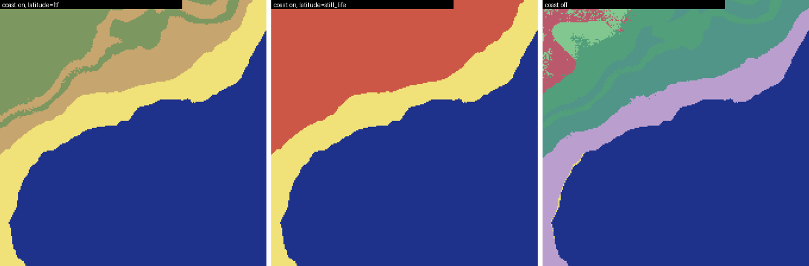
*Coast at the test spawn, generated chunks, one colour per biome (yellow = beach). Bridge on with `latitude=ftf`, bridge on with `latitude=still_life`, bridge off (FTF 1.0.0027's own climate numbers): beaches on 98% / 98% / 3% of the shoreline.*


*Inland at the test wetland: with the bridge off, salt lake covers 12% of dry land and FTF's wetland water turns into river biome.*

### Beaches

*5.0. `beach_max_height`, `beach_shallows`.*

**Problem.** Still Life's beach biomes are coastal points (continentalness up to 0.02) in a narrow weirdness band (0.05-0.08),
and its beach surface rule only lays sand (gravel on cold beaches) below Y 65. On Lithosphere that band is land within about
12 blocks of the sea plus the shallow water in front of it. The height mapping above is by rank: FreeTerraForged's lowest
~28% of land, which Lithosphere keeps below Y 75, reached Y 128 in the test world, so beach biomes climbed whole coastal
slopes as grassland (at one test spot 100% of the land in a 384-block square, 29 blocks above the sea on average, 1% sand),
while the sea stayed ocean biome right up to the shore. A preset can't change this: the bridge measures every world's heights
and coast distances, so moving the preset's coast control points left the beaches where they were. Sondre's bridge 3.3.0
takes another route (it adds beach biome to low land and shallow sea within set distances of the shore) but keeps the same
height mapping, and at the test spot gave the same result as 5.0 without this fix.

**Change.** Coastal land in the beach band more than `beach_max_height` blocks above the sea gets the band just above it
(the land's own inland biome), and sea up to `beach_shallows` blocks deep (not deep ocean) gets the beach band. The defaults
come from Still Life's own beaches: in a Lithosphere + Still Life world made with the same mods, half of the beach land was
within 2 blocks of the sea and 90% within 9, and 56-63% of the coastal water was beach biome, 2-4 blocks deep.

**Checked** at the same spot and at the test spawn's coast: beach land 3/6 blocks above the sea (median / 90%) instead of
29/41 and 18/39; beach biome on half of the coastal water instead of 2%; 5 km of coast below.

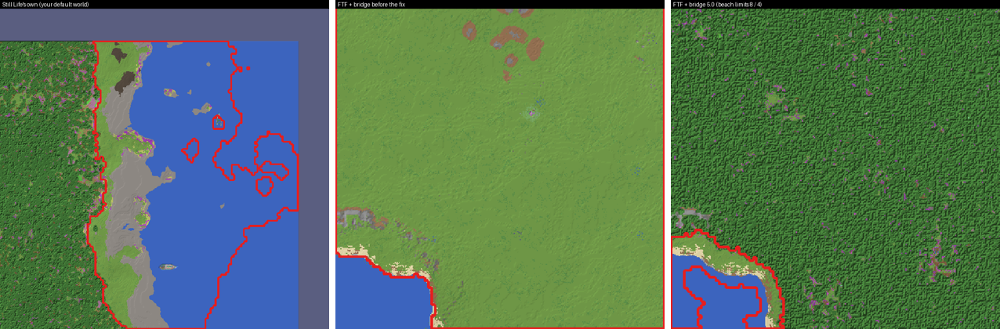
*Top blocks, red line = edge of the beach biome. Left: Still Life's own beach (Lithosphere + Still Life, taiga beach with
gravel); middle: the bridge before this fix at the same FTF spot (all of it "beach" grassland); right: with `beach_max_height`
8 and `beach_shallows` 4 (a band along the shore and the shallow water in front of it).*


*Beach biomes along 5 km of FTF coast: before the fix (300-1000 blocks wide, up to Y 130) and after (median Y 64).*

## 2. Latitude, continents and biome sets

*3.x. `latitude`, `pole_distance`, `american_share`.*

- `latitude=still_life` gives Still Life's own climate: one equator and colder bands toward the poles, `pole_distance`
  blocks away. `ftf` keeps FTF's repeating temperature bands (with altitude cooling).
- Still Life has two complete biome sets (American and Afro-Eurasian). Lithosphere chooses them by region; the bridge
  rolls once per FTF continent (`continentId`), so each continent has one consistent set, `american_share` of them American.

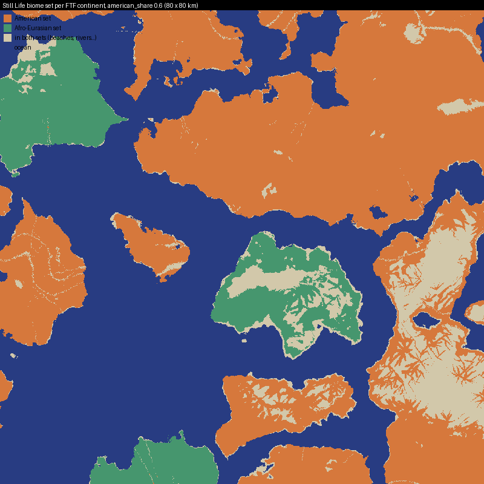
*Still Life biome set per FTF continent at `american_share` 0.6, 80 x 80 km of the test world (biome-map tool, FTF 1.0.0027). Each continent is one set; mountain land shows as "both sets" (peaks and rivers exist in both).*

## 3. Swamps in humid lowland

*4.0. `humid_swamps`, `swamp_humidity`, `swamp_max_height`.*

**Problem.** Still Life's swamps, marshes and fens live in its "wetland" erosion band, which Lithosphere gives to low,
wet land. FTF only marks its own river wetlands (a few spots along rivers), so Still Life's large swamp biomes almost
never appeared.

**Change.** Land that is very humid (FTF humidity at or above `swamp_humidity`), low (at or below `swamp_max_height` on
Lithosphere's scale), not highland and at least ~110 blocks inland (coasts keep their beaches) gets the wetland band.


*12 x 12 km. Left: bridge on; right: `humid_swamps=false`. Wetland-band biomes highlighted; with the rule a very humid lowland becomes a bayou (28% of this map), without it only coastal marsh remains.*

## 4. Dry wetlands: aspen swamps and salt flats

*4.4, surfaces in Still Life 0.3.5-ftf. `aspen_swamps`, `salt_lakes`.*

**Problem.** Two of Still Life's wetland biomes need the wetland band *together with* fairly dry air: `aspen_swamp`
(cool) and `salt_lake` (hot). The humid-swamp rule above never gives dry air, so they never generated. `/ftf locate biome`
found none.

**Change.** On American-set continents (the Afro-Eurasian set has neither biome), inland **flat** ground (at most 4 blocks
between the column and the ground 16 blocks away in four directions) whose climate falls inside one of the two biomes'
climate boxes (taken from Still Life's table, `ASPEN_SWAMP` / `SALT_LAKE`) gets the wetland band in noise-shaped patches a
few hundred blocks across. `1` gives about a quarter of the qualifying land (thresholds measured over several seeds,
`MASK_COVER`/`MASK_THRESHOLD`), `2` about half. Salt flats may sit 25 blocks higher than `swamp_max_height`, because dry
inland basins are often raised.

**Why the Still Life patch too.** Still Life builds both biomes for sea level (Lithosphere drops the wetland band to the
sea): its salt crust is only at Y 62-64 and its aspen-swamp mud only at Y 62. On FTF terrain they sit at any height and
looked like plain desert or forest. The 0.3.5-ftf surface rules work at any height: white calcite crust (dithered with
clay) on dry salt-lake ground, clay under water, mud in aspen swamps (see `still-life-ftf-edition.md`).


*6 x 6 km, cool dry American lowland. Left: bridge on; right: `aspen_swamps=0, salt_lakes=0`. Aspen swamp patches (red) on flat ground.*


*6 x 6 km, hot dry inland. Same comparison: salt flats (red, 15% of this map).*

## 5. FTF lakes as salt lakes

*4.6. `salt_lakes_on_lakes`. `LakeCell`, `mixin/CellMixin`, `mixin/UpliftRiverCarverMixin`, `mixin/TerrainBiomeRoleSelectionMixin`.*

**Problem.** A salt lake should be a lake. FTF has no lake objects: its "lakes" are stretches where a river widens on a
flat step of the water table (`UpliftRiverCarver.getLakeMultiplier`, which multiplies the river bed radius). Their cells
are marked `TerrainType.RIVER` like any river and `Terrain.isLake()` is never true (FTF 1.0.0027 added a
`TerrainType.LAKE`, but nothing assigns it yet). FTF gives river water the nearest river biome
(`TerrainBiomeRoleSelection.resolve`; since 1.0.0027 only submerged cells, and only when the biome chosen there is not
already a river biome). A first attempt in 4.5 keyed on `isLake()` and so never fired.

**Change.**
- A boolean is added to FTF's `Cell` (`LakeCell`, copied in `copyFrom`, cleared in `reset`). Right after FTF carves a
  river bed (`carveZone1Riverbed`), the bridge marks the cell as lake when the river is widened at least 1.5x there.
- In the salt-lake climate, lake cells and ground within 16 blocks of them get the wetland band (on either continent set;
  Afro-Eurasian ones use the American wetland band, where the only possible biome there is the salt lake).
- A biome in the tag `stilllife_ftf_bridge:lake_biomes` (`still_life:salt_lake`) counts as a river biome in FTF's
  river-water check, so the lake keeps its biome (`@WrapOperation` on the second `Holder.is(TagKey)` call in `resolve`,
  the one in the river/lake branch; 4.x wrapped `Terrain.isRiver()`, which 1.0.0027 no longer calls there).

**Checked** on the harness: 46k salt-lake columns around a test lake; render and cross-sections. Re-checked on 1.0.0027.

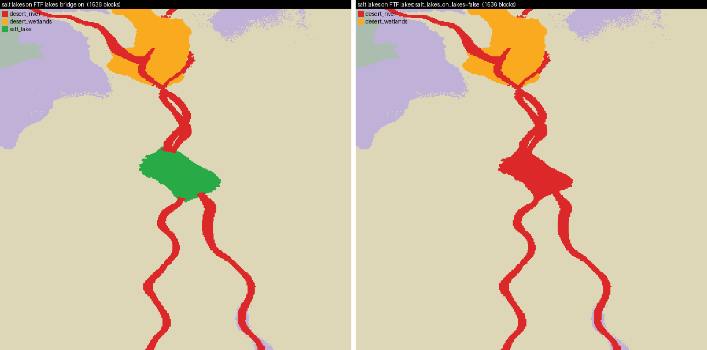
*1.5 x 1.5 km around the test lake. Left: bridge on (the lake is `salt_lake`); right: `salt_lakes_on_lakes=false` (FTF gives it its river biome).*

## 6. Wetland biomes keep their water

*5.0. `keep_wetland_biomes`. `mixin/TerrainBiomeRoleSelectionMixin`, tag `stilllife_ftf_bridge:wetland_biomes`.*

**Problem.** Up to 1.0.0025 FTF left the biome of its wetlands alone. 1.0.0027 re-picks the biome of submerged wetland
cells: it keeps the chosen biome only if FTF recognises it as a wetland (`WetlandBiomeTags.isWetland`: the tags
`c:is_swamp`, `c:swamps`, `c:is_wetland`, `c:wetlands`, or a name containing swamp, wetland, marsh, bog, bayou or fen), and
otherwise takes the nearest such biome. Still Life's `c:is_swamp` tag and those names cover most of its wetlands, but not
the muskegs (`muskeg`, `snowy_muskeg`, `frozen_muskeg`), `floodplain`, `flooded_prairie`,
`flooded_tropical_deciduous_rainforest`, `marl_prairie` or `salt_lake`: their water would have become patches of bog, fen or
marsh inside the biome.

**Change.** Every Still Life wetland-band biome (the 23 in `has_wetland_pools`, plus `lake_biomes`) also counts as a
wetland in that check (`@WrapOperation` on the `WetlandBiomeTags.isWetland` call in `resolve`).


*1.2 x 1.2 km, an FTF wetland in a frozen muskeg. Left: bridge on; right: `keep_wetland_biomes=false`: FTF replaces the frozen muskeg water with temperate rainforest wetlands.*


*Same for a flooded tropical forest wetland: without the setting its water turns into mangrove marsh.*

## 7. Lakes filled to their banks

*4.7.0, `lake_min_depth` in 4.7.1. `lake_fill`, `lake_min_depth`. `mixin/UpliftRiverCarverMixin`.*

**Problem.** Most FTF lakes were ringed by a dry shelf 20-40 blocks wide, exactly at water level, between the water and
the bank. A cross-section of a test lake (water at Y 88) showed ground at Y 88 for 25-35 blocks on each side. Two causes,
both in FTF:

1. FTF clears the lake to its width-noise-varied radius (`zone1Radius`, which includes `biasedScale`) but shapes the bed
   for the river's plain width (`carveZone1Riverbed` is passed `scaleFactor` 1, not `biasedScale`). Wherever the noise
   widens the lake, the outer ring of the cleared area has no bed depth: it stays flat at water level.
2. A water column's floor block is the block the bed height reaches into, rounded *up* (measured by dumping FTF's cells
   along a transect and comparing them with the generated blocks). A bed less than one whole block under the surface
   block therefore ends flush with the water surface and stays dry.

**Change.** In lake stretches (blended in as the river widens from 1x to 1.5x, so ordinary river beds are unchanged):
the bed is shaped for the full cleared width (`@ModifyArg` on the `carveZone1Riverbed` call), and the bed stays at least
`lake_min_depth` whole blocks under the water surface block (`@ModifyReturnValue` on `carveZone1Riverbed`).

**Checked**: the test lake's water area grew 46% (24.9k to 36.4k columns) and now reaches within ~2 blocks of the bank; the
banks and the ridge around the lake are unchanged. With depth 1 a quarter of the lake was 1-block shallows that looked
white over the salt crust; 2 (the default since 4.7.1) reads as water.

**FTF 1.0.0027** rewrote the river carver (natural valley sides, no terraces) but still shapes the bed with `scaleFactor`
1, so the shelf is still there: on the same test lake `lake_fill` still adds about a quarter more water.

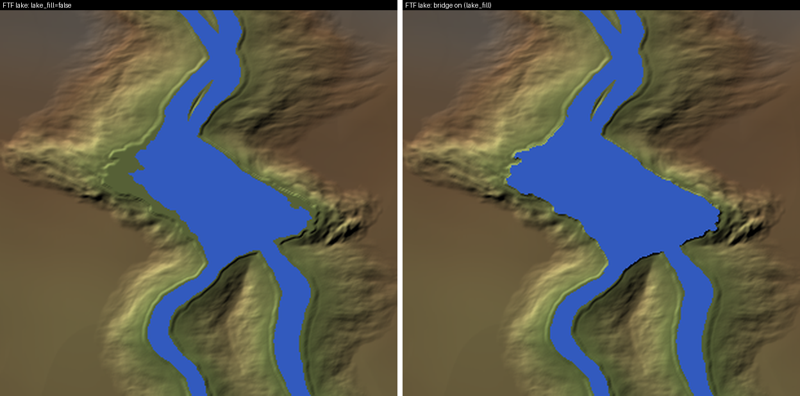
*The test lake, raw FTF terrain cells (hillshade). Left: `lake_fill=false` (dry shelf at water level around the lake); right: bridge on.*

## 8. Standing water in wetlands

*4.5. `wetland_pools`. `WetlandPoolsFeature`.*

**Problem.** Still Life floods its swamps, marshes, bogs and fens only at sea level (its surface rules put water and mud
at Y 62-63), because Lithosphere drops them there. They are meant to be filled in by Lithosphere's terrain; FTF has no such
hook, so above sea level they were dry forests.

**Change.** A feature (lakes step, added to the 23 Still Life wetland biomes in tag `stilllife_ftf_bridge:has_wetland_pools`
by a NeoForge biome modifier) places noise-shaped pools from a few to twenty blocks across in the top ground block, 1-2
blocks deep, with a mud bed and a muddy rim. A column only becomes water where all four neighbours reach at least as high,
so a pool is always held by ground and never spills down a slope; the decision depends only on the terrain, so pools match
across chunk borders.

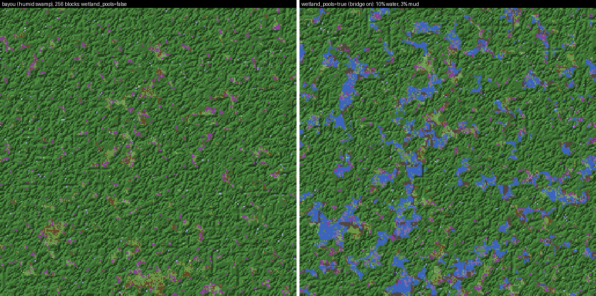
*256 x 256 blocks of a bayou (a humid-lowland swamp), top blocks. Left: `wetland_pools=false` (dry forest floor); right: bridge on (pools on 10% of the ground, mud rims).*

## 9. Snow on peaks

*4.0. `snow_caps`, `snow_cliff_steepness`. `SnowCaps`, `mixin/ScreeFeatureMixin`, `mixin/DecorateSnowFeatureMixin`.*

**Problem.** Still Life puts snow blocks on its snowy peaks with surface rules. FTF's erosion decorator erodes snow, powder
snow and gravel (its `erodible` tag): above its rock line it turned that snow into stone, on slopes into tuff, in its dirt
band into moss or coarse dirt. Its snow decorator also cleared snow layers off any slope steeper than 0.45 above Y 95 (a
height made for 256-block worlds), so in tall worlds almost no snow survived on mountains.

**Change.** The erosion decorator skips columns topped with snow unless they are cliffs (steeper than
`snow_cliff_steepness`, or FTF's rock steepness when 0), and the snow decorator only clears cliffs.

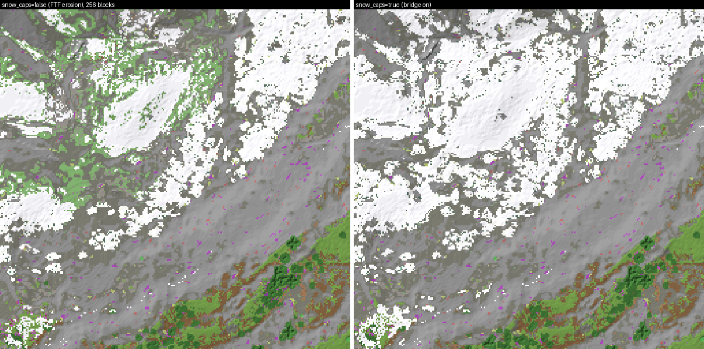
*256 x 256 blocks of peaks near the test spawn, top blocks. Left: `snow_caps=false` (FTF turns snow into moss, tuff and stone); right: bridge on. Snow above Y 450: 34% vs 49% of columns.*

## 10. Rivers start below mountains

*4.0. `river_headwaters`, `river_mountain_height`, `river_fade_in`. `RiverHeadwaters`, `mixin/UpliftRiverCarverMixin`, `mixin/NetworkMixin`.*

**Problem.** FTF's rivers are warped straight lines from the continent's interior to the sea that ignore the terrain, so
they slice deep canyons through mountain ranges. Still true in 1.0.0027 (its own `MountainRiverCutTest` checks that rivers
cut through mountains), now as wide V-shaped valleys.

**Change.** Once per river, its course is sampled every 48 blocks on FTF's terrain before any river carving; the last
point (going downstream) where the ground is more than `river_mountain_height` above the river's water is found, and the
river is only carved below it. Over `river_fade_in` blocks it fades in from a dry valley (which keeps the land's own
terrain type and biome) to a full river. A branch that would join its parent upstream of the parent's new start has
nowhere to flow and is dropped too (`NetworkMixin` tells each branch which river it joins).

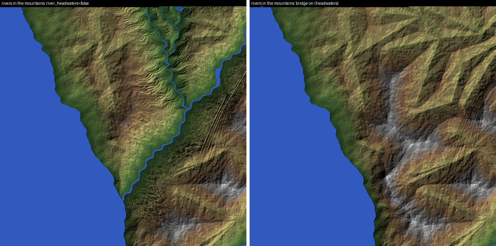
*6 x 6 km of coastal mountains, raw FTF terrain. Left: `river_headwaters=false` (a river valley cut through the range); right: bridge on (the river is dropped, the mountains stay).*

## 11. Wetlands stay off hillsides

*4.0, own setting in 5.0. `wetland_max_height`. `mixin/WetlandMixin`.*

FTF's wetlands flatten everything within their radius to water level, so where one touches a hill it digs a pit into it
(still so in 1.0.0027: without this, cell maps of the test area showed wetland pits up to 380 blocks deep in mountain
sides). Ground up to half of `wetland_max_height` (default 48) above the wetland's water is shaped normally, ground more
than the full value above it is left alone, and in between the wetland fades out; 0 turns this off. Up to 4.8 the limit was
`river_flank_max_cut`; worlds made then keep their saved value.


*2.4 x 2.4 km of mountainside. Left: `wetland_max_height=0` (FTF flattens a wetland into a pit up to 381 blocks deep); right: bridge on.*

## 12. The coastal uplift cliff

*4.8.0. `uplift_smoothing`. `UpliftSmoothing`, `mixin/UpliftContinentGeneratorMixin`.*

**Problem.** Long, flat-topped "plateau ridges" ran for kilometres parallel to coasts: a 40-100 block cliff with lowland on
the sea side and high land behind. It was first taken for FTF's plateau terrain, then for its tectonic plate uplift
(`tectonicPlateUplift`: setting it to 0 removed the ridge, but also lowered a third of the land by 50-95 blocks). Dumping
FTF's raw cells across the cliff showed the real cause: the water table (which also lifts the land) drops from ~Y 150-166
to sea level between two neighbouring cells. In `UpliftContinentGenerator.apply`, FTF replaces the uplift by a "custom
peak" from the coast distance wherever that value is below 0.05:

```java
float customPeak = shiftAndRemap(cell.controlPoint, levels.water);
if (customPeak < 0.05F && customPeak < upliftGradient) upliftGradient = customPeak;
```

So within a band along every coast the uplift is forced to nearly zero, and where raised land meets that band it ends in
a cliff.

**Change.** Beyond the band, the uplift is capped by a value that climbs from the band's edge back to full uplift over
`uplift_smoothing` blocks (`@WrapOperation` on the write to `cell.waterTable`). Coastlines, the land seaward of the old
cliff and everything farther inland are unchanged. FTF's water table is stepped (15 plateaus, `ContinentalHydrology`),
so the ramp shows as a staircase of ~10-block terraces; 1600 blocks spreads them 150-250 blocks apart, like river benches.

**Checked** on raw terrain maps of 3 x 3 km at the cliff: cell-to-cell height jumps over 20 blocks went from 704 to 0;
4.7% of the area changed (lowered by up to ~80 blocks near the old cliff top). FTF 1.0.0027 keeps the same code: on the
same map the biggest jump between cells 4 blocks apart is 48 blocks without smoothing and 14 with it.

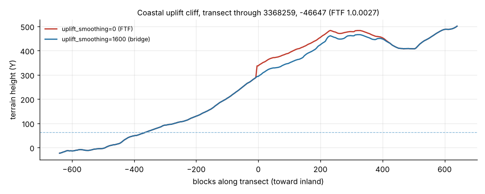
*Height along a transect through the cliff at the test spawn (FTF 1.0.0027): a 48-block step without smoothing, a slope with it.*

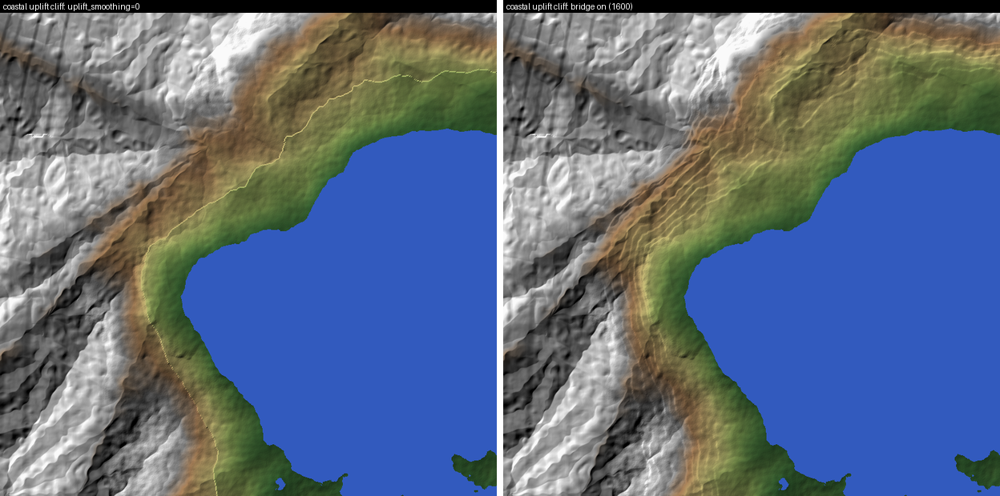
*3 x 3 km at the test spawn, raw FTF terrain. Left: `uplift_smoothing=0` (the thin bright line is the cliff); right: 1600.*

## 13. VanillaBackport biomes

*4.2. `pale_garden`, `dappled_forest`, `sulfur_caves`. `VanillaBackportBiomes`, `mixin/MinecraftBiomeSourceGraphsMixin`.*

VanillaBackport adds the Pale Garden, Dappled Forest and Sulfur Caves to vanilla's layout, which Still Life replaces. The
bridge adds them to the layout FTF places biomes from (`MinecraftBiomeSourceGraphs.multiNoiseRoot`) by taking a humidity
band from chosen Still Life biomes: the Pale Garden the most humid part of temperate old-growth and mixed-wood forests,
the Dappled Forest the drier cool part of temperate forest, wooded prairie, aspen woodlands and inland mixed forest, the
Sulfur Caves thin bands of Still Life's barren caves. Each setting scales its band (1 = standard, 0 = none, 2 = about
double). Before 4.2 the Still Life patch wrote these into Still Life's table; now the amounts can be changed per world.


*6 x 6 km. Left: bridge on (`pale_garden` 0.18); right: amounts 0.*

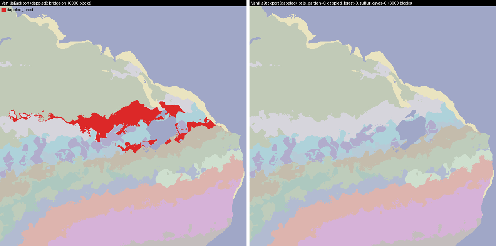
*Dappled Forest (`dappled_forest` 0.5) vs 0.*

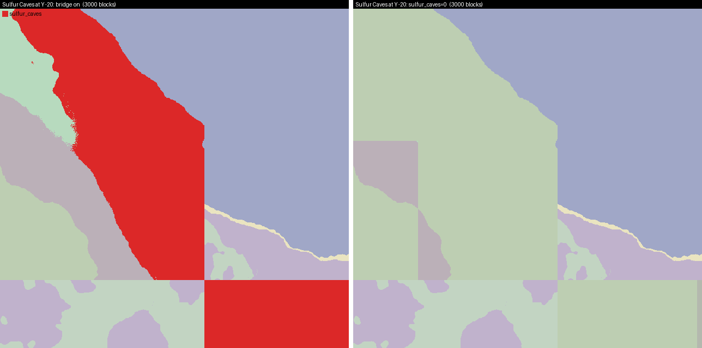
*Sulfur Caves at Y -20 (`sulfur_caves` 0.5) vs 0. The square shapes are FreeTerraForged's underground biome banding (cave biomes are laid out in square cells), not the bridge.*

## 14. Sulfur Caves rock

*4.3, own setting in 5.0. `sulfur_rock`. `SulfurRockFeature`.*

VanillaBackport paints the Sulfur Caves with a surface rule driven by a 3D noise. FTF doesn't run VanillaBackport's surface
rule and skips surface rules for rock far from open space, so the caves were plain stone. The bridge places the same rock
as the first feature step, before VanillaBackport's sulfur pools and spikes: base stone becomes cinnabar where the
`sulfur_cave_gradient` noise is in [-0.4, -0.1] or above 0.4, and sulfur in [0, 0.4] (VanillaBackport's own thresholds).


*A horizontal slice at Y -20 through a Sulfur Cave (128 x 128 blocks). Left: `sulfur_rock=false` (plain deepslate); right: bridge on (sulfur yellow, cinnabar red).*

## 15. Removed in 5.0: no longer needed with FTF 1.0.0027

### Even valley sides (`river_flank_max_cut`, `river_flank_slope`, 4.0-4.8)

**Was:** FTF 1.0.0025 faded a river valley out to the land over a fixed width with terraced steps, so in tall terrain it
sheared 100+ blocks off hill and mountain sides as walls. The bridge let carving lower the land by at most 48 blocks,
relaxed along a 45-degree slope from the bank (`@ModifyVariable` on `finalHeight` in `UpliftRiverCarver.carve`).

**Why removed:** 1.0.0027 replaced the terraces with natural valley sides of about 24 degrees (`carveValleySlopeFadeout`,
slope ratio 2.2) that reach out as far as the terrain needs (up to 1100 blocks). The bridge's limit, applied on top, only
cut that slope off: it left a terrace edge around each valley where the 48-block limit took over, and steeper valley
floors. Cell maps with and without it, at an inland lake and two coastal rivers: valley-floor slopes (median) 0.43-0.52
without it against 0.49-0.85 with it; everywhere else the same or within noise. A world's saved
`river_flank_max_cut` / `river_flank_slope` no longer shape valleys; the wetland limit it also set is now
`wetland_max_height` (section 11).


*A coastal river on FTF 1.0.0027, raw terrain. Left: without the flank limit (FTF's own valley); right: with it (48 blocks, slope 1): the terrace edge around the valley.*

### /ftf locate biome (4.4-4.8)

**Was:** `/ftf locate biome` failed with "An unexpected error occurred" (tooltip `spawnSearch`, a NullPointerException):
`FTFBiomeLocateQuery.isolateSampler` copied the world's spawn-search setting onto a private climate sampler with
`Objects.requireNonNull`, and that setting is empty unless the world's spawn was chosen in this session. The bridge skipped
copying an empty one.

**Why removed:** FTF 1.0.0027 fixed it itself (the setting may now be empty and falls back to a default), so the hook had
nothing left to do.

## How the images were made

All on a headless NeoForge 21.1.265 server with FreeTerraForged 1.0.0027, Worldgen Accelerator 0.63.4, VanillaBackport 1.2.2
and Still Life 0.3.5-ftf, the same seed and preset, and the settings of the tested world; each pair changes one option.
- **Raw terrain** (hillshaded heights, blue = water): a debug build of the bridge dumps FreeTerraForged's terrain cells over
  an area in seconds, without generating chunks.
- **Biome maps**: the same debug build asks the game's biome source for the biome at the surface (or a given Y) of every
  sample point, so these are the biomes chunks would get. Highlighted biomes are coloured, the rest faded.
- **Block images** (snow, sulfur, climate): chunks generated with Chunky and read back from the region files.
