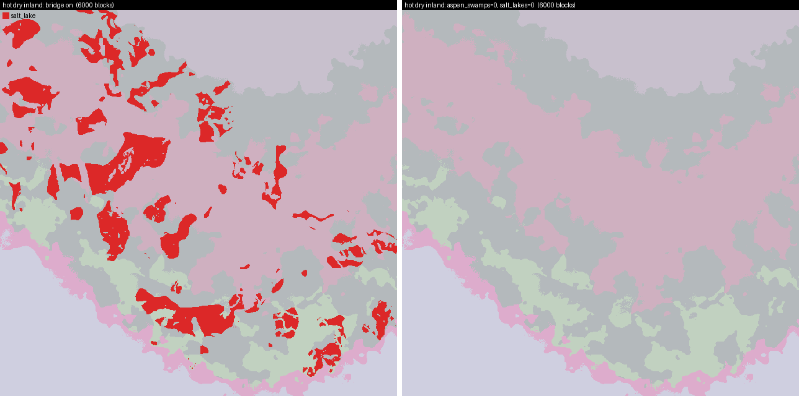
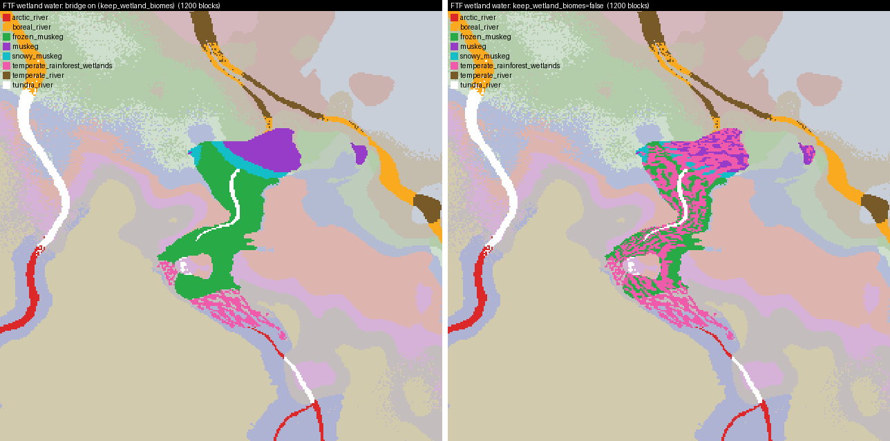
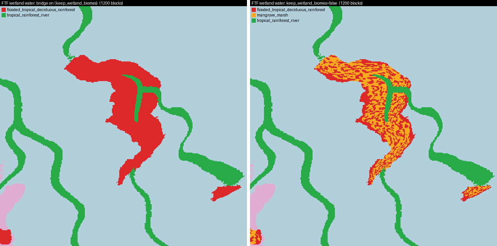
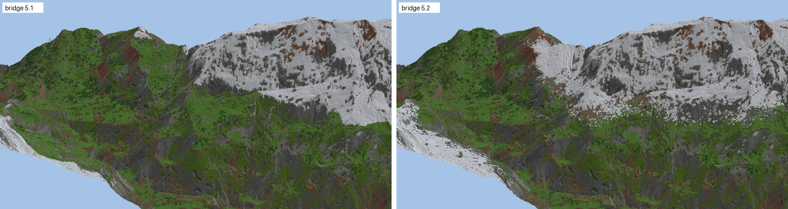
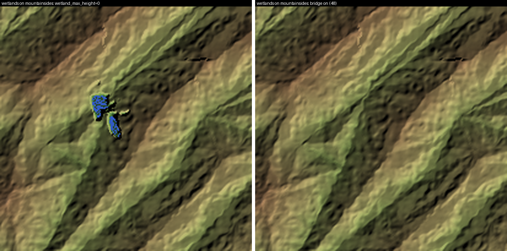
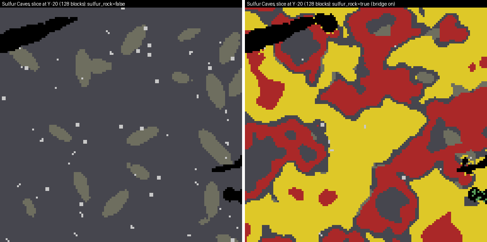
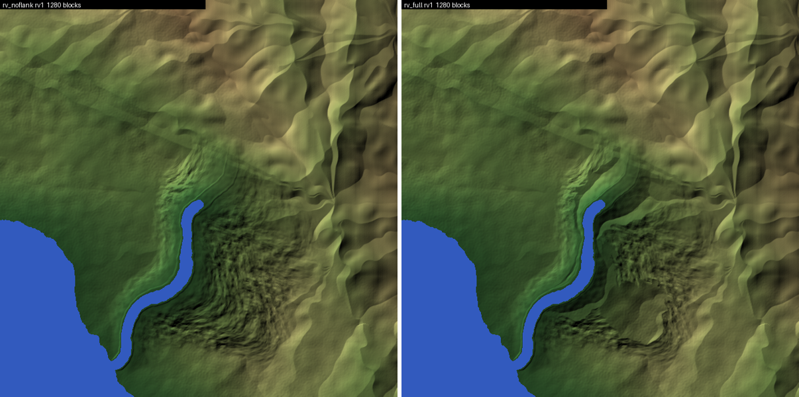

# The bridge, feature by feature

Each section says what was wrong, why, what the bridge changes (with the FreeTerraForged code it hooks into) and how it was
checked, with a bridge-on / bridge-off image (same seed, preset and settings, only the one option changed; see "How the
images were made" at the end). FreeTerraForged (FTF) class names are from FTF 1.0.0027-1.0.0032 (bridge 5.x; bridge 4.x
was built on 1.0.0025); the bridge's own classes are in `common/src/main/java/stilllife/ftfbridge`. Version numbers say
when a feature came in (see `CHANGELOG.md`).

Bridge 5.1 keeps out of FTF's lakes and rivers (section 13): of the 11 hooks into FTF code in 5.0, 7 are left, so that the
bridge keeps working as FTF changes and FTF's own terrain stays as its developer means it.

**NeoForge and Fabric (5.3).** Everything in this document is shared code (`common/`) and works the same on both loaders.
FTF's code is the same on both, and every mixin hooks FTF's own classes by name, so the mixins need no changes. Only the
start-up differs: `neoforge/` and `fabric/` each hold one entry point that hands the shared code the loader's config folder
(`Platform`), registers the two features (wetland pools, sulfur rock) and adds them to their biomes (NeoForge: the biome
modifier files in `neoforge/.../biome_modifier`; Fabric: Fabric API's `BiomeModifications`), and opens and closes the
world's settings when a world starts and stops. Fabric runs Minecraft with its own names for classes and methods
(`class_2791` for `ChunkAccess`), so the Fabric jar is remapped to them when it is built (Fabric Loom in the Gradle build,
`tools/RemapJar.java` in `tools/build-javac.sh`). Checked by generating the same areas on a NeoForge and a Fabric server
with the same seed, preset and world settings: a snowy mountainside (biomes 99.9% identical, snow in the caps 55.7% on
both) and a salt lake (99.5% of surface blocks identical, water 26.0% on both); the differences are in single columns at
biome edges and in trees, about as large as between two runs on the same loader.

Every option that changes terrain or biomes is **saved per world** (`WorldLock`, `<world>/stilllife_ftf_bridge.json`),
because a world whose settings change halfway would generate chunks that don't match. Worlds made before an option existed
keep it off. Every hook into FTF that is not essential is optional (`require = 0`): if a future FTF changes that code, the
feature switches itself off instead of stopping the game; `FtfCompat` checks the essential ones at start-up and fails with
a readable message.

- [1. Climate translation](#1-climate-translation)
- [2. Latitude, continents and biome sets](#2-latitude-continents-and-biome-sets)
- [3. Swamps in humid lowland](#3-swamps-in-humid-lowland)
- [4. Dry wetlands: aspen swamps and salt lakes](#4-dry-wetlands-aspen-swamps-and-salt-lakes)
- [5. Wetland biomes keep their water](#5-wetland-biomes-keep-their-water)
- [6. Standing water in wetlands and salt lakes](#6-standing-water-in-wetlands-and-salt-lakes)
- [7. Snow on peaks](#7-snow-on-peaks)
- [8. Wetlands stay off hillsides](#8-wetlands-stay-off-hillsides)
- [9. The coastal uplift cliff](#9-the-coastal-uplift-cliff)
- [10. VanillaBackport biomes](#10-vanillabackport-biomes)
- [11. Sulfur Caves rock](#11-sulfur-caves-rock)
- [12. Cave floors](#12-cave-floors)
- [13. Removed in 5.1: FTF's lakes and rivers left to FTF](#13-removed-in-51-ftfs-lakes-and-rivers-left-to-ftf)
- [14. Removed in 5.0: no longer needed with FTF 1.0.0027](#14-removed-in-50-no-longer-needed-with-ftf-100027)

## 1. Climate translation

*3.0, refined in 4.x. `StillLifeClimateBridge`, `mixin/SamplerDecorationMixin`.*

**Problem.** Still Life is a multi-noise biome layout: thousands of entries, each a box in six climate parameters
(temperature, humidity, continentalness, erosion, depth, weirdness) and a biome. It was written for Lithosphere, whose
terrain produces those parameters in a particular way: continentalness rises with distance from the coast, erosion splits
the world into lowland and highland bands (and into Still Life's two biome sets), weirdness encodes peaks and valleys,
depth is the distance below the surface. FTF also gives Minecraft six numbers, but computes them from its own terrain, so
Still Life's table read them wrongly: biomes ended up by the wrong rules (inland beaches, highland biomes in valleys).

**Change.** The bridge hooks the point where FTF hands a climate point to the biome lookup
(`WorldgenPlans.SamplerDecoration.sample`, a `@ModifyReturnValue`) and rewrites it from FTF's terrain cell at that
position (`CellSampler.getCachedOrLookup`):

- **Continentalness** from FTF's `controlPoint` (its distance to the coast; called `continentEdge` before FTF 1.0.0027),
  mapped through a table so that the coast, 50, 110, 170, 320, 690, 1180 and 1380 blocks inland land on the
  continentalness values Lithosphere has at those distances. Oceans keep FTF's value.
- **Height scale.** Still Life's height-dependent choices assume Lithosphere's heights. The bridge samples FTF's terrain
  of the world once (a 32 x 32 km grid), takes the height percentiles of land, and maps them onto Lithosphere's percentiles
  (`Y_LITHO`), so "the highest 5% of land" means the same in both. The result is saved in the world's settings file
  (`heights`, `coast_edge`) and only re-measured if the preset's terrain changes.
- **Erosion** = the biome-set half (-0.5 American / +0.5 Afro-Eurasian) plus Still Life's band offsets for lowland,
  highland (FTF's highland terrain category) and wetland.
- **Weirdness** = a ridge magnitude from the mapped height (peaks, slopes, valleys as Still Life expects), with a
  per-region sign so both of Still Life's variants appear. Since 5.2 the height used for the mountain bands wanders (see
  [section 7](#7-snow-on-peaks)).
- **Depth** rescaled from FTF's to Lithosphere's (`LITHO_DEPTH`), so cave biomes sit at the depths Still Life meant. Since
  5.5 as a share of the column (see [Cave biome depth](#cave-biome-depth-55)).

**Checked** on generated worlds: biome maps per height band and per distance from the coast, compared with the same seed
on Lithosphere + Still Life.

**FTF 1.0.0027** made its own climate numbers closer to vanilla's (a `continentalness` in vanilla's bands, a weirdness that
keeps coasts out of the valley band, perlin instead of worley macro-biome noise). None of that reaches Still Life: the
bridge still writes its own continentalness, erosion, weirdness, depth and (with `latitude=still_life`) temperature, and only
takes humidity from FTF, which did not change. The translation is still needed because Still Life's table follows
Lithosphere's numbers, not vanilla's.


*Coast at the test spawn, generated chunks, one colour per biome (yellow = beach). Bridge on with `latitude=ftf`, bridge on with `latitude=still_life`, bridge off (FTF 1.0.0027's own climate numbers): beaches on 98% / 98% / 3% of the shoreline.*


*Inland at the test wetland: with the bridge off, salt lake covers 12% of dry land and FTF's wetland water turns into river biome.*

### Cave biome depth (5.5)

*`column_depth`. `StillLifeClimateBridge`.*

**Problem.** Since 1.0.0023 FTF's depth number is not blocks but the share of the column below the surface:
1.5 x (surface - y) / (surface + world depth), so 1.5 at the world's bottom whatever the surface height. Bridge 5.0-5.4 read
it as 1/128 per block (vanilla's scale) and looked that up in `LITHO_DEPTH` (Lithosphere's depth every 16 blocks). Under
high ground that made every point look much shallower than it is (under a surface at Y 540, 64 blocks down read as 20), so:
- FTF, which fades cave biomes in over the first 28 blocks' worth of depth, started them later: with the bridge the
  same cells began 0-48 blocks deeper than with FTF alone (coverage 1.0, 9 cells at ground Y 407-611: 32-128 blocks instead
  of 32-80);
- the depth never reached Still Life's deepest band (1.0-1.1), so its deepest cave biome, Haunted Depths, and the deep
  entries of Deep Dark never appeared.

**Change.** The share of the column is mapped onto the Lithosphere column under the same Still Life height: a point a
third of the way from the surface to the world's bottom gets the depth a point a third of the way down a Lithosphere column
of that height (down to Y -64) would have. Every column then has Still Life's cave bands in order from the surface to
bedrock, with the deepest ones near the bottom under high ground, as in Lithosphere.

**Checked** (tester's preset, coverage 1.0, 1,681 chunks around a snowy peak, ground around Y 514): cave biomes start at
32-64 blocks below the ground (7 of 8 cells; one with few caves at 224 in every setup), never deeper than with FTF alone.
Share of cave biome by depth below the ground, 5.4 / 5.5 / FTF alone with Minecraft's biomes: 32-63 blocks 23% / 62% /
47%, 64-95 blocks 54% / 100% / 94%. Below about 400 blocks 5.5 has Deep Dark (12-44%) and Haunted Depths (3-21%, most at
the bottom); 5.4 had neither. Worlds made before 5.5 keep the old depth (`column_depth` false), so their new chunks match.

### Beaches

*5.0. `beach_max_height`, `beach_shallows`.*

**Problem.** Still Life's beach biomes are coastal points (continentalness up to 0.02) in a narrow weirdness band (0.05-0.08),
and its beach surface rule only lays sand (gravel on cold beaches) below Y 65. On Lithosphere that band is land within about
12 blocks of the sea plus the shallow water in front of it. The height mapping above is by rank: FreeTerraForged's lowest
~28% of land, which Lithosphere keeps below Y 75, reached Y 128 in the test world, so beach biomes climbed whole coastal
slopes as grassland (at one test spot 100% of the land in a 384-block square, 29 blocks above the sea on average, 1% sand),
while the sea stayed ocean biome right up to the shore. A preset can't change this: the bridge measures every world's heights
and coast distances, so moving the preset's coast control points left the beaches where they were. Sondre's bridge 3.3.0
takes another route (it adds beach biome to low land and shallow sea within set distances of the shore) but keeps the same
height mapping, and at the test spot gave the same result as 5.0 without this fix.

**Change.** Coastal land in the beach band more than `beach_max_height` blocks above the sea gets the band just above it
(the land's own inland biome), and sea up to `beach_shallows` blocks deep (not deep ocean) gets the beach band. The defaults
come from Still Life's own beaches: in a Lithosphere + Still Life world made with the same mods, half of the beach land was
within 2 blocks of the sea and 90% within 9, and 56-63% of the coastal water was beach biome, 2-4 blocks deep.

**Checked** at the same spot and at the test spawn's coast: beach land 3/6 blocks above the sea (median / 90%) instead of
29/41 and 18/39; beach biome on half of the coastal water instead of 2%; 5 km of coast below.


*Top blocks, red line = edge of the beach biome. Left: Still Life's own beach (Lithosphere + Still Life, taiga beach with
gravel); middle: the bridge before this fix at the same FTF spot (all of it "beach" grassland); right: with `beach_max_height`
8 and `beach_shallows` 4 (a band along the shore and the shallow water in front of it).*


*Beach biomes along 5 km of FTF coast: before the fix (300-1000 blocks wide, up to Y 130) and after (median Y 64).*

## 2. Latitude, continents and biome sets

*3.x; blended borders 5.1; regions and halves 5.4. `latitude`, `pole_distance`, `american_share`, `biome_set_blend`,
`biome_sets`, `biome_set_region_size`.*

- `latitude=still_life` gives Still Life's own climate: one equator and colder bands toward the poles, `pole_distance`
  blocks away. `ftf` keeps FTF's repeating temperature bands (with altitude cooling).
- Still Life has two complete biome sets (American and Afro-Eurasian). Lithosphere chooses them by region; the bridge
  rolls once per FTF continent (`continentId`), so each continent has one consistent set, `american_share` of them American.


*Still Life biome set per FTF continent at `american_share` 0.6, 80 x 80 km of the test world (biome-map tool, FTF 1.0.0027). Each continent is one set; mountain land shows as "both sets" (peaks and rivers exist in both).*

**Blended borders (5.1).** FTF's continents are Voronoi cells, and where two of them share land their border is a long,
nearly straight line. With one set per continent, every biome switched along that line: on one side salt lakes and cacti
savanna (American), on the other xeric shrubland (Afro-Eurasian), with temperature and humidity the same on both sides
(found in a test world from a straight biome edge several kilometres long). Now the set is read from the continent at a
point moved by a smooth warp of up to about `biome_set_blend` blocks (two noises with ~256-block features) plus a small
random jitter per 4-block cell. Near a border the switch wanders back and forth and frays into a dithered edge, like FTF's
other biome edges; away from borders the moved point is on the same continent and nothing changes. The continent at the
moved point comes from FTF's continent generator (`Heightmap.continent().apply`, a Voronoi lookup, not a full terrain cell).
0 gives the sharp border.

**Both sets on one continent (5.4).** With one set per continent, a world with a single FTF continent (continent type
SINGLE, or a preset with very large continents) only ever gets one of Still Life's two sets. `biome_sets` chooses the layout:

- `continents` (default, as before): one set per continent; `american_share` is the share of continents.
- `regions`: every continent is divided into irregular regions, each American or Afro-Eurasian, as Lithosphere does for
  Still Life's own worlds. Regions are the cells of a jittered grid (each point belongs to the nearest of nine jittered
  grid points), `biome_set_region_size` percent of an average continent's land in area: 25 gives about four regions per
  continent. The land of an average continent is measured once per world from FTF's continent map (the land of every
  continent whose centre lies within 1.5 continent cells of the origin) and kept in the world's settings
  (`continent_land_area`), so the regions never change size in that world.
- `halves`: every continent is American west of a line and Afro-Eurasian east of it. The line wanders by up to about a
  sixth of the continent's width, so it is not a straight north-south cut.

In `regions` and `halves`, `american_share` is the share of **each continent's own land**: the first time a continent is
needed, the bridge samples its land (96 x 96 points over 1.5 continent cells each way from its centre) and sets the region
threshold, or the line, so that this share of that continent is American. Regions stay whole, so the share is met to the
nearest region. At 0.5 every continent is half and half, not just the world on average.
`biome_set_blend` frays the borders between regions and halves the same way it frays continent borders.

**Checked** on the tester's preset switched to continent type SINGLE (one continent of about 306 km² of land) and on the
tester's own world (UPLIFT, many continents, 341 km² of land on average), with biome maps of the game's biome source
(counting land whose biome belongs to one set only). The single continent: `continents` 0% American (one roll),
`regions` at `american_share` 0.5 50% in three regions about 8.7 km across, at 0.3 27%, `halves` about 50%. The eleven
continents wholly inside a 98 x 98 km map of the tester's world: `continents` 100% or 0% each, `regions` 44-59% on all but
a small one (32%), `halves` 36-67% (the wandering line moves some land across). With `continents`, biomes match 5.3 (99.96% of a test area). On generated chunks,
`regions` gives the same biomes on NeoForge and Fabric (99.96%).


*The single continent (48 x 48 km, land coloured by the Still Life set of its biome: orange American, green Afro-Eurasian, grey biomes in both sets such as peaks and rivers). Left to right: `biome_sets` continents, regions (25%), halves; `american_share` 0.5.*


*6 x 6 km around a border between an American and an Afro-Eurasian continent (red dots: the border), one colour per biome. Left: `biome_set_blend=0`; right: 384.*

## 3. Swamps in humid lowland

*4.0. `humid_swamps`, `swamp_humidity`, `swamp_max_height`.*

**Problem.** Still Life's swamps, marshes and fens live in its "wetland" erosion band, which Lithosphere gives to low,
wet land. FTF only marks its own river wetlands (a few spots along rivers), so Still Life's large swamp biomes almost
never appeared.

**Change.** Land that is very humid (FTF humidity at or above `swamp_humidity`), low (at or below `swamp_max_height` on
Lithosphere's scale), not highland and at least ~110 blocks inland (coasts keep their beaches) gets the wetland band.


*12 x 12 km. Left: bridge on; right: `humid_swamps=false`. Wetland-band biomes highlighted; with the rule a very humid lowland becomes a bayou (28% of this map), without it only coastal marsh remains.*

## 4. Dry wetlands: aspen swamps and salt lakes

*4.4, surfaces in Still Life 0.3.5-ftf, salt lake flatness 5.1. `aspen_swamps`, `salt_lakes`, `salt_lake_max_relief`.*

**Problem.** Two of Still Life's wetland biomes need the wetland band *together with* fairly dry air: `aspen_swamp`
(cool) and `salt_lake` (hot). The humid-swamp rule above never gives dry air, so they never generated. `/ftf locate biome`
found none.

**Change.** On American-set continents (the Afro-Eurasian set has neither biome), inland **flat** ground whose climate
falls inside one of the two biomes' climate boxes (taken from Still Life's table, `ASPEN_SWAMP` / `SALT_LAKE`) gets the
wetland band in noise-shaped patches a few hundred blocks across. Flat means at most 4 blocks between the column and the
ground 16 blocks away in four directions for aspen swamps, and at most `salt_lake_max_relief` (default 2) for salt lakes.
`1` gives about a quarter of the qualifying land (thresholds measured over several seeds, `MASK_COVER`/`MASK_THRESHOLD`),
`2` about half. Salt lakes may sit 25 blocks higher than `swamp_max_height`, because dry inland basins are often raised.

**Why salt lakes need flatter ground (5.1).** With standing water (section 6) a salt lake should look like a sheet of
shallow water on a white flat. FTF's "flat" land is often a gentle slope of 1-block terraces: a test salt lake at relief 4
climbed 30 blocks (Y 103-132) with a step every 6-8 blocks, and since water cannot cross a step, its water could only lie in
bands along each terrace. At relief 2 that lake shrank to a sixth of its area, onto the flat part, and salt lakes in
general became fewer and flatter; 4 gives the 5.0 layout.

**Why the Still Life patch too.** Still Life builds both biomes for sea level (Lithosphere drops the wetland band to the
sea): its salt crust is only at Y 62-64 and its aspen-swamp mud only at Y 62. On FTF terrain they sit at any height and
looked like plain desert or forest. The 0.3.5-ftf surface rules work at any height: white calcite crust (dithered with
clay) on dry salt-lake ground, clay under water, mud in aspen swamps (see `still-life-ftf-edition.md`).


*6 x 6 km, cool dry American lowland. Left: bridge on; right: `aspen_swamps=0, salt_lakes=0`. Aspen swamp patches (red) on flat ground.*


*6 x 6 km, hot dry inland, bridge 5.1. Left: bridge on (`salt_lake_max_relief` 2); right: `aspen_swamps=0, salt_lakes=0`. Salt lakes in red: 11% of this map (15% with 5.0's relief 4).*

## 5. Wetland biomes keep their water

*5.0. `keep_wetland_biomes`. `mixin/TerrainBiomeRoleSelectionMixin`, tag `stilllife_ftf_bridge:wetland_biomes`.*

**Problem.** Up to 1.0.0025 FTF left the biome of its wetlands alone. 1.0.0027 re-picks the biome of submerged wetland
cells: it keeps the chosen biome only if FTF recognises it as a wetland (`WetlandBiomeTags.isWetland`: the tags
`c:is_swamp`, `c:swamps`, `c:is_wetland`, `c:wetlands`, or a name containing swamp, wetland, marsh, bog, bayou or fen), and
otherwise takes the nearest such biome. Still Life's `c:is_swamp` tag and those names cover most of its wetlands, but not
the muskegs (`muskeg`, `snowy_muskeg`, `frozen_muskeg`), `floodplain`, `flooded_prairie`,
`flooded_tropical_deciduous_rainforest`, `marl_prairie` or `salt_lake`: their water would have become patches of bog, fen or
marsh inside the biome.

**Change.** Every Still Life wetland-band biome (the 24 in `has_wetland_pools`, salt lake included) also counts as a
wetland in that check (`@WrapOperation` on the `WetlandBiomeTags.isWetland` call in `resolve`).


*1.2 x 1.2 km, an FTF wetland in a frozen muskeg. Left: bridge on; right: `keep_wetland_biomes=false`: FTF replaces the frozen muskeg water with temperate rainforest wetlands.*


*Same for a flooded tropical forest wetland: without the setting its water turns into mangrove marsh.*

## 6. Standing water in wetlands and salt lakes

*4.5; salt lakes and level-ground pools 5.1. `wetland_pools`, `salt_lake_water`, `salt_lake_slope_pools`.
`WetlandPoolsFeature`.*

**Problem.** Still Life floods its swamps, marshes, bogs and fens only at sea level (its surface rules put water and mud
at Y 62-63), and its salt lakes are sea-level flats where Lithosphere's terrain dips just below the water: about a fifth of
the lake is water one block deep over calcite, in wide irregular sheets with round calcite islands (measured on a
Lithosphere + Still Life world: 21% water, sheets up to 16k columns). FTF's terrain puts these biomes at any height, so
they were dry.

**Change.** A feature (lakes step, added to Still Life's 24 wetland-band biomes in tag
`stilllife_ftf_bridge:has_wetland_pools` by a NeoForge biome modifier) places water in the top ground block. Whether a
column becomes water depends only on the terrain and noise, so pools match across chunk borders, and water is only placed
where the ground around holds it, so it never spills.

- **Wetlands:** noise-shaped pool patches from a few to twenty blocks across, 1-2 blocks deep, with a mud bed and a muddy
  rim. Water only sits where the ground is level for 2 blocks around (nothing lower, nothing more than one block higher).
  The parts of a patch on sloping ground become mud, level with the ground. Up to 5.0 a column only needed its four
  neighbours to reach as high, so on a sloped marsh water filled every 1-block step and left grass steps between them:
  stripes of water that looked like broken ground (a test marsh on a slope of 0.7 blocks per block: 16% water, median pool 1-2
  columns).
- **Salt lakes (5.1):** one block of water over calcite, no mud, covering about `salt_lake_water` (default 0.35) of the
  lake: wide, ragged sheets from a noise with 64-128-block features read at a warped point, broken by round calcite islands
  (radius 3-6, like Still Life's salt crust disks), on ground that is level for 2 blocks around. Where the ground is not one
  level for 6 blocks around (a stepped lake), sheets could only lie in bands along each step, so with
  `salt_lake_slope_pools` (default true) the water there comes as small round pools held by their four neighbours instead.

**Checked** on generated chunks: the sloped marsh (16% water in stripes, then 2% water in small level pools and 30% mud);
the bayou below; and salt lakes on the tester's seed and preset: 26% of a flat salt lake under water, in sheets up
to 2,300 columns.


*256 x 256 blocks of a bayou (a humid-lowland swamp), ground under trees and plants. Left: `wetland_pools=false` (dry forest floor); right: bridge on (water on 20% of the ground, mud on 20%).*


*A marsh on a slope (100 x 100 blocks, top blocks, water blue, mud brown). Left: bridge 5.0's rule (water in every held 1-block step); right: 5.1.*


*256 x 256 blocks, salt lake biome bright (water turquoise, calcite white, clay grey). Left: Still Life's own salt lake (Lithosphere + Still Life, sea level); right: a salt lake on FTF with bridge 5.1 (defaults).*

> **Streams Reflowing** restyles other mods' water as its own banks by default (`allWaterBanks=1` in
> `config/streamsreflowing.properties`), which removes these pools and leaves mud rings where they were (salt lake water
> 26% -> 1% on the same lake). Set `allWaterBanks=0`.

## 7. Snow on peaks

*4.0; snow line 5.2. `snow_caps`, `snow_cliff_steepness`, `peak_line_variation`, `snow_cap_fade`. `SnowCaps`,
`mixin/ScreeFeatureMixin`, `mixin/DecorateSnowFeatureMixin`.*

**Problem.** Still Life puts snow blocks on its snowy peaks with surface rules. FTF's erosion decorator erodes snow, powder
snow and gravel (its `erodible` tag): above its rock line it turned that snow into stone, on slopes into tuff, in its dirt
band into moss or coarse dirt. Its snow decorator also cleared snow layers off any slope steeper than 0.45 above Y 95 (a
height made for 256-block worlds), so in tall worlds almost no snow survived on mountains.

**Change.** The erosion decorator skips columns topped with snow unless they are cliffs (steeper than
`snow_cliff_steepness`, or FTF's rock steepness when 0), and the snow decorator only clears cliffs.


*256 x 256 blocks of peaks near the test spawn, top blocks. Left: `snow_caps=false` (FTF turns snow into moss, tuff and stone); right: bridge on. Snow above Y 450: 34% vs 49% of columns.*

### A natural snow line (5.2)

*`peak_line_variation`, `snow_cap_fade`. `StillLifeClimateBridge.peakShift` and `capSnowShare`, `SnowCaps.fadeBare`.*

**Problem.** Still Life picks its mountain biomes by height: the climate translation gives each column the weirdness band
of its height (section 1), and snowy peaks start at band 0.567 (Still Life height 242, about Y 380 in the tester's world).
On Lithosphere that height is read from its smooth large-scale terrain, so the cap's edge wanders over the real slopes. The
bridge reads FTF's actual height, so the edge was an exact contour line: on a mountainside in the tester's world, no snowy
peaks below Y 362 and 99% above Y 384, and snow on the ground went from 2% to 79% within 8 blocks of height. Still Life's
snowy peaks surface rule is plain snow on every floor (no noise, unlike its arctic desert), so the cap also began with a
solid white edge. `snow_caps=false` doesn't help: the edge stays at the same height, and above it FTF turns half the snow
into moss, tuff and gravel.

**Change.**
- **`peak_line_variation`** (default 40 blocks): for the mountain bands, the bridge counts the ground as higher or lower by
  a shift per biome cell: a slow wander across a range (two noises with 1 km and 256-block features, scaled so 90% of the
  shift lies within +-40), plus the terrain (the mean height 24 blocks north, south, east and west minus the column's own,
  clamped to +-40: gullies count higher, so snow and alpine biomes reach further down them, while ridges and spurs count
  lower), plus a jitter of up to +-8 blocks per biome cell that dithers the edge like FTF's other biome edges. The shift
  fades in between Still Life heights 140 and 175, so lowland bands, beaches and wetlands never move; the alpine bands and
  the treeline wander with the cap.
- **`snow_cap_fade`** (default 24 blocks, with `snow_caps`): in FTF's erosion pass, a snowy peaks column less than 24
  blocks above the cap's local edge keeps its snow with a chance that rises from about 10% at the edge to 100% (lower on
  steep ground near the edge), in the pattern of Still Life's own `surface_dithered` noise, the one its arctic desert uses
  for patchy snow. A bare column's snow blocks, and the dirt Still Life puts under them, become the rock or gravel below,
  and FTF's snow pass clears the snow layer the game lays on it. Polar caps (temperature below -0.56, where Still Life
  starts snowy peaks at the alpine band) are left alone.

A Still Life surface rule could fade the cap too, but it only knows absolute Y: the cap's edge is at a different height in
every world (heights are calibrated per world) and wanders with `peak_line_variation`. The bridge knows the edge at every
spot, so the fade is done there and Still Life is unchanged.

**Checked** with the tester's preset and world settings on 1024 x 1024 blocks of a mountainside. Snow on the ground by
height, 5.1: 2% at Y 368-376, 47% at 376-384, 79% at 384-392; 5.2: 3% at Y 320, 22% at 336, 43% at 352, 53% at 368, 68%
at 384. Measured inward from the cap's edge, snow covers 20% of the first 4 blocks, 41% at 8-16 blocks and 64% at 16-32
(5.1: 54%, 72%, 74%). The edge now crosses two or three 20-block contours every 500 blocks. Generation time about the same
(4,225 chunks: 3:46 with 5.1, 4:01 with 5.2).


*A 1 x 1 km mountainside seen from the south (generated chunks drawn in perspective; ground blocks, trees dark green). Left: bridge 5.1, the cap starts at about Y 380 along a level edge; right: bridge 5.2 defaults.*


*The edge of the same cap from above (512 x 512 blocks, contours every 20 blocks, red at Y 300 and 400). Left: 5.1, the edge follows a contour; right: 5.2.*

## 8. Wetlands stay off hillsides

*4.0, own setting in 5.0. `wetland_max_height`. `mixin/WetlandMixin`.*

FTF's wetlands flatten everything within their radius to water level, so where one touches a hill it digs a pit into it
(still so in 1.0.0027: without this, cell maps of the test area showed wetland pits up to 380 blocks deep in mountain
sides). Ground up to half of `wetland_max_height` (default 48) above the wetland's water is shaped normally, ground more
than the full value above it is left alone, and in between the wetland fades out; 0 turns this off. Up to 4.8 the limit was
`river_flank_max_cut`; worlds made then keep their saved value.


*2.4 x 2.4 km of mountainside. Left: `wetland_max_height=0` (FTF flattens a wetland into a pit up to 381 blocks deep); right: bridge on.*

## 9. The coastal uplift cliff

*4.8.0. `uplift_smoothing`. `UpliftSmoothing`, `mixin/UpliftContinentGeneratorMixin`.*

**Problem.** Long, flat-topped "plateau ridges" ran for kilometres parallel to coasts: a 40-100 block cliff with lowland on
the sea side and high land behind. It was first taken for FTF's plateau terrain, then for its tectonic plate uplift
(`tectonicPlateUplift`: setting it to 0 removed the ridge, but also lowered a third of the land by 50-95 blocks). Dumping
FTF's raw cells across the cliff showed the real cause: the water table (which also lifts the land) drops from ~Y 150-166
to sea level between two neighbouring cells. In `UpliftContinentGenerator.apply`, FTF replaces the uplift by a "custom
peak" from the coast distance wherever that value is below 0.05:

```java
float customPeak = shiftAndRemap(cell.controlPoint, levels.water);
if (customPeak < 0.05F && customPeak < upliftGradient) upliftGradient = customPeak;
```

So within a band along every coast the uplift is forced to nearly zero, and where raised land meets that band it ends in
a cliff.

**Change.** Beyond the band, the uplift is capped by a value that climbs from the band's edge back to full uplift over
`uplift_smoothing` blocks (`@WrapOperation` on the write to `cell.waterTable`). Coastlines, the land seaward of the old
cliff and everything farther inland are unchanged. FTF's water table is stepped (15 plateaus, `ContinentalHydrology`),
so the ramp shows as a staircase of ~10-block terraces; 1600 blocks spreads them 150-250 blocks apart, like river benches.

**Checked** on raw terrain maps of 3 x 3 km at the cliff: cell-to-cell height jumps over 20 blocks went from 704 to 0;
4.7% of the area changed (lowered by up to ~80 blocks near the old cliff top). FTF 1.0.0027 keeps the same code: on the
same map the biggest jump between cells 4 blocks apart is 48 blocks without smoothing and 14 with it.


*Height along a transect through the cliff at the test spawn (FTF 1.0.0027): a 48-block step without smoothing, a slope with it.*


*3 x 3 km at the test spawn, raw FTF terrain. Left: `uplift_smoothing=0` (the thin bright line is the cliff); right: 1600.*

## 10. VanillaBackport biomes

*4.2. `pale_garden`, `dappled_forest`, `sulfur_caves`. `VanillaBackportBiomes`, `mixin/MinecraftBiomeSourceGraphsMixin`.*

VanillaBackport adds the Pale Garden, Dappled Forest and Sulfur Caves to vanilla's layout, which Still Life replaces. The
bridge adds them to the layout FTF places biomes from (`MinecraftBiomeSourceGraphs.multiNoiseRoot`) by taking a humidity
band from chosen Still Life biomes: the Pale Garden the most humid part of temperate old-growth and mixed-wood forests,
the Dappled Forest the drier cool part of temperate forest, wooded prairie, aspen woodlands and inland mixed forest, the
Sulfur Caves thin bands of Still Life's barren caves. Each setting scales its band (1 = standard, 0 = none, 2 = about
double). Before 4.2 the Still Life patch wrote these into Still Life's table; now the amounts can be changed per world.

VanillaBackport's own switches for these biomes (`pale_garden`, `has_dappled_forest` and `has_sulfur_caves` in
`config/vanillabackport-common.toml`) only stop VanillaBackport from placing them itself; the biomes stay registered, so up to
5.2 the bridge still placed them in an FTF world. Since 5.3 the bridge reads those switches too (`VanillaBackportConfig`):
a biome switched off there is left out exactly as with an amount of 0 here, and the log says which switch did it. With one,
two or all three biomes off either way, the rest of Still Life and the bridge is unchanged (the donor biomes keep their whole
climate range; the sulfur rock feature only runs in the Sulfur Caves, so it does nothing). Switching a biome off in
VanillaBackport affects new chunks of existing worlds too, as it would without the bridge; the amounts here are saved per
world.

VanillaBackport is required (1.2.2 or newer, 5.3): Still Life's FTF edition already needed it for its 1.21.4+ blocks, and
without it neither loader starts.


*6 x 6 km. Left: bridge on (`pale_garden` 0.18); right: amounts 0.*


*Dappled Forest (`dappled_forest` 0.5) vs 0.*


*Sulfur Caves at Y -20 (`sulfur_caves` 0.5) vs 0. The square shapes are FreeTerraForged's underground biome banding (cave biomes are laid out in square cells), not the bridge.*

## 11. Sulfur Caves rock

*4.3, own setting in 5.0. `sulfur_rock`. `SulfurRockFeature`.*

VanillaBackport paints the Sulfur Caves with a surface rule driven by a 3D noise. FTF doesn't run VanillaBackport's surface
rule and skips surface rules for rock far from open space, so the caves were plain stone. The bridge places the same rock
as the first feature step, before VanillaBackport's sulfur pools and spikes: base stone becomes cinnabar where the
`sulfur_cave_gradient` noise is in [-0.4, -0.1] or above 0.4, and sulfur in [0, 0.4] (VanillaBackport's own thresholds).


*A horizontal slice at Y -20 through a Sulfur Cave (128 x 128 blocks). Left: `sulfur_rock=false` (plain deepslate); right: bridge on (sulfur yellow, cinnabar red).*

## 12. Cave floors

*5.5. `cave_floor_guard`. `CaveFloorGuard`, `SurfaceLayer`, `mixin/FastStrataSequenceRuleMixin`.*

**Problem.** FTF lays out cave biomes itself, and only part of the underground gets one: the preset's
`undergroundBiomeCoverage` (default 0.25) is the share of square cells (`undergroundBiomeSize`, default 225 blocks) that get
cave biomes, and near the surface no cell does (see [FTF notes](ftf-terrain-notes.md#cave-biomes-and-surface-biomes-underground)).
Everywhere else a cave keeps the biome of the ground above it, all the way down. Minecraft wraps its biome surface rules in
`above_preliminary_surface`, so with Minecraft's biomes such caves stay plain rock. Still Life doesn't (in its own worlds
every cave more than about 25 blocks down is a cave biome), so on FTF the floors of those caves got the ground of the biome
above: snow blocks in caves under snowy peaks, sand under deserts. In the tester's world 92-97% of cave floors were in a
surface biome, and 89% of them were snow blocks under a snowy peak, 70% sand under a desert. Not the bridge's doing: the
same regions of a world with FTF alone have exactly the same cave-biome and surface-biome columns (there they are plain
rock).

Minecraft's own check is not enough on FTF either. `above_preliminary_surface` compares with an estimated surface,
interpolated between chunk corners from the terrain noise without its detail, and on FTF's terrain that estimate can sit
20-25 blocks below the real ground. Tried as a Still Life patch: snow and sand stayed on 0.3-2% of those floors, all in small
pockets 8-25 blocks under the ground (a one-block gap 26 blocks under a snowy peak, a one-block sand shelf 19 blocks under
a desert).

**Change.** Once per world, just before FTF optimises it (`FastStrataSequenceRule.optimize`), the bridge rewrites the
surface rule FTF builds from Still Life's:
- every rule that names only surface biomes (the big block of biome ground materials, beaches and shallow seas, marshes,
  the Dappled Forest) only applies in the column's **surface layer**;
- in rules that already check `above_preliminary_surface` (grass, dirt, gravel and mud for every surface biome), the ground
  parts need the surface layer too. Still Life's rock layers there (granite, diorite, basalt and terracotta from 20 blocks
  under a floor) keep the plain check, so they stay continuous under small pockets near the surface.

The surface layer is a new surface rule condition, `stilllife_ftf_bridge:surface_layer` (also usable by datapacks): the run
of solid blocks that reaches up to open air, or to water standing on it (sea, lake and river beds). It is read from the real
column: its highest solid block (the chunk's height map, past any water) and how many solid blocks lie between the current
block and the air above it (FTF's `ISurfaceContext`). One look-up per column, one comparison per block. Cave-biome rules
and rules with no biome (bedrock, deepslate, stone, FTF's strata) are unchanged. Surface and cave biomes come from the
climate layout FTF places biomes from (cave = any entry deeper than the surface).

`cave_floor_guard` (saved per world; worlds made before 5.5 keep `off`):
- `exact` (default): ground blocks only on ground open to the sky or under standing water. Never on the floor of a cave,
  pocket or overhang; the bottom of an open ravine or sinkhole does get them.
- `vanilla`: Still Life's surface-biome rules get Minecraft's own `above_preliminary_surface` check, as Minecraft's biomes
  have; small pockets 8-25 blocks under FTF's ground keep their ground blocks.
- `off`: Still Life's own rules, as before 5.5.

Optional hook (`require = 0`): if FTF changes `optimize`, or no longer opens the surface system fields the condition reads,
the guard switches itself off and says so in the log.

**Checked** on the tester's seed, preset and settings (FTF 1.0.0032, Still Life 0.3.6-ftf, harness chunks identical block
for block to the tester's own), around a snowy peak, a desert and the tester's two screenshot spots:
- floors under a rock roof in surface biomes that carry ground blocks: bridge 5.4 68,108 of 78,306 (87%); 5.5 `exact` 2 of
  247,715, both inside a desert village house (a structure, placed later); `vanilla` 7 of 224,416, 16-31 blocks down. The tester's two spots: plain rock.
- open ground unchanged: ground blocks differ between 5.4 and 5.5 in about 2.5% of columns, as much as between two runs of
  the same build (features such as boulders and patches land differently between runs).
- same on Fabric. And with Still Life 0.3.7-ftf (a test build that wrapped the rules in `above_preliminary_surface` itself):
  the tightening covers those wraps, same result.
- not covered: caves that Minecraft's carvers cut after the surface is laid. Where the ground layer over such a cave is thin
  it shows from below, as under some deep sea floors (mud and Still Life's terracotta rock layers on the floor of a cave
  just under a 3-block sea floor). Minecraft's own biomes do the same.
- cost: none measurable. Tester's preset (1024 blocks high), the same area around a snowy peak generated 3 times each
  with no guard (5.4), with Minecraft's check added to Still Life's rules (the 0.3.7-ftf test build) and with `exact`,
  alternating. With 2 worker threads on the 2-core test server, 441 chunks: surface rules 24.0, 23.4 and 23.5 ms per chunk
  (runs of one setup spread by about 2 ms), the whole chunk 170, 162 and 162 ms of CPU. With 28 worker threads, 1,089
  chunks: 134, 121 and 122 s. Surface rules are about 14% of generation time; FTF skips them for about 84% of blocks
  (rock far from air), and for the rest the guard adds one comparison per block and one height look-up per column.


*Cross-sections through a snowy peak (Z -12636) and an arid desert (Z -23240) on the tester's seed, preset and settings
(dark = cave air). Left of each pair: bridge 5.4, snow blocks and sand on the cave floors; right: 5.5 (`exact`).*

## 13. Removed in 5.1: FTF's lakes and rivers left to FTF

Bridge 5.0 also reshaped FTF's lakes and rivers. 5.1 removes those changes, so the bridge depends on less of FTF's code
(4 of its 11 hooks went: the river carver, the river network, the heightmap and FTF's `Cell`) and FTF's own lakes and rivers
are used as its developer makes them. Their settings in older worlds' files are ignored, so new chunks there will not match
old ones along lakes and rivers. A side effect: Worldgen Accelerator's fast path for FTF rivers ("far rivers skipped"),
which these hooks had switched off, works again.

### FTF lakes as salt lakes (`salt_lakes_on_lakes`, 4.6-5.0)

**Was:** FTF has no lake objects; its lakes are stretches where a river widens on a flat step of the water table, marked as
river. The bridge added a flag to FTF's `Cell`, set it where FTF carves a widened river bed, gave lake cells and their shores
the salt-lake climate, and stopped FTF's river-biome swap from replacing it there.

**Why removed:** it changed FTF's lakes and needed three hooks into FTF code. FTF is getting real lakes; salt lakes now come
from the dry-wetland climate alone (section 4), with water of their own (section 6). The test lake is now FTF's own
desert river lake.

### Lakes filled to their banks (`lake_fill`, `lake_min_depth`, 4.7-5.0)

**Was:** FTF clears a lake to its noise-widened radius but shapes the bed for the river's plain width, so most lakes had a
dry shelf 20-40 blocks wide at water level; the bridge shaped the bed for the full width and kept it 2 blocks under the
water. Water area of the test lake: 41k columns with FTF's own lake, 51k with the fill (FTF 1.0.0027).

**Why removed:** a change to FTF's river carver for a look FTF may change itself when it adds real lakes.

### Rivers start below mountains (`river_headwaters`, `river_mountain_height`, `river_fade_in`, 4.0-5.0)

**Was:** FTF's rivers are warped lines from a continent's interior to the sea, and they cut through mountain ranges. The
bridge sampled each river's course before carving and only let it start below the last point where the ground rose more
than 160 blocks above its water, fading it in from a dry valley.

**Why removed:** FTF 1.0.0027-1.0.0032 place rivers much better, and cutting through ranges is FTF's design (its own test
checks that rivers do). One FTF effect shows again where a river crosses a coastal range: a straight cliff 15-20 blocks
high can run from the river mouth up the slope along the edge of FTF's valley carving (seen in a test world with FTF
1.0.0030, also without the bridge and without Worldgen Accelerator): that is FTF's own valley carving.

## 14. Removed in 5.0: no longer needed with FTF 1.0.0027

### Even valley sides (`river_flank_max_cut`, `river_flank_slope`, 4.0-4.8)

**Was:** FTF 1.0.0025 faded a river valley out to the land over a fixed width with terraced steps, so in tall terrain it
sheared 100+ blocks off hill and mountain sides as walls. The bridge let carving lower the land by at most 48 blocks,
relaxed along a 45-degree slope from the bank (`@ModifyVariable` on `finalHeight` in `UpliftRiverCarver.carve`).

**Why removed:** 1.0.0027 replaced the terraces with natural valley sides of about 24 degrees (`carveValleySlopeFadeout`,
slope ratio 2.2) that reach out as far as the terrain needs (up to 1100 blocks). The bridge's limit, applied on top, only
cut that slope off: it left a terrace edge around each valley where the 48-block limit took over, and steeper valley
floors. Cell maps with and without it, at an inland lake and two coastal rivers: valley-floor slopes (median) 0.43-0.52
without it against 0.49-0.85 with it; everywhere else the same or within noise. A world's saved
`river_flank_max_cut` / `river_flank_slope` no longer shape valleys; the wetland limit it also set is now
`wetland_max_height` (section 8).


*A coastal river on FTF 1.0.0027, raw terrain. Left: without the flank limit (FTF's own valley); right: with it (48 blocks, slope 1): the terrace edge around the valley.*

### /ftf locate biome (4.4-4.8)

**Was:** `/ftf locate biome` failed with "An unexpected error occurred" (tooltip `spawnSearch`, a NullPointerException):
`FTFBiomeLocateQuery.isolateSampler` copied the world's spawn-search setting onto a private climate sampler with
`Objects.requireNonNull`, and that setting is empty unless the world's spawn was chosen in this session. The bridge skipped
copying an empty one.

**Why removed:** FTF 1.0.0027 fixed it itself (the setting may now be empty and falls back to a default), so the hook had
nothing left to do.

## How the images were made

All on a headless NeoForge 21.1.265 server (the loader comparison in the introduction also on Fabric Loader 0.20.1 with
Fabric API 0.116.18 and the Fabric jars of the same mods) with Worldgen Accelerator 0.63.4, VanillaBackport 1.2.2 and the same seed
(8982759974645396284), with the settings of the tested world; each pair changes one option. Images up to bridge 5.0: FTF
1.0.0027, Still Life 0.3.5-ftf and the test preset. Images new in 5.1 (biome-set border, salt lakes, wetland pools, river
beds): FTF 1.0.0030 or 1.0.0032 and Still Life 0.3.6-ftf, with the test preset (salt flats map, bayou) or the in-game
tester's preset (the rest); the "5.0 rule" and "0.3.5-ftf" panels were read from the tester's own world. Images new in 5.2
(snow line): FTF 1.0.0032, Still Life 0.3.6-ftf, the tester's preset and world settings. Images new in 5.5 (cave floors): the
same with the tester's newer seed (-4620324235953065567), preset and settings.
- **Raw terrain** (hillshaded heights, blue = water): a debug build of the bridge dumps FreeTerraForged's terrain cells over
  an area in seconds, without generating chunks.
- **Biome maps**: the same debug build asks the game's biome source for the biome at the surface (or a given Y) of every
  sample point, so these are the biomes chunks would get. Highlighted biomes are coloured, the rest faded.
- **Block images** (snow, sulfur, climate, pools, salt lakes, river beds): chunks generated with Chunky and read back from
  the region files; pool and bed images show the block under trees, plants and water. The snow line in perspective is the
  same data drawn column by column from the back to the front.
