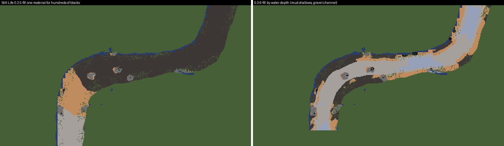

# The Still Life FTF edition

`still-life-patch/make_ftf_edition.py` turns the Still Life 0.3 jar (from Modrinth; one jar for NeoForge and Fabric) into
`still_life-0.3.9-ftf`. Still Life is All Rights Reserved, so neither the original nor the result is in this repository;
the script edits your own download on your own computer. Its output was checked against the 0.3.7-ftf jar used in
testing: the same content file for file (JSON compared by value), except the Dappled Forest rule (0.3.8) and the version
in the metadata. 0.3.7-ftf added the third layer (`patch_terrain.py`) and river beds at any height; 0.3.8-ftf brings the
Dappled Forest ground back.

0.3.8-ftf is meant for bridge 6.0 and was tested with FreeTerraForged 1.0.0034. The first two layers (0.3.6-ftf) work
with FreeTerraForged 1.0.0027-1.0.0032 and bridge 5.x (checked by generating salt lakes, wetlands, rivers and coasts,
with no datapack or tag errors); 0.3.5-ftf still works with bridge 5.1, without the river beds.

The edition has four layers. The fourth (0.3.9-ftf, `patch_tags.py`) adds the biome tags Still Life's American biome set
ships without; it is described at the end. The third, the terrain filter on Still Life's trees and plants, needs bridge 6.0.

## 1. The base edition (0.3-ftf): terrain shaping removed

Still Life ships two things in one: a **biome layout** (biomes, their features and surfaces, the climate table that says
which biome goes where) and **terrain shaping** that plugs into Lithosphere (density functions and a noise router built on
Lithosphere's). FreeTerraForged generates the terrain itself and replaces Minecraft's noise router with its own, so the
terrain half has nothing to do except break: it references Lithosphere functions that are not installed.

| Change | Why |
|---|---|
| Removed `data/minecraft/worldgen/density_function/` | Still Life's overrides of Minecraft's terrain functions, built on Lithosphere's. FTF makes the terrain. |
| Removed `data/still_life/worldgen/density_function/` | Still Life's own terrain functions (same reason). |
| Removed `data/still_life/worldgen/configured_carver/` | Carvers tuned for Lithosphere's terrain and underground rivers. |
| Removed `noise_settings/overworld_old.json` and `META-INF/mods.toml` | An unused older copy, and old Forge metadata. |
| `noise_settings/overworld.json`: the noise-router entries that referenced Lithosphere or Still Life functions (`final_density`, `initial_density_without_jaggedness`, `depth`, `barrier`, `fluid_level_floodedness`, `fluid_level_spread`, `temperature`, `vegetation`) set back to Minecraft 1.21.1's own | So the file loads without Lithosphere. FTF supplies its own terrain and climate anyway. |
| `dimension/overworld.json`: the Deep Dark entry Still Life gives depth 0 (the surface layer) set to depth 0.2-1.0 | Keeps it underground. FTF copies this climate table into a new world's `level.dat`, so it only matters for worlds created with the jar. Without it, Deep Dark pockets appeared near the bottom of the world in places that are barren or dripstone caves in the tested worlds. |
| Metadata: name "Still Life (FTF edition)", version `-ftf`, requires FreeTerraForged and VanillaBackport | The jar replaces the normal Still Life jar and needs both. VanillaBackport provides the 1.21.4+ content Still Life 0.3 uses (pale oak, bushes, leaf litter, cactus flowers, resin). |

Everything else (biomes, the climate table, surface rules, features, structures) is kept as Still Life ships it. Placing
the biomes correctly on FTF terrain is the bridge's job (`docs/bridge.md`).

## 2. The fixes (0.3.1-ftf to 0.3.8-ftf): `patch_sl.py`

Found while testing on FTF terrain. Each change is applied to Still Life's own files by the script, not copied in.

### Granite and diorite only where rock is exposed (0.3.3)

Still Life paints whole mountain surfaces with granite and diorite bands. On FTF's tall mountains this made pink and
white mountains (diorite reads as snow from far away). Now the top three blocks are stone and the bands only start below,
so they show where FTF's erosion strips slopes down to the rock (cliffs, gullies, bare high rock) as streaks. Diorite keeps
half of its band. Ores and vanilla's granite/diorite blobs are features and are not affected.

### Big snow patches also on rock (0.3.x)

Still Life's large snow patches were limited to soil. On FTF's high mountains most of the top is rock, so peaks above the
snow line had almost no snow. The patches now also cover rock.

### Salt lakes and aspen swamps at any height (0.3.5)

Still Life builds these for sea level, because Lithosphere drops its wetland climate band there: the salt crust only exists
at Y 62-64 and the lake bed at Y 40-61; the aspen swamp's mud only at Y 62. On FTF terrain they sit at any height (the
bridge places them on flat dry land), where they looked like plain desert or forest.

- Salt lake: on dry ground, a white calcite crust dithered with clay (as Still Life's Y 62 band looks) at any height; clay
  under water.
- Aspen swamp: patches of mud on dry ground at any height (the bridge adds pools of standing water, and sheets of shallow
  water in salt lakes).
- The `disk_calcite_salt_lake` feature (rings of calcite in shallow water) no longer only at Y 60-62.

### River beds by water depth (0.3.6)

Still Life picks the bed of sea-level rivers (Y 52-62) from one noise, `still_life:river_sediments`, whose features are
about 500 blocks across: mud, packed mud, gravel or clay by threshold. On Lithosphere's narrow rivers that reads as
variety; FTF's rivers are wide and long, so a river ran one material for hundreds of blocks and then switched across its
whole width along a nearly straight line, which looked artificial. Rivers above Y 63 never used this rule.

Now the bed follows the water depth, read with the surface rule's water condition: in the shallows (1 block deep) mud and
packed mud, at 2 blocks a mix with gravel, in the channel (3 or more) mostly gravel with some clay. Minecraft's
`surface` noise (~64-block features) mixes them. Arid rivers (desert, Mediterranean and savanna) use their own materials
the same way: coarse dirt and packed mud in the shallows, packed mud and clay in the channel. Tropical rivers, which are
almost all mud, are unchanged. On the test river: shallows 47% mud / 37% packed mud, channel 72% gravel / 26% clay.

The jar's Fabric and Quilt metadata now carry the version too: some launchers (Prism) read it from there and showed 0.3.5-ftf.

*A sea-level river on FTF (temperate river, 384 x 224 blocks, bed blocks under the water; dark = mud, tan = packed mud,
grey = gravel, blue-grey = clay). Left: 0.3.5-ftf; right: 0.3.6-ftf.*

### River beds at any height (0.3.7)

Still Life only paints river beds where the floor is between Y 52 and Y 63, because on Lithosphere every river runs at sea
level. FTF's rivers run at their own height, so every bed above Y 63 stayed bare stone or soil. The band is now measured
from the water above the floor instead: under water, at most 11 blocks (plus the surface depth) below the water surface.

### The Dappled Forest ground (0.3.1-0.3.6, again from 0.3.8)

VanillaBackport gives its Dappled Forest small patches of coarse dirt with a surface rule that it adds through
`NoiseBasedChunkGenerator.buildSurface`, which FreeTerraForged's generator does not use. The edition's surface rule carries
the same rule (2D noise, so FreeTerraForged's surface step accepts it): on dry floor surfaces of the Dappled Forest,
coarse dirt where `minecraft:small_patch` is above 1.2. It only acts where the biome is, and Lifeforged places the
Dappled Forest only with `dappled_forest` above 0 (off by default), so with the default settings it changes nothing.
0.3.7-ftf, made while Lifeforged 6.0 did not place VanillaBackport's biomes, left it out.

The Pale Garden has no surface rule of its own (grass and dirt, as Still Life's surface gives it), and the Sulfur Caves
rock is placed by Lifeforged as a feature (`sulfur_rock`), because FreeTerraForged skips surface rules deep in rock. The
VanillaBackport biomes are not carved into the climate table either: Lifeforged adds them at run time, at each world's
amounts.

### Still Life Naturalized carries its own copy

Still Life Naturalized ships its own copy of these surface rules (`noise_settings/overworld.json`), and that is the copy the
game uses when it is installed. A change to the FTF edition's surface rules therefore has to be regenerated into
Naturalized too (Naturalized 1.3.1-ftf has the 0.3.7-ftf rules; 1.3.2-ftf is 1.3.1-ftf with the Dappled Forest rule
added, nothing else changed).

## 3. Trees and plants that read the terrain (0.3.7-ftf): `patch_terrain.py`

`patch_terrain.py` puts the bridge's placement filter `stilllife_ftf_bridge:terrain` (bridge 6.0; `bridge.md` section 15)
on Still Life's placed features, so they follow FreeTerraForged's terrain: trees off cliffs, 1:1 faces, fresh scree and
bare rock and out of steep avalanche gullies, thinner on ridges and wind-swept ground; a ragged treeline (broadleaf trees
from about 145 to 80 blocks below the snow line, conifers from 110 to 50) that climbs into sheltered gullies and up sunny
faces; with the bridge's `forest_variety`, natural clearings (worlds made by 6.0.0: also regional tree mixes); Still Life's snowy spruces and
bushes only in the snow model's snowfields, with plain twins elsewhere; grass, fern and flower patches thinner on exposed
crests, flowers leaning to sunny and ferns and moss to shady slopes; Still Life's steep-slope and stone-cliff patches only
on steep ground (stone-cliff no longer leaves boxes of packed mud); its snow layer patches and calcite disks left to the
bridge's snow model. Trees that a tree group picks from carry no filter of their own, so the group's filter decides once.
Features that finish a tree already standing (Still Life's palm crowns, which scan up the column for the trunk) carry no
filter either, so a palm never loses its crown where the filter says no. In bridge 6.0 worlds (format 18 and later) a
twin of Still Life's stone-cliff feature that leaves snow alone runs instead of the original, and its tundra and
mountain snow disks run only in biomes that keep Still Life's own surface, so snow no longer depends on chunk order.

`make_ftf_edition.py` runs it as its last step. It can also be run on its own, on a jar or an extracted folder:
`python3 patch_terrain.py in.jar [out.jar]` (default output `<name>-terrain.jar`), for example on an add-on whose
tree features override Still Life's (Still Life Naturalized 1.3.1-ftf and 1.3.2-ftf already have it applied). It is idempotent: the filter it writes replaces any terrain filter a
feature already has, so it can run again on its own output. The bridge adds the features above the treeline itself
(clumps, krummholz, the subalpine belt, ledge plants).

**No obsidian monoliths.** Still Life hides an easter egg: two placed features, `still_life:pf_other/ground/monolith`
and `monolith_small` (`minecraft:fixed_placement`), put a giant obsidian pillar with a geode-like shell at 20000, 100,
20000 and eight small ones around it (at 20070 / 19930 and 20150 / 19850, Y 50 to 100), and nearly every biome lists
them. They are no part of a natural landscape, so `patch_terrain.py` (`remove_monoliths`, idempotent) drops both
references from the feature lists of every biome (and any biome modifier) and deletes the two placed and two configured
features and the two block tags only they use (`monolith_cannot_replace`, `monolith_invalid_blocks`). Checked on the
regenerated jars: no file mentions "monolith", every JSON parses, the biomes are otherwise unchanged; Still Life
Naturalized's FTF jar has no references.

## 4. Biome tags for the American set (0.3.9-ftf): `patch_tags.py`

Still Life 0.3 tags its Afro-Eurasian biomes with about a dozen tags each (Minecraft's `is_forest`, `is_taiga`,
`is_overworld`, structure tags, animal variants; the common `c:` climate and landscape tags; Towns and Towers' village
tags). The 61 biomes of its American set, added later, are only in `still_life:is_still_life`, and five of its coldest
Afro-Eurasian biomes (`frozen_taiga`, `frozen_taiga_clearings`, `frozen_muskeg`, `frozen_tundra`, `arctic_snowy_beach`)
have three tags. In those biomes there were no villages, pillager outposts, desert pyramids, jungle temples, swamp huts
or strongholds, farm animals and frogs had no warm or cold variants, and other mods could not tell what kind of land it
was. The bridge reads tags too: `c:is_mountain`, `c:is_dry`, `c:is_wet`, `c:is_beach`.

Each of those 66 biomes now takes the tags of the tagged Still Life biome closest to it: 944 entries in 104 tag files.
The pairs are the `ANALOG` table at the top of the script (prairies as `mixed_forest_steppe`, the temperate rainforests as
`temperate_mixed_forest`, `taiga_shield` and `aspen_taiga` as `cold_taiga`, the tropical deciduous rainforests as
`monsoon_forest`, `painted_peaks` as `barren_peaks`, and so on). Three tags are not copied: `c:is_rare`, and Still Life's
own `still_life:is_arctic` and `still_life:is_tundra`, which stay as Still Life set them. A few biomes get tags of their
own: the snowy and frozen taigas and muskegs `c:is_snowy`; the painted biomes `minecraft:is_badlands` (mesa mineshafts)
and Towns and Towers' badlands villages and outposts.

Nothing is removed and no biome that was tagged changes. Checked on the 0.3.8-ftf jar: the same files, only tag files and
the version differ, every old entry still in place; only `buried_woods` is left with three tags (it has no clear
counterpart). The jar loads on FreeTerraForged 1.0.0034 with no tag errors. Which structures then appear was not checked
in generated chunks.
